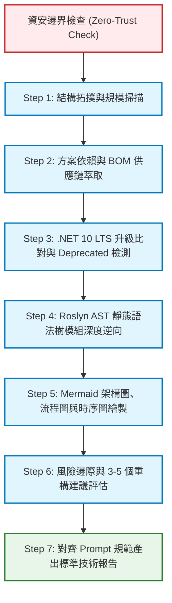

# NKUST 專案讀取與逆向架構分析技能手冊 (Project Ingestion Skills)
- 本技能手冊為 AI Agent、架構師與新進維護工程師提供一套標準化、可重複執行、無死角且絕對安全的「專案讀取、解析、理解與架構文件產出」完整工作流程。
- `${project_name}`：專案名稱。

---

## 零、不可妥協之最高資安防衛邊界 (Zero-Trust Security Guardrail)

在執行本技能之任何分析、讀取、腳本執行或測試作業時，**必須無條件嚴格遵守以下核心資安禁令與政策**：

> [!CAUTION]
> ### 🚨 核心資安禁令與政策 (Core Prohibitions)
> 1. **資料庫防護**：
>    - **嚴禁異動 `Sybase.nkust.edu.tw` 資料庫內的任何資料或結構**。所有分析皆僅得在本機靜態代碼與本機 SQL Server 測試環境進行。
> 2. **網段隔離**： 
>    - **嚴禁異動或探測 `140.133.*.*` 校園核心網段主機資料**。
> 3. **程式碼註釋治理規範**：
>    - 原來註釋內容請於開頭加註「`[原來註釋資訊]`」，其餘內容不異動。
>    - 新增加的註釋說明內容請於開頭加註「`[新增註釋資訊]-${timestamp}(YYYY-mm-dd-H-i-s)`」。
> 4. **路徑相對化原則**：
>    - 所有產出文件、Markdown 引用、腳本與分析輸出，檔案路徑均必須以「相對路徑」顯示，嚴禁出現本機磁碟絕對路徑。
> 5. **強制純靜態離線分析 (Air-Gapped Static Analysis)**：
>    - 所有讀取僅針對本機磁碟原始碼文本與 AST 語法樹進行剖析，嚴禁發起針對遠端實體資料庫的連線或異動呼叫。
> 6. **自動化防護驗證**：
>    - 在進行任何分析前，必須優先執行安全檢查腳本 [Inspect-SecurityBoundaries.ps1](scripts/Inspect-SecurityBoundaries.ps1)，確保 100% 合規。
> 7. **詳細規範**：
>    - 參閱參考手冊 [01_security_boundary_rules.md](reference/01_security_boundary_rules.md)。

---

## 一、技能核心定位與能力矩陣 (Core Capabilities)

本技能涵蓋現代軟體工程中「架構還原 (Software Architecture Recovery)」、「軟體物料清單 (SBOM)」、「編譯器語法樹分析 (Roslyn AST)」與「動態時序建模 (Mermaid Modeling)」之整合實踐：



| 核心維度 | 具體分析能力 | 支援腳本 / 程式工具 | 對應產出報告 |
| :--- | :--- | :--- | :--- |
| **拓撲與規模** | 方案專案、C# 檔案數、程式碼行數與目錄架構 | [Analyze-ProjectStructure.ps1](scripts/Analyze-ProjectStructure.ps1) | `README.md` (Project Structure) |
| **供應鏈與 BOM** | 後端 NuGet 套件清單、前端 LibMan 客戶端函式庫、開源授權審核 | [Extract-DotnetBOM.ps1](scripts/Extract-DotnetBOM.ps1) | `README/PROJECT_BOM.md` |
| **現代化升級** | .NET 10 LTS 相容性檢查、已棄用 (Deprecated) 套件標註、官方升級方案 | [Verify-UpgradeCompatibility.ps1](scripts/Verify-UpgradeCompatibility.ps1) | `README/PROJECT_BOM_UPGRADE.md` |
| **AST 深度逆向** | Class、Method、Input 參數、Output 回傳值、核心業務處理邏輯剖析 | [CodebaseAstScanner](program/CodebaseAstScanner/) | 各子模組之 `REPORT.md` |
| **架構與拓撲** | 專案依賴關聯、SSO 憑證交換時序圖 (SP/IdP)、分層架構圖 | [Generate-MermaidTopology.ps1](scripts/Generate-MermaidTopology.ps1) | 各子模組之 `ENV.md` 與 `README.md` |
| **品質與風險** | 連線池枯竭、中文字編碼截斷、CSRF/iframe 防禦、Code Smells 與具體重構代碼 | [07_code_smell_refactor_sop.md](reference/07_code_smell_refactor_sop.md) | `README/PROJECT_REPORT.md` |

---

## 二、標準作業程序 (Standard Operating Procedure, SOP)

### 步驟 1：執行資安邊界審查與拓撲快速掃描
- **指令**：
  ```powershell
  # 執行安全邊界合規檢核
  powershell -ExecutionPolicy Bypass -File scripts/Inspect-SecurityBoundaries.ps1
  
  # 掃描方案結構與統計程式碼規模
  powershell -ExecutionPolicy Bypass -File scripts/Analyze-ProjectStructure.ps1
  ```
- **檢驗重點**：確認無動態異動遠端資料庫行為，並取得各專案之檔案數與行數基線。

### 步驟 2：提取全方案前後端技術物料清單 (BOM)
- **指令**：
  ```powershell
  # 自動萃取全專案前後端 BOM 清單
  powershell -ExecutionPolicy Bypass -File scripts/Extract-DotnetBOM.ps1 -OutputMarkdownPath "README/PROJECT_BOM.md"
  
  # 驗證 BOM 規格與開源授權
  powershell -ExecutionPolicy Bypass -File program/BomValidator/BomValidator.ps1
  ```
- **參考指引**：遵循 [03_bom_and_sbom_standard.md](reference/03_bom_and_sbom_standard.md)。

### 步驟 3：比對 .NET 10 LTS 目標相容性與標記 Deprecated 元件
- **指令**：
  ```powershell
  powershell -ExecutionPolicy Bypass -File scripts/Verify-UpgradeCompatibility.ps1
  ```
- **判定準則**：
  - 官方宣布停止維護（如 `wkhtmltox`）-> 標記為 **`Deprecated`**，替換為 `PuppeteerSharp`。
  - Windows-only 限制（如舊版 `System.Drawing.Common`）-> 標記為 **`Deprecated`**，替換為 `SixLabors.ImageSharp`。
  - 框架內建整合（如舊版 `Microsoft.AspNet.Mvc` 或獨立 Cookies 套件）-> 標記為 **`Deprecated`**，移除並使用 ASP.NET Core 原生中介軟體。
- **參考指引**：遵循 [04_dotnet10_upgrade_eval.md](reference/04_dotnet10_upgrade_eval.md)。

### 步驟 4：執行 Roslyn AST 靜態語意分析
- **指令**：
  ```powershell
  dotnet run --project program/CodebaseAstScanner/CodebaseAstScanner.csproj -- "${project_name}.Service"
  ```
- **核心提取內容**：
  - Class Name 與完整 Namespace。
  - 繼承與介面實作（`BaseService`, `GenericRepository<T>`）。
  - 公開函式簽章（方法名稱、參數型別、回傳型別、非同步標記）。
  - XML `<summary>` 註解與核心業務處理邏輯。
- **參考指引**：遵循 [05_roslyn_ast_parsing_spec.md](reference/05_roslyn_ast_parsing_spec.md)。

### 步驟 5：視覺化建模與 Mermaid 拓撲繪製
- **指令**：
  ```powershell
  powershell -ExecutionPolicy Bypass -File scripts/Generate-MermaidTopology.ps1
  ```
- **繪圖範疇**：
  - 方案子專案引用依賴圖（Dependency Graph）。
  - 系統分層架構圖（展示層、業務層、實體層、雙資料庫與外部 IdP/SP 系統）。
  - SSO 憑證交換時序圖（SP 受代登 60 秒票券校驗與 IdP 代登發起跳轉）。
- **參考指引**：遵循 [06_mermaid_diagram_specs.md](reference/06_mermaid_diagram_specs.md)。

### 步驟 6：辨識潛在風險、邊際條件與產出重構建議
- **評估維度**：
  1. 連線集區耗盡、Sybase 中文編碼截斷、票券重送防禦（Replay Attack）。
  2. 識別 Code Smells（Service Locator 反模式、同步阻塞非同步、缺少分頁投影）。
  3. 提供 3-5 個具體 Before / After 程式碼重構範例。
- **參考指引**：遵循 [07_code_smell_refactor_sop.md](reference/07_code_smell_refactor_sop.md)。

### 步驟 7：對齊 Prompt 規格輸出標準技術文件
- **對照矩陣**：嚴格依據 [08_prompt_report_matrix.md](reference/08_prompt_report_matrix.md)，確保各 Prompt 規定的 7 大固定章節無遺漏，語系一律符合台灣繁體中文規範。

---

## 三、工具與腳本清冊索引 (Toolchain Index)

### 3.1 執行腳本庫 (`scripts/`)
1. [Inspect-SecurityBoundaries.ps1](scripts/Inspect-SecurityBoundaries.ps1) - 資安防衛邊界檢核與合規掃描。
2. [Analyze-ProjectStructure.ps1](scripts/Analyze-ProjectStructure.ps1) - 方案目錄、專案、程式碼規模與行數統計。
3. [Extract-DotnetBOM.ps1](scripts/Extract-DotnetBOM.ps1) - 前端 LibMan 與後端 NuGet 物料清單 (BOM) 自動提取。
4. [Verify-UpgradeCompatibility.ps1](scripts/Verify-UpgradeCompatibility.ps1) - .NET 10 LTS 升級相容性與 Deprecated 檢測。
5. [Generate-MermaidTopology.ps1](scripts/Generate-MermaidTopology.ps1) - 方案專案引用拓撲 Mermaid 代碼生成。

### 3.2 核心程式工具 (`program/`)
1. [CodebaseAstScanner](program/CodebaseAstScanner/) - C# 控制台專案，靜態語法樹符號、類別、函式與資安檢查提取器。
2. [BomValidator.ps1](program/BomValidator/BomValidator.ps1) - BOM 表格完整性與開源授權合規檢核器。

---

## 四、參考手冊索引 (`reference/`)

1. [01_security_boundary_rules.md](reference/01_security_boundary_rules.md) - 資安防衛邊界與零信任禁令指引。
2. [02_codebase_ingestion_guide.md](reference/02_codebase_ingestion_guide.md) - 專案程式碼結構化讀取與逆向架構方法論。
3. [03_bom_and_sbom_standard.md](reference/03_bom_and_sbom_standard.md) - 軟體物料清單 (BOM) 與供應鏈安全標準。
4. [04_dotnet10_upgrade_eval.md](reference/04_dotnet10_upgrade_eval.md) - .NET 10 LTS 升級評估與 Deprecated 套件判準。
5. [05_roslyn_ast_parsing_spec.md](reference/05_roslyn_ast_parsing_spec.md) - C# 靜態 AST 語法樹與程式符號提取規格。
6. [06_mermaid_diagram_specs.md](reference/06_mermaid_diagram_specs.md) - 架構圖、流程圖、時序圖與拓撲圖 Mermaid 繪製規範。
7. [07_code_smell_refactor_sop.md](reference/07_code_smell_refactor_sop.md) - 程式碼壞味道偵測與重構建議指引。
8. [08_prompt_report_matrix.md](reference/08_prompt_report_matrix.md) - Prompt 需求規格與輸出說明文件雙向對齊矩陣。

---

## 五、執行過程追蹤與維護規範 (`process/`)

1. [1_implementation_plan.md](process/1_implementation_plan.md) - 完整的專案讀取技能建置規劃書。
2. [2_task_list.md](process/2_task_list.md) - 任務分解結構 (WBS) 與驗收清單。
3. [3_walkthrough.md](process/3_walkthrough.md) - 執行過程紀錄、測試驗證輸出與最終驗收記錄。

## 六、專案資訊解讀輸出 (`output/`)

1. [README.md](output/README.md) - 專案結構、拓撲與規模統計。
2. [README/PROJECT_BOM.md](output/README/PROJECT_BOM.md) - 前端 LibMan 與後端 NuGet 物料清單 (BOM)。
3. [README/PROJECT_BOM_UPGRADE.md](output/README/PROJECT_BOM_UPGRADE.md) - .NET 10 LTS 升級相容性與 Deprecated 套件檢測。
4. [README/PROJECT_REPORT.md](output/README/PROJECT_REPORT.md) - 風險邊際、Code Smells 與重構建議報告。
5. [各子模組之 REPORT.md](output/*/REPORT.md) - Roslyn AST 靜態語法樹分析報告。
6. [各子模組之 ENV.md](output/*/ENV.md) - 專案依賴拓撲、分層架構圖與 SSO 時序圖。
7. [各子模組之 README.md](output/*/README.md) - 專案子模組結構、拓撲與規模統計。