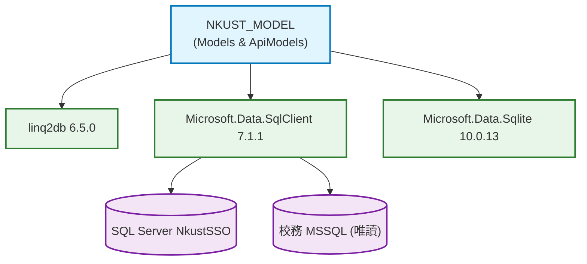

# NKUST_MODEL 模組環境相依與 BOM 物料報告 (NKUST_MODEL_ENV.md)

- **所屬專案**：NKUST SSO Server
- **對應模組**：`NKUST_MODEL`
- **架構層級**：Data Access & Entity Layer

---

## 一、關鍵環境變數與連線組態

| 組態索引鍵 (Configuration Key) | 必要性 | 預設值 / 範例 | 職責與用途說明 |
| :--- | :---: | :--- | :--- |
| `Sso:StorageProvider` | 是 | `SqlServer` 或 `Sqlite` | 決定 SSO 自有儲存引擎。正式環境固定為 `SqlServer`。 |
| `ConnectionStrings:Sso` | 條件式 | `Server=localhost;Database=NkustSSO;...` | SQL Server 模式專用連線字串，所有自有資料表位於 `dbo`。 |
| `ConnectionStrings:LoginAuth` | 條件式 | `Server=campus-db;Database=CampusAuth;...` | 外部校務 MSSQL 唯讀連線字串，供帳密比對與資料抽取。 |
| `Sso:DataDirectory` | 否 | `../.local` | SQLite 儲存庫檔案與本地密鑰存放目錄。 |

---

## 二、NKUST_MODEL 後端物料清單 (BOM)

| 套件識別碼 (Package ID) | 採用版本 | 授權條款 (License) | 核心職責與在模組中之用途 |
| :--- | :---: | :---: | :--- |
| **`linq2db`** | `6.5.0` | MIT | 輕量高效能 ORM，提供 LINQ 查詢表達式與 SQL 語法樹編譯。 |
| **`Microsoft.Data.SqlClient`** | `7.1.1` | MIT | 微軟官方 SQL Server 驅動，支援 TDS 8.0 與 Azure AD/Entra ID 驗證。 |
| **`Microsoft.Data.Sqlite.Core`** | `10.0.13` | MIT | 輕量化 SQLite 核心驅動，用於本地隔離測試與無資料庫部署。 |
| **`SQLitePCLRaw.bundle_e_sqlite3`** | `3.0.5` | Apache-2.0 | SQLite 原生二進位 C-runtime 跨平台封裝。 |

---

## 三、模組依賴與拓撲關係圖

