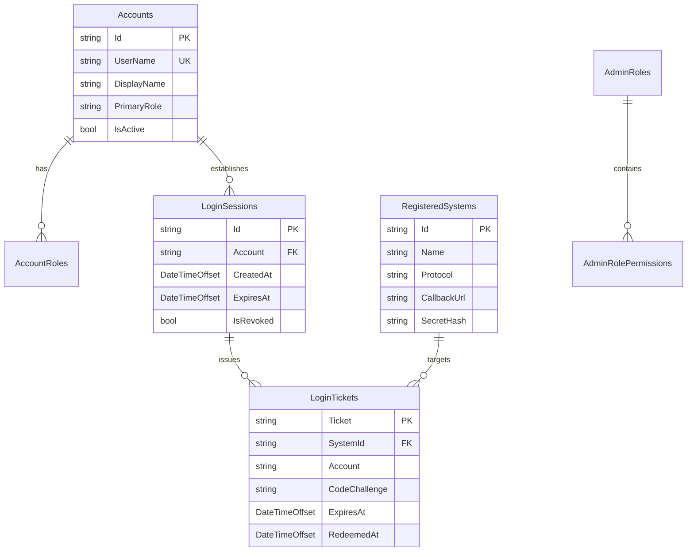

# NKUST_MODEL 模組技術架構分析報告 (NKUST_MODEL_REPORT.md)

- **模組名稱**：`NKUST_MODEL` (領域實體、ORM 映射與雙儲存架構層)
- **實體路徑**：[NkustSso.Server/Models/](../../../NkustSso.Server/Models/) 及 [NkustSso.Server/ApiModels/](../../../NkustSso.Server/ApiModels/)
- **目標框架**：`.NET 10 LTS` (net10.0)
- **核心依賴**：`linq2db 6.5.0`, `Microsoft.Data.SqlClient 7.1.1`, `Microsoft.Data.Sqlite.Core 10.0.13`

---

## 一、專案/模組整體概述 (Module Overview)

`NKUST_MODEL` 負責整個 NKUST SSO Server 之資料契約定義、實體映射、雙資料庫儲存抽象與外部唯讀校務資料庫連線工廠。本模組堅持資料隔離設計原則：
1. **SSO 自有儲存 (Own Storage)**：由 `SsoStorage` 封裝，依 `Sso:StorageProvider` 設定選擇 SQL Server（`NkustSSO.dbo`）或 SQLite（`sso.db` + `sessions.db`），所有自主建立之表結構僅存在於此。
2. **外部校務來源 (Campus Source)**：透過 `ICampusDatabaseFactory` 建立獨立連線，嚴格限制為**唯讀驗證與身分抽取**，杜絕任何 DDL、Migration 或資料寫入操作。

### 1.1 目錄結構與職責清冊
- `Models/`:
  - `SsoStorage.cs` / `SsoDatabase.cs`: 雙引擎資料庫連線、資料表映射與架構初始化。
  - `Account.cs` / `AccountRole.cs`: 帳號與角色核心實體。
  - `LinqIdentityStores.cs`: 基於 linq2db 之 ASP.NET Core Identity 儲存層實作。
  - `LoginSession.cs` / `LoginTicket.cs`: 中央登入會話與 60 秒動態代登票券實體。
  - `OidcEntities.cs`: OpenIddict 應用程式、授權、範圍與權杖實體。
  - `SamlLoginRequest.cs`: SAML 登入請求與轉址暫存實體。
  - `RegisteredSystem.cs` / `SystemProtocols.cs`: 登記串接系統之協定規格定義。
  - `AdminManagement.cs`: 後台權限角色、選單與授權特徵實體。
  - `CampusDatabaseFactory.cs`: 校務 MSSQL 唯讀連線工廠。
  - `SqliteStorageImport.cs`: SQLite 匯入 SQL Server 離線遷移工具。
- `Models/External/`:
  - `CampusCredentialRecord.cs`, `EmployeeRecord.cs`, `StudentRecord.cs`, `CampusSoapRecords.cs` 等外部校務唯讀映射 POCO。
- `ApiModels/`:
  - `SsoAuthorizeRequest.cs`, `SsoTicketRedemptionRequest.cs`, `SsoIdentityResponse.cs` 等 Web API DTO。

---

## 二、核心架構與檔案/函式解析 (AST Semantic Analysis)

### 2.1 儲存核心與雙引擎工廠 (`SsoStorage.cs` / `SsoDatabase.cs`)
- **類別**：`SsoStorage`
  - **函式**：`FromConfiguration(IConfiguration configuration, string localDirectory)`
    - **輸入**：應用程式設定檔實例、本機資料目錄路徑。
    - **輸出**：`SsoStorage` 抽象實例（SQL Server 或 SQLite）。
    - **核心邏輯**：讀取 `Sso:StorageProvider`；若為 `SqlServer`，讀取 `ConnectionStrings:Sso` 並指定為 `NkustSSO` 資料庫；若為 `Sqlite`，則於本地目錄配置 `sso.db` 與 `sessions.db`。
  - **函式**：`InitializeAsync(bool seedDefaults)`
    - **輸入**：布林值旗標（是否寫入初始管理角色與公開分類）。
    - **輸出**：`Task`
    - **核心邏輯**：建立 `SsoDatabase` 實例，執行 `CreateIfNotExists` 建立必要自有資料表，但不異動任何既有資料列。

### 2.2 校務唯讀連線工廠 (`CampusDatabaseFactory.cs`)
- **介面與實作**：`ICampusDatabaseFactory` -> `CampusDatabaseFactory`
  - **函式**：`CreateConnection()`
    - **輸入**：無。
    - **輸出**：`DataConnection` (linq2db 連線實例，指向校務 MSSQL)。
    - **核心邏輯**：讀取 `ConnectionStrings:LoginAuth`；連線配置包含連線池限制與強制逾時，僅提供唯讀查詢。
  - **函式**：`HasValidConnection(IConfiguration configuration)`
    - **輸入**：`IConfiguration`。
    - **輸出**：`bool`（驗證連線字串是否存在且格式有效）。

### 2.3 60 秒動態代登票券實體 (`LoginTicket.cs`)
- **實體屬性**：
  - `Ticket` (`string`): 隨機生成之一路徑安全代登票券 (Ticket Guid/Token)。
  - `SystemId` (`string`): 授權使用之接收系統識別碼。
  - `Account` (`string`): 已登入通過驗證之學號/員編。
  - `CodeChallenge` / `CodeChallengeMethod`: PKCE 防護雜湊碼。
  - `ExpiresAt` (`DateTimeOffset`): 票券有效期限（固定自簽發起 60 秒）。
  - `RedeemedAt` (`DateTimeOffset?`): 票券核銷時間點（已核銷即刻失效）。

---

## 三、實體關係與資料庫拓撲圖 (Mermaid Topology)

---

## 四、潛在風險、邊際條件與效能注意事項

1. **實體結構遷移防禦 (Migration Guardrail)**：
   `CreateIfNotExists` 不會自動為既有資料表增修欄位。若因版本升級需要新增欄位，必須同時提供 SQL Server 與 SQLite 的遷移邏輯，且絕不可清除或覆寫正式環境既有資料。
2. **外部校務實體變更相容性**：
   外部 MSSQL 資料庫結構由學校校務中心獨立維護。`CampusCredentialRecord` 映射之欄位若有微幅調整，應確保具備容錯處理，避免因非必要欄位遺漏導致登入服務全面中斷。
3. **SQLite 檔案鎖定與併發限制**：
   在開發或單機環境採用 SQLite 時，高併發寫入 Session 或 Ticket 可能遭遇 `database is locked`。正式環境強烈建議全面切換為 SQL Server 提供連線池與行級鎖支援。

---

## 五、重構建議 (Refactoring Recommendations)

1. **引入 Compiled Query 快取機制**：
   針對高頻執行的 `LoginTicket` 核銷查詢，改採 linq2db 原生 Compiled Query，降低查詢表達式編譯開銷。
2. **為外部校務實體引進唯讀連線保護 (Read-Only Connection Flag)**：
   在連線字串明確指定 `ApplicationIntent=ReadOnly`，從 SQL Server 協定層面徹底防禦任何意外的資料異動。
3. **統一審計欄位基底介面 (IAuditableEntity)**：
   為所有實體抽離 `CreatedAt`, `UpdatedAt`, `CreatedBy` 介面，統一由 Interceptor 於寫入時自動標記時間戳記。
