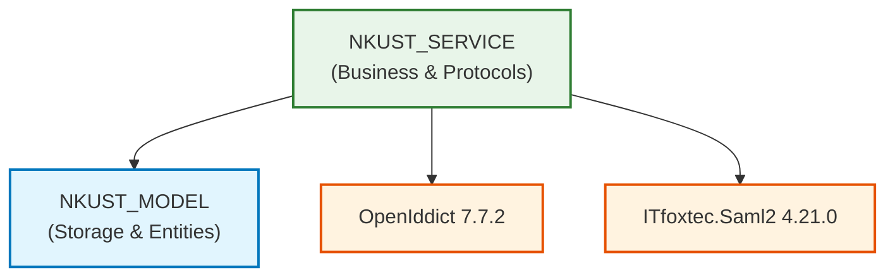

# NKUST_SERVICE 模組環境相依與 BOM 物料報告 (NKUST_SERVICE_ENV.md)

- **所屬專案**：NKUST SSO Server
- **對應模組**：`NKUST_SERVICE`
- **架構層級**：Business Logic & SSO Protocol Orchestration Layer

---

## 一、關鍵環境變數與安全組態

| 組態索引鍵 (Configuration Key) | 必要性 | 預設值 / 範例 | 職責與用途說明 |
| :--- | :---: | :--- | :--- |
| `Sso:Issuer` | 是 | `https://localhost:7100/` | SSO 認證中心 Authority URL，用於 OIDC Discovery 與 SAML EntityID。 |
| `Sso:Session:WindowMinutes` | 否 | `120` | 中央會話滑動有效視窗 (分鐘)。 |
| `Sso:Session:MaximumMinutes` | 否 | `720` | 中央會話最大存活時間上限 (分鐘)。 |
| `IntegrationServices:SoapEnabled` | 否 | `false` | 啟用或停用 `/KuasSSOWebService.asmx` SOAP 協定端點。 |
| `IntegrationServices:JsonEnabled` | 否 | `false` | 啟用或停用 `POST /api/integration/v1/verify` JSON 驗證端點。 |
| `IntegrationServices:TimeoutSeconds` | 否 | `10` | 串接服務連線外部校務庫之逾時秒數 (1–30 秒)。 |

---

## 二、NKUST_SERVICE 後端物料清單 (BOM)

| 套件識別碼 (Package ID) | 採用版本 | 授權條款 (License) | 核心職責與在模組中之用途 |
| :--- | :---: | :---: | :--- |
| **`OpenIddict.AspNetCore`** | `7.7.2` | Apache-2.0 | OIDC 伺服器中介軟體，管理 Code Flow、Token 發行與 PKCE 查驗。 |
| **`ITfoxtec.Identity.Saml2.MvcCore`** | `4.21.0` | Apache-2.0 | SAML 2.0 IdP 協定引擎，提供 AuthNRequest 綁定與簽署。 |
| **`System.Security.Cryptography.Pkcs`** | `10.0.13` | MIT | 密碼學元件，支援 X.509 憑證簽章與 PKCS#7 結構封裝。 |
| **`System.DirectoryServices.Protocols`** | `10.0.13` | MIT | 支援底層 LDAP 通訊與憑證目錄交換。 |

---

## 三、模組相依性拓撲圖

