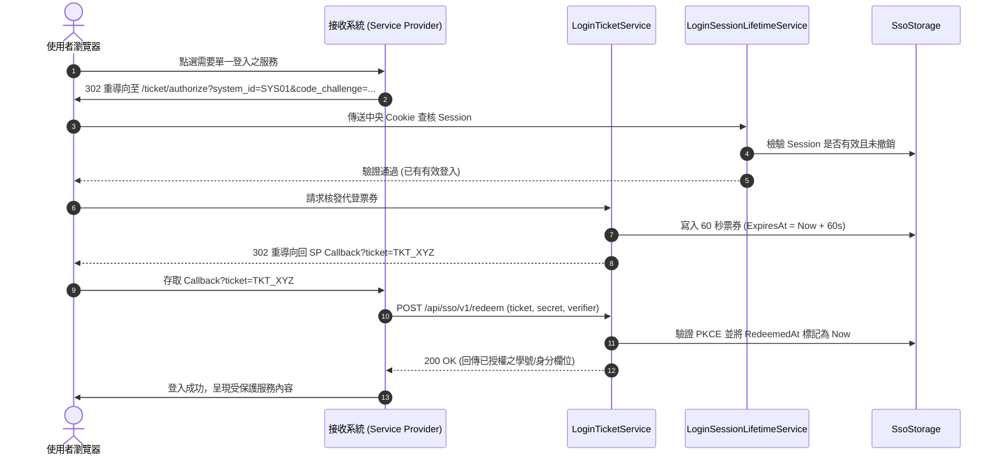

# NKUST_SERVICE 模組技術架構分析報告 (NKUST_SERVICE_REPORT.md)

- **模組名稱**：`NKUST_SERVICE` (業務邏輯、SSO 協定核心、身分授權與整合服務層)
- **實體路徑**：[NkustSso.Server/Services/](../../../NkustSso.Server/Services/)
- **目標框架**：`.NET 10 LTS` (net10.0)
- **核心依賴**：`OpenIddict.AspNetCore 7.7.2`, `ITfoxtec.Identity.Saml2.MvcCore 4.21.0`, `linq2db 6.5.0`

---

## 一、專案/模組整體概述 (Module Overview)

`NKUST_SERVICE` 是整個 NKUST SSO Server 的業務心臟與協定樞紐。本層封裝了所有的身分認證邏輯、多協定（OIDC, SAML 2.0, Web API Ticket, Legacy SOAP）憑證交換引擎、中央 Session 生命週期管理、入口可見度授權以及後台管理業務。

### 1.1 目錄分類與核心職責
- **SSO 協定核心服務**：
  - `LoginTicketService`: 管理 60 秒一次性動態票券之發行、PKCE 驗證與原子化核銷。
  - `SamlIdentityProvider`: 封裝 SAML 2.0 IdP 斷言生成、XML 數位簽章與回傳表單模型。
  - `LinqOidcStore.cs` (`LinqApplicationStore`, `LinqTokenStore` 等): OpenIddict 核心儲存介面實作。
  - `IdentityClaimReleasePolicy`: 依各系統登記之授權欄位白名單篩選並簽發 Claim。
- **校務驗證與身分服務**：
  - `CampusLoginService`: 校務帳密查核、帳號啟用狀態檢驗與防暴力破解。
  - `TienFangPasswordVerifier`: 相容校務天方密碼雜湊演算法。
  - `AccountIdentityService`: 解析並標準化學生、教師、職員身分與學號/員編。
- **入口與選單權限服務**：
  - `PortalVisibility`: 依使用者身分（學生/教職員/校友）動態過濾入口服務連結。
  - `AdminAuthorizationService`: 基於功能代碼 (`AdminAuthorizationService.Features`) 的細緻後台權限查核。
- **整合服務與舊版 SOAP 相容**：
  - `LegacySoapOperationDispatcher`: 轉譯並執行 `/KuasSSOWebService.asmx` 的 9 大舊版方法。
  - `LegacySoapWsdlGenerator`: 動態生成符合 SOAP 1.1 / 1.2 規格之 WSDL 定義。
  - `CredentialVerificationService`: JSON 帳密查驗 API 之業務處理。
  - `ExpiredTicketCleanupService`: 背景週期性清理過期票券之 `IHostedService`。

---

## 二、核心架構與檔案/函式解析 (AST Semantic Analysis)

### 2.1 60 秒動態代登票券服務 (`LoginTicketService.cs`)
- **類別**：`LoginTicketService`
  - **函式**：`IssueTicketAsync(string systemId, string account, string? codeChallenge, string? codeChallengeMethod)`
    - **輸入**：接收系統代碼、已驗證帳號、PKCE Code Challenge 及其演算法（支援 S256）。
    - **輸出**：`Task<string>` (產出之動態 Ticket 字串，格式為強安全隨機碼)。
    - **核心邏輯**：於資料庫新增一筆 `LoginTicket` 紀錄，設定 `ExpiresAt = DateTimeOffset.UtcNow.AddSeconds(60)`，`RedeemedAt = null`。
  - **函式**：`RedeemTicketAsync(string ticket, string systemId, string? codeVerifier)`
    - **輸入**：票券碼、發起兌換之系統代碼、PKCE 原始驗證字串。
    - **輸出**：`Task<TicketRedemptionResult>` (包含核銷成功狀態與授權帳號)。
    - **核心邏輯**：
      1. 查詢票券是否存在且所屬系統匹配。
      2. 檢驗 `ExpiresAt > DateTimeOffset.UtcNow` 且 `RedeemedAt == null`。
      3. 若存在 `CodeChallenge`，以 SHA-256 運算 `codeVerifier` 並進行 Base64Url 安全比對。
      4. 原子化將 `RedeemedAt` 更新為當前時間，阻斷重送攻擊。

### 2.2 SAML 2.0 識別提供者 (`SamlIdentityProvider.cs`)
- **類別**：`SamlIdentityProvider`
  - **函式**：`BindAuthnRequestAsync(HttpRequest request)`
    - **輸入**：包含 SP SAML Request 之 HTTP 請求。
    - **輸出**：`Saml2AuthnRequest` 實體。
    - **核心邏輯**：解析 HTTP Redirect 或 POST 綁定之 SAMLRequest 參數，解壓縮並驗證 XML 簽章。
  - **函式**：`CreateResponseAsync(Saml2AuthnRequest authnRequest, ClaimsPrincipal user, RegisteredSystem system)`
    - **輸入**：SAML 請求、已登入使用者主體、登記系統組態。
    - **輸出**：包含 SAMLResponse XML 與目標 ACS 網址之回傳模型。
    - **核心邏輯**：提取已授權之 Claims，封裝入 SAML 2.0 Assertion，以本機憑證執行 RSA-SHA256 數位簽章。

### 2.3 舊版 SOAP 協定轉譯器 (`LegacySoapOperationDispatcher.cs`)
- **類別**：`LegacySoapOperationDispatcher`
  - **函式**：`DispatchAsync(string operationName, XmlDocument requestXml, string clientIp)`
    - **輸入**：SOAP Action / Operation 名稱、請求 XML DOM、呼叫端 IP。
    - **輸出**：SOAP 回應 XML 字串。
    - **核心邏輯**：匹配 9 大實作方法（`s90_login_chk`, `s90_chk_usr`, `s90_get_usr_info` 等），查核呼叫端 IP 白名單，調用校務 MSSQL 唯讀來源，組裝 SOAP 1.1 / 1.2 Envelope。

---

## 三、SSO 憑證交換時序圖 (Mermaid Sequence)

---

## 四、潛在風險、邊際條件與效能注意事項

1. **中央會話撤銷查核 (Session Revocation Latency)**：
   本系統不依賴純無狀態 JWT，每次受保護操作均透過 `LoginSessionStore` 與 `CampusSessionValidator` 查核資料庫中的撤銷標記 (`IsRevoked`)，確保管理者能「一鍵踢除異常登入」。高併發下需注意資料庫查核之連線池消耗。
2. **票券過期未核銷之資料表膨脹**：
   使用者若發起代登後關閉分頁，將殘留未核銷之過期票券。系統由 `ExpiredTicketCleanupService` 每 5 分鐘執行批次清除，防止表格膨脹。
3. **SOAP 舊系統呼叫端 IP 偽冒風險**：
   舊系統以來源 IP 作為身分驗證的一環。`LegacySoapOperationDispatcher` 嚴格限制僅接受直連之 `RemoteIpAddress`，嚴禁輕信未經驗證之 `X-Forwarded-For`。

---

## 五、重構建議 (Refactoring Recommendations)

1. **引入 Policy-Based Claim Transformation Pipeline**：
   將 OIDC、SAML 與 Web API 的 Claim 篩選邏輯重構為單一管線模式 (`IClaimTransformPipeline`)，減少協定間重複的屬性映射代碼。
2. **為 SOAP 與 Web API 導入端點級 MemoryCache**：
   針對頻繁重複查詢之使用者基本靜態屬性（如姓名、所屬系所），在 60 秒短效視窗內施加記憶體快取，降低對校務 MSSQL 的重複查詢。
3. **優化後台權限查核之快取機制**：
   `AdminAuthorizationService` 目前每次請求均比對資料庫角色權限；建議改為使用 MemoryCache 配合角色變更時之主動失效通知 (Eviction Trigger)。
