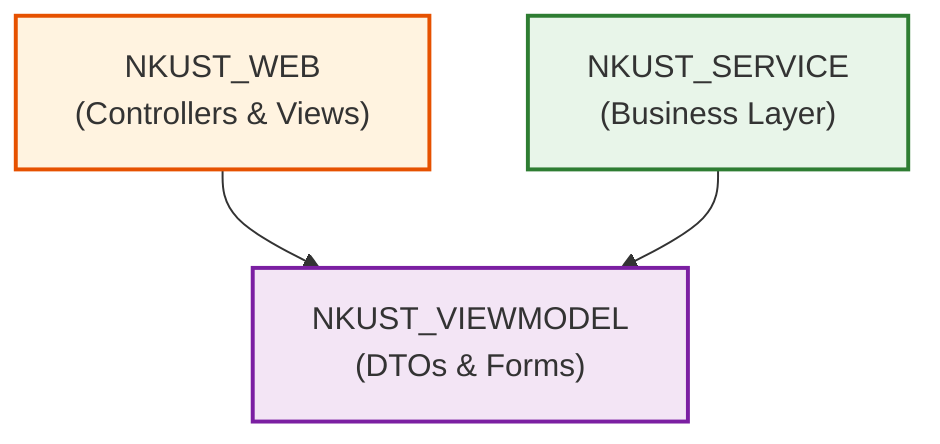

# NKUST_VIEWMODEL 模組環境相依與 BOM 物料報告 (NKUST_VIEWMODEL_ENV.md)

- **所屬專案**：NKUST SSO Server
- **對應模組**：`NKUST_VIEWMODEL`
- **架構層級**：View Model & Data Transfer Object (DTO) Layer

---

## 一、關鍵環境變數與安全組態

`NKUST_VIEWMODEL` 屬於純資料契約定義層，無直接外部網路連線依賴。其運行依賴於 ASP.NET Core 原生 Model Binding 與 DataAnnotations 驗證機制。

---

## 二、NKUST_VIEWMODEL 技術物料清單 (BOM)

| 相依組件 | 採用版本 | 職責與用途說明 |
| :--- | :---: | :--- |
| **`Microsoft.AspNetCore.App`** | `10.0` (Shared Framework) | 提供 `System.ComponentModel.DataAnnotations` 驗證特性與 ModelMetadata 支援。 |

---

## 三、模組依賴拓撲圖

