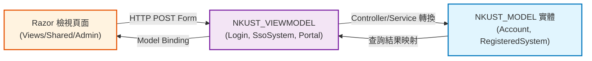

# NKUST_VIEWMODEL 模組技術架構分析報告 (NKUST_VIEWMODEL_REPORT.md)

- **模組名稱**：`NKUST_VIEWMODEL` (視圖模型、前後端資料契約與表單驗證層)
- **實體路徑**：[NkustSso.Server/ViewModels/](../../../NkustSso.Server/ViewModels/)
- **目標框架**：`.NET 10 LTS` (net10.0)

---

## 一、專案/模組整體概述 (Module Overview)

`NKUST_VIEWMODEL` 負責定義與封裝展示層 (UI) 與業務邏輯層之間的強型別資料契約 (Data Transfer Objects, DTOs)。本模組確保實體層資料結構與前端畫面解耦，防止過度暴露敏感資料（Over-posting），並提供 DataAnnotations 表單驗證與資料格式化。

### 1.1 目錄分類與模型職責
- **登入與會話視圖模型**：
  - `LoginViewModel`: 封裝帳號、密碼、身分專區 (`area`)、驗證碼與目標 ReturnUrl。
  - `CurrentUserViewModel`: 封裝目前已登入使用者之主要身分代碼、顯示名稱、學號/員編。
  - `LoginSessionListViewModel` / `RevokeLoginSessionViewModel`: 作用中會話清單與撤銷確認視圖。
- **身分專區與服務入口模型**：
  - `PortalDirectoryViewModel`, `PortalServiceGroupViewModel`, `PortalServiceItemViewModel`: 專區首頁服務清冊、分類與單項連結模型。
  - `PortalCategoryListViewModel`, `PortalCategoryEditViewModel`: 後台專區分類管理表單模型。
- **串接系統與手冊模型**：
  - `SsoSystemListViewModel`, `SsoSystemEditViewModel`, `SsoSystemCreatedViewModel`: SSO 串接系統 (OIDC / SAML / Web API / Link) 之組態編輯與密鑰呈現模型。
  - `IntegrationClientListViewModel`, `IntegrationClientEditViewModel`, `IntegrationClientSecretViewModel`: 伺服器對伺服器帳密驗證登記模型。
  - `IntegrationManualListViewModel`, `IntegrationManualViewModel`: 串接手冊 PDF 與 ZIP 下載模型。
- **協定特定模型**：
  - `SamlResponseFormViewModel`: 自動提交 SAML 2.0 斷言至 SP ACS 網址之 HTML POST 表單模型。
  - `SoapApiGuideViewModel`, `JsonApiGuideViewModel`: 串接指南與測試規格展示模型。

---

## 二、核心架構與檔案/模型解析 (AST Semantic Analysis)

### 2.1 登入表單模型 (`LoginViewModel.cs`)
- **類別**：`LoginViewModel`
- **主要屬性**：
  - `Account` (`string`): 必填，學號或員編，具備前後空白自動清除。
  - `Password` (`string`): 必填，密碼欄位標記 `[DataType(DataType.Password)]`。
  - `Area` (`string`): 當前登入身分專區（`student`, `employee`, `alumni`）。
  - `ReturnUrl` (`string?`): 登入成功後跳轉之相對路徑（防禦 Open Redirect）。
  - `ErrorMessage` (`string?`): 伺服器端驗證失敗之繁體中文提示訊息。

### 2.2 串接系統編輯模型 (`SsoSystemEditViewModel.cs`)
- **類別**：`SsoSystemEditViewModel`
- **主要屬性**：
  - `SystemId` (`string`): 系統唯一識別代碼。
  - `SystemName` (`string`): 系統中文名稱。
  - `Protocol` (`string`): 協定類型（`oidc`, `saml`, `ticket`, `link`）。
  - `CallbackUrl` (`string`): 合法授權回呼網址白名單。
  - `AllowedReturnFields` (`List<string>`): 授權釋出之使用者身分屬性清單。
  - `PortalSections` (`List<string>`): 發布至前台之身分專區（學生/教職員/校友）。
  - `RequirePortalLogin` (`bool`): 外部純連結是否強制要求本站中央登入。

### 2.3 SAML 2.0 自動提交表單模型 (`SamlResponseFormViewModel.cs`)
- **類別**：`SamlResponseFormViewModel`
- **主要屬性**：
  - `ActionUrl` (`string`): SP 端之 Assertion Consumer Service (ACS) 網址。
  - `SamlResponse` (`string`): 已完成數位簽章並 Base64 編碼之 SAML XML 斷言。
  - `RelayState` (`string?`): SP 原始請求所附帶之狀態參數。

---

## 三、模組資料合約流向圖 (Mermaid Topology)

---

## 四、潛在風險、邊際條件與效能注意事項

1. **開放重導向漏洞防禦 (Open Redirect Prevention)**：
   `LoginViewModel.ReturnUrl` 必須於 Controller 嚴格使用 `Url.IsLocalUrl(returnUrl)` 查核，或比對 `RegisteredSystems.CallbackUrl` 白名單，嚴禁未經校驗直接 302 跳轉。
2. **敏感資料遮蔽 (Sensitive Data Masking)**：
   `IntegrationClientSecretViewModel` 與 `SsoSystemCreatedViewModel` 產出之系統密鑰 (Secret) 僅得於新增當下顯示一次，禁止回顯於編輯檢視頁面。
3. **XSS 跨站腳本攻擊防禦**：
   Razor 引擎預設對 `@Model` 屬性進行 HTML 編碼；在輸出不可信任之描述欄位時，禁止使用 `@Html.Raw`。

---

## 五、重構建議 (Refactoring Recommendations)

1. **引入 FluentValidation 建立聲明式驗證規則**：
   將龐雜的表單驗證邏輯抽離出 ViewModel 本體，移至獨立的 Validator 類別，增進單元測試性。
2. **改採 C# record 提升不可變性 (Immutability)**：
   針對純唯讀展示之模型（如 `CurrentUserViewModel`、`PortalServiceItemViewModel`），宣告為 `public record`，提升執行緒安全與記憶體效率。
