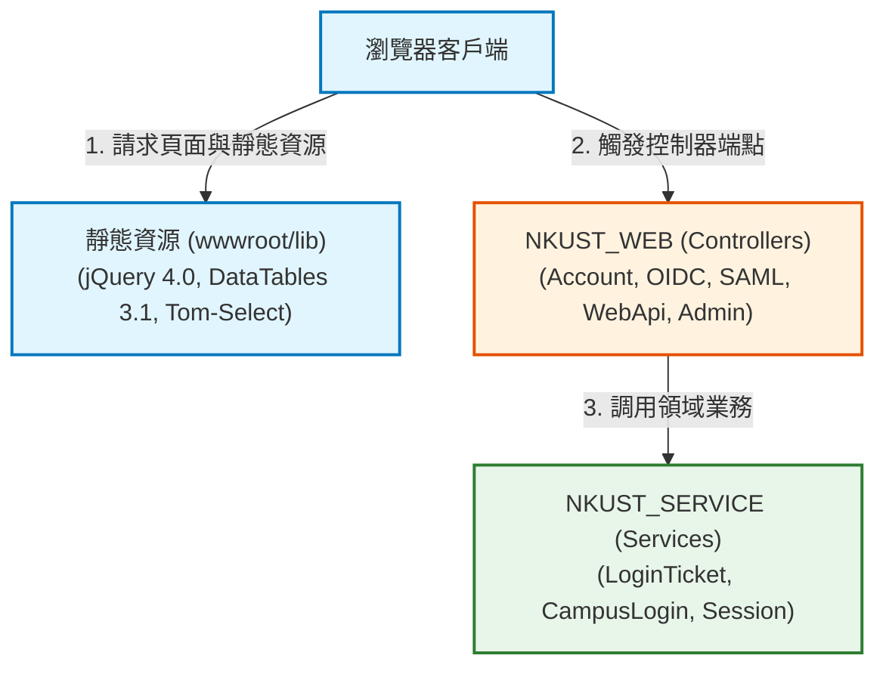

# NKUST_WEB 模組環境相依與 BOM 物料報告 (NKUST_WEB_ENV.md)

- **所屬專案**：NKUST SSO Server
- **對應模組**：`NKUST_WEB`
- **架構層級**：Presentation, Controllers & Middleware Layer

---

## 一、關鍵環境變數與安全組態

| 組態索引鍵 (Configuration Key) | 必要性 | 預設值 / 範例 | 職責與用途說明 |
| :--- | :---: | :--- | :--- |
| `ASPNETCORE_ENVIRONMENT` | 是 | `Development` | 目前專案原型強制限制於 `Development`，防範未設定憑證前於正式環境意外啟動。 |
| `DOTNET_WATCH_SUPPRESS_BROWSER_REFRESH` | 否 | `true` | 避免 dotnet watch 注入與嚴格 CSP 政策衝突之腳本。 |
| `Sso:DataDirectory` | 否 | `../.local` | 本機開發憑證與 DataProtection 金鑰目錄。 |

---

## 二、NKUST_WEB 前後端技術物料清單 (BOM)

### 2.1 後端 NuGet 套件
| 套件識別碼 (Package ID) | 採用版本 | 授權條款 (License) | 核心職責與在模組中之用途 |
| :--- | :---: | :---: | :--- |
| **`Microsoft.AspNetCore.App`** | `10.0` | MIT | ASP.NET Core 10 MVC 框架、Kestrel 伺服器、RateLimiting 與 Authentication。 |
| **`OpenIddict.AspNetCore`** | `7.7.2` | Apache-2.0 | 提供 `/connect/authorize`, `/connect/token`, `/connect/logout` 端點處理。 |
| **`ITfoxtec.Identity.Saml2.MvcCore`** | `4.21.0` | Apache-2.0 | 提供 `/saml/sso` 與 `/saml/metadata` 端點處理。 |

### 2.2 前端離線客戶端函式庫 (wwwroot/lib)
所有前端資源由 [versions.json](../../../NkustSso.Server/wwwroot/lib/versions.json) 鎖定版本與 SRI 雜湊：

| 函式庫名稱 | 採用版本 | 來源與完整性雜湊 (SRI SHA-512) | 核心用途 |
| :--- | :---: | :--- | :--- |
| **`jquery`** | `4.0.0` | `sha512-TXCHVR3Lb6TZdtw1l3RTLf8RBWVGexdxL6AC8/e0xZKEpBflBsjh9/8LXw+dkNFuOyW9B7iB3O1sP7hS0Kiacg==` | 前端 DOM 操作與管理介面動態互動基礎。 |
| **`datatables.net`** | `3.1.4` | `sha512-tnk14y/AOr0Z1d7avIUvCcOGgqZpeo7B6g6RQiycMQckEMq2FaaZTG1Q1xD6Kci5gpAvdjZInDmbscoiVSTyGw==` | 後台各管理表格之客戶端分頁、排序與關鍵字過濾。 |
| **`datatables.net-dt`** | `3.1.4` | `sha512-HST6HmWEMr6SA6FM2SpYu2ko0In5nHjUb03Ocop2gsHLWoRP18sgVbehxUtRS3QZP4eHfU68ujs/gnzd0U2t9g==` | DataTables 官方樣式與 CSS 佈局。 |
| **`tom-select`** | `2.6.2` | `sha512-eiXIkk82XzzUTOVQDFpy+ZGejuqdTvMukyUyeZBQaKnqW42UoTiTZnrod/eX0rkqJEc4rZY9DZ3zdjV07i29wQ==` | 現代化下拉選單加強元件，取代舊版 Select2。 |

---

## 三、模組管線拓撲圖

