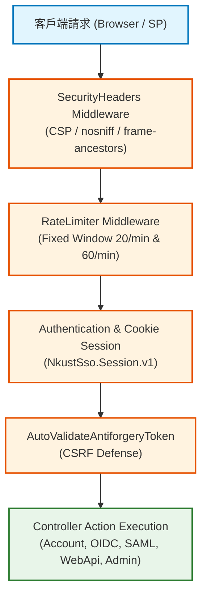

# NKUST_WEB 模組技術架構分析報告 (NKUST_WEB_REPORT.md)

- **模組名稱**：`NKUST_WEB` (HTTP 端點、Controller 控制器、中介軟體管道、Razor 視圖與前端資產層)
- **實體路徑**：[NkustSso.Server/Controllers/](../../../NkustSso.Server/Controllers/), `Views/`, `wwwroot/`, `Program.cs`
- **目標框架**：`.NET 10 LTS` (net10.0)
- **核心依賴**：`Microsoft.AspNetCore.App`, `OpenIddict.AspNetCore 7.7.2`, `ITfoxtec.Identity.Saml2.MvcCore 4.21.0`

---

## 一、專案/模組整體概述 (Module Overview)

`NKUST_WEB` 是 NKUST SSO Server 的對外 HTTP 傳輸展示層。本層負責接收與解析外部使用者瀏覽器及 SP 系統發起之 HTTP 請求，執行速率限制 (RateLimiting)、身分認證會話查核、防偽驗證 (Anti-Forgery)、內容安全政策 (CSP) 標頭注入，並分派至對應的協定端點與 Razor 檢視頁面。

### 1.1 目錄分類與控制器職責
- **身分驗證與協定控制器**：
  - `AccountLoginController`: 統一登入頁面展示、帳密驗證發起、會話建立與安全登出。
  - `OidcAuthorizationController`: 處理 OpenID Connect 授權碼模式請求、Token 簽發與登出。
  - `SamlSsoController`: 處理 SAML 2.0 AuthNRequest 解析、IdP 數位簽章斷言與 Metadata 發布。
  - `WebApiSsoController`: 處理自訂 Web API 單一登入啟動（`/ticket/authorize`）與 JSON 票券兌換（`POST /api/sso/v1/redeem`）。
  - `CredentialVerificationApiController`: 統一分派 SOAP 1.1/1.2 (`/KuasSSOWebService.asmx`) 與 JSON 帳密查驗端點。
- **門戶入口與服務瀏覽**：
  - `PortalHomeController` & `PortalServicesController`: 提供學生、教職員、校友三大專區之公開服務瀏覽與跳轉。
- **後台管理控制器 (Admin Suite)**：
  - `AdminHomeController`: 後台主儀表板。
  - `AdminMenuManagementController` & `AdminRoleManagementController`: 管理選單配置與八大權限群組。
  - `SsoSystemManagementController`: OIDC / SAML / Web API 串接系統登記與授權欄位管理。
  - `LoginSessionManagementController`: 檢視作用中會話與即時強制撤銷。
  - `IntegrationClientManagementController`: 伺服器對伺服器帳密驗證金鑰與 IP 登記。
  - `IntegrationManualController`: 串接規格 PDF / ZIP 下載。

---

## 二、核心架構與檔案/控制器解析 (AST Semantic Analysis)

### 2.1 統一登入入口控制器 (`AccountLoginController.cs`)
- **類別**：`AccountLoginController`
  - **函式**：`Login(string? area, string? returnUrl)` [HttpGet]
    - **核心邏輯**：檢查呼叫端是否已有有效中央 Cookie；若已有有效 Session，直接呼叫 `LocalRedirect` 跳轉至安全目標 ReturnUrl；若無有效 Session，呈現符合專區風格之登入介面。
  - **函式**：`Login(LoginViewModel model)` [HttpPost, ValidateAntiForgeryToken]
    - **輸入**：登入表單模型（帳號、密碼、專區、ReturnUrl）。
    - **輸出**：登入成功導向或帶有錯誤訊息之檢視。
    - **核心邏輯**：
      1. 呼叫 `CampusLoginService` 進行帳號啟用狀態比對與密碼演算法查核。
      2. 驗證通過後，呼叫 `LoginSessionLifetimeService` 建立持久化中央會話。
      3. 簽發加密 HTTP-only 安全 Cookie (`NkustSso.Session.v1`)。
      4. 查驗 `ReturnUrl` 是否為合法本機路徑或已登記系統回呼網址。

### 2.2 Web API 票券核銷端點 (`WebApiSsoController.cs`)
- **類別**：`WebApiSsoController`
  - **端點**：`POST /api/sso/v1/redeem`
    - **輸入**：`SsoTicketRedemptionRequest` (包含 `Ticket`, `SystemId`, `SystemSecret`, `CodeVerifier`)。
    - **輸出**：`IActionResult` (JSON 格式 `SsoIdentityResponse`)。
    - **核心邏輯**：
      1. 取得呼叫端直連 `RemoteIpAddress`，比對系統登記之 IP 白名單。
      2. 比對 `SystemSecret` 雜湊碼。
      3. 呼叫 `LoginTicketService.RedeemTicketAsync` 進行 60 秒一次性票券消耗與 PKCE 比對。
      4. 依系統授權欄位白名單，回傳學號、員編、姓名、單位與身分類別。

### 2.3 中介軟體管道與資安邊界防護 (`Program.cs`)
- **嚴格 CSP 內容安全政策**：
  ```csharp
  context.Response.Headers.ContentSecurityPolicy = 
      "default-src 'self'; style-src 'self'; img-src 'self' data:; frame-ancestors 'none'; base-uri 'self'; form-action 'self'";
  context.Response.Headers["X-Content-Type-Options"] = "nosniff";
  context.Response.Headers["Referrer-Policy"] = "no-referrer";
  context.Response.Headers.CacheControl = "no-store";
  ```
- **速率限制防暴力破解 (RateLimiter)**：
  - 登入端點：每 IP 每分鐘限制 20 次請求。
  - 串接查驗端點：每 IP 每分鐘限制 60 次請求。

---

## 三、HTTP 請求處理管線圖 (Mermaid Topology)



---

## 四、潛在風險、邊際條件與效能注意事項

1. **點擊劫持與 iframe 內嵌衝突 (Clickjacking Defense)**：
   本系統強制輸出 `frame-ancestors 'none'`。校內任何嘗試以 `<iframe>` 內嵌 SSO 頁面之系統皆會遭現代瀏覽器主動攔截。接收系統必須一律採用 302 跳轉或另開視窗模式。
2. **CSP 與第三方腳本限制**：
   嚴禁在 View 檔案中使用 `<script>` 內聯腳本或 HTML 標籤內的 `style="..."` 屬性。所有 JavaScript 必須置於 `wwwroot/js/` 並由 CSP 允許之本機來源載入。
3. **Data Protection 金鑰漫遊與持久化**：
   系統使用本地憑證保護 DataProtection 金鑰 (`.local/keys-server`)。跨多台伺服器部署時，必須確保多個節點共享同一組解密憑證與金鑰目錄。

---

## 五、重構建議 (Refactoring Recommendations)

1. **實作 API 版本控制 (API Versioning)**：
   目前端點路徑手動硬編碼 `/api/sso/v1/`；建議引進 `Asp.Versioning.Mvc` 進行語意化版本管理與 Swagger/OpenAPI 自動架構產出。
2. **前台靜態資產自動化 Bundling / Minification**：
   在發布管線中加入前端資產最小化與 Gzip / Brotli 預先壓縮流程，降低首頁載入延遲。
