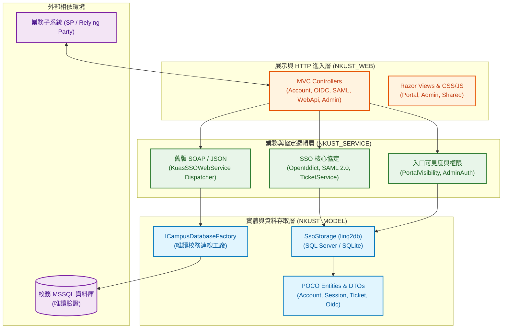

# NKUST SSO Server 專案權威架構與技術說明總檔 (Master README)

- **系統全銜**：國立高雄科技大學校園單一登入與服務入口伺服器 (NKUST SSO Server)
- **開發框架**：`ASP.NET Core 10` (.NET 10 LTS, C# 14)
- **認證標準**：OpenID Connect (OIDC), SAML 2.0 IdP, Web API Ticket 60s 單一登入, Legacy SOAP / JSON 驗證
- **儲存引擎**：SQL Server (`NkustSSO.dbo`) / SQLite (`sso.db` + `sessions.db`) 雙模支援；外部校務 MSSQL 唯讀驗證
- **分析工具**：[nkust-codebase-ingestion-v1](../../SKILL.md) 全自動靜態逆向工程套件

---

## 一、系統核心定位與亮點特色

NKUST SSO Server 是國立高雄科技大學資訊中心建構之統一數位身分與校園入口樞紐，具備下列核心特點：

1. **零信任資安防衛**：
   - 嚴格落實唯讀原則，外部校務 MSSQL 僅作帳密比對與唯讀身分資料抽取，絕不變更外部結構。
   - 完全隔離且禁止探測 `140.133.*.*` 網段與 `Sybase.nkust.edu.tw` 資料庫。
2. **多協定無縫聚合**：
   - 支援現代化 OpenIddict OIDC Authorization Code Flow (強制 PKCE)。
   - 支援國際標準 SAML 2.0 Identity Provider 協定。
   - 保留舊校務系統之 60 秒代登票券與 SOAP ASMX 9 大核心方法。
3. **無外連離線安全架構 (Air-Gapped Ready)**：
   - 前端全面摒棄執行期 CDN，所有資源經 SRI 雜湊鎖定於本地 `wwwroot/lib/`。
   - 內建嚴格 Content-Security-Policy (CSP)、Anti-Forgery 與 IP 連線速率限制 (RateLimiting)。

---

## 二、系統分層拓撲與專案依賴圖



---

## 三、方案子模組專案與程式碼規模

經由 [Analyze-ProjectStructure.ps1](../../scripts/Analyze-ProjectStructure.ps1) 靜態掃描結果：

| 專案名稱 | 目標框架 | C# 檔案數 | 程式碼總行數 | 實體目錄 | 主要職責與特徵 |
| :--- | :---: | :---: | :---: | :--- | :--- |
| **`NkustSso.Server`** | `net10.0` | 139 | 14,252 | [NkustSso.Server/](../../../NkustSso.Server/) | 整合 MVC 網站、SSO 協定核心、雙儲存 ORM 與整合服務。 |
| **`NkustSso.StorageChecks`** | `net10.0` | 28 | 2,901 | [tests/NkustSso.StorageChecks/](../../../tests/NkustSso.StorageChecks/) | 隔離測試程式，涵蓋 SQLite / SQL Server 儲存檢驗與協定驗證。 |
| **全方案總計** | `net10.0` | **167** | **17,153** | 方案根目錄 | 現代化、模組化、跨平台之校園單一登入中樞。 |

---

## 四、四大核心架構子模組導覽

| 子模組標籤 | 實體架構目錄 | 技術架構報告 | 環境與 BOM 報告 | 快速導覽 README |
| :--- | :--- | :---: | :---: | :---: |
| **`NKUST_MODEL`** | `NkustSso.Server/Models/`<br/>`NkustSso.Server/ApiModels/` | [REPORT](NKUST_MODEL/NKUST_MODEL_REPORT.md) | [ENV](NKUST_MODEL/NKUST_MODEL_ENV.md) | [README](NKUST_MODEL/README.md) |
| **`NKUST_SERVICE`** | `NkustSso.Server/Services/` | [REPORT](NKUST_SERVICE/NKUST_SERVICE_REPORT.md) | [ENV](NKUST_SERVICE/NKUST_SERVICE_ENV.md) | [README](NKUST_SERVICE/README.md) |
| **`NKUST_VIEWMODEL`** | `NkustSso.Server/ViewModels/` | [REPORT](NKUST_VIEWMODEL/NKUST_VIEWMODEL_REPORT.md) | [ENV](NKUST_VIEWMODEL/NKUST_VIEWMODEL_ENV.md) | [README](NKUST_VIEWMODEL/README.md) |
| **`NKUST_WEB`** | `NkustSso.Server/Controllers/`<br/>`Views/`, `wwwroot/` | [REPORT](NKUST_WEB/NKUST_WEB_REPORT.md) | [ENV](NKUST_WEB/NKUST_WEB_ENV.md) | [README](NKUST_WEB/README.md) |

---

## 五、系統全域技術報告清單

- 📊 **[PROJECT_REPORT.md](README/PROJECT_REPORT.md)**：全景架構、SSO 憑證交換時序圖、風險邊際防禦與 5 大現代化重構建議。
- 📦 **[PROJECT_BOM.md](README/PROJECT_BOM.md)**：全方案後端 8 大 NuGet 套件與前端 4 大離線 npm 套件之軟體物料清單。
- 🚀 **[PROJECT_BOM_UPGRADE.md](README/PROJECT_BOM_UPGRADE.md)**：.NET 10 LTS 升級比對分析與已棄用 (Deprecated) 元件審查報告。

---

## 六、環境準備、啟動與測試指引

### 6.1 環境需求
- Windows 10/11 或 Linux 伺服器
- **.NET 10 SDK** (v10.0+)
- **儲存選項**：
  - 開發/測試：免安裝資料庫，系統自動建立本機 SQLite (`.local/sso.db`, `.local/sessions.db`)。
  - 正式部署：Microsoft SQL Server 2019+ (`NkustSSO` 資料庫)。

### 6.2 快速啟動
```powershell
# 1. 複製設定檔範本 (保留既有設定)
if (!(Test-Path NkustSso.Server/appsettings.json)) {
    Copy-Item NkustSso.Server/appsettings.example.json NkustSso.Server/appsettings.json
}

# 2. 啟動 SSO 伺服器 (預設 https://localhost:7100)
dotnet run --project NkustSso.Server
```

### 6.3 執行測試與自動化檢查
```powershell
# 執行儲存隔離檢驗
dotnet build tests/NkustSso.StorageChecks/NkustSso.StorageChecks.csproj -o .local/agent-check-build
dotnet .local/agent-check-build/NkustSso.StorageChecks.dll

# 執行資安邊界合規檢核
powershell -ExecutionPolicy Bypass -File .agents/skills/nkust-codebase-ingestion-v1/scripts/Inspect-SecurityBoundaries.ps1
```
