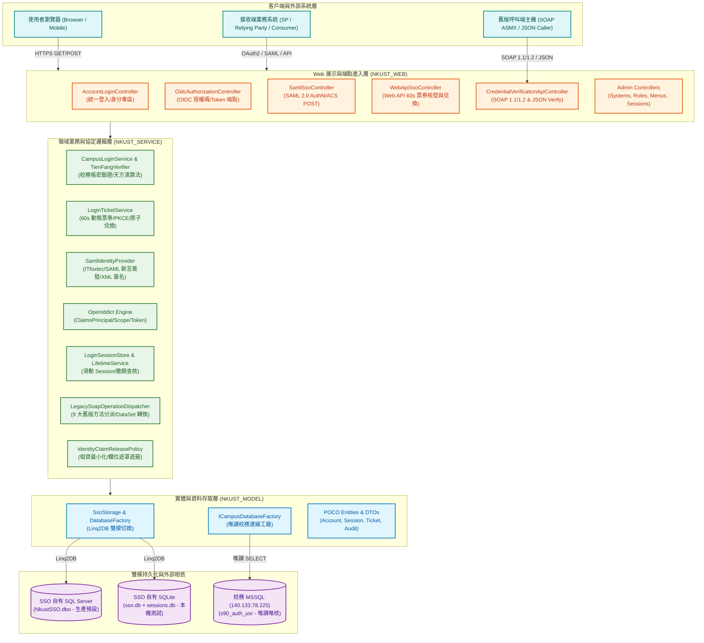
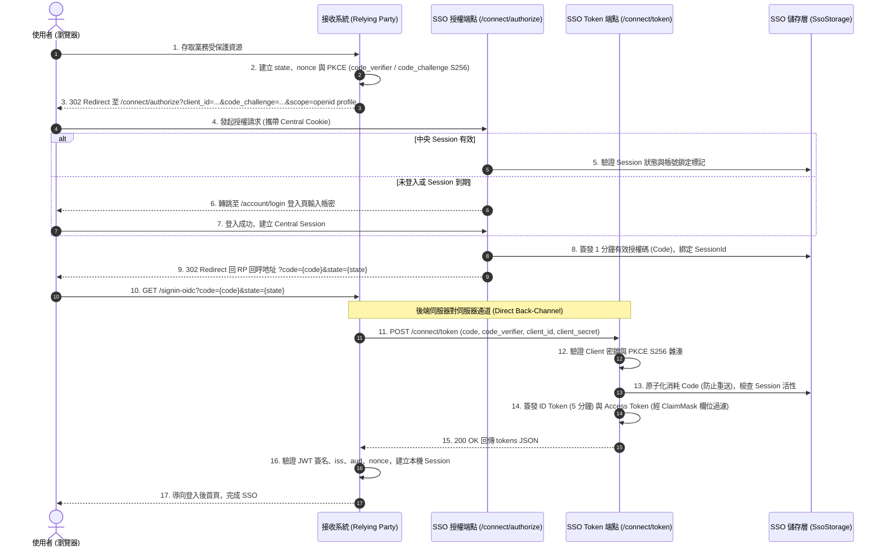
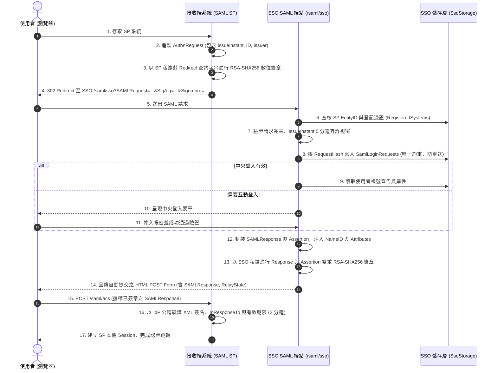
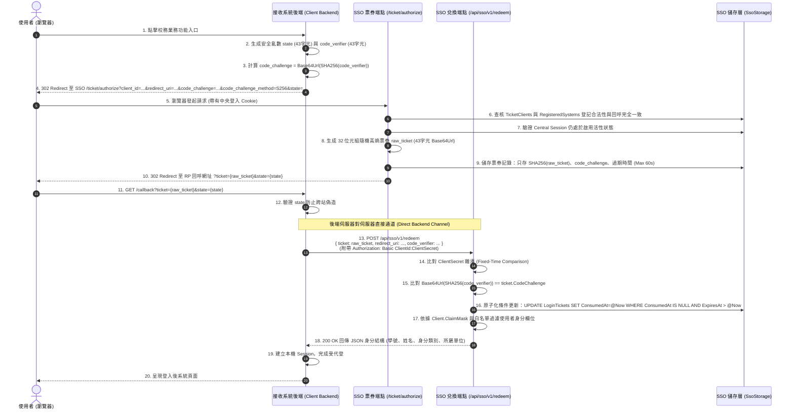
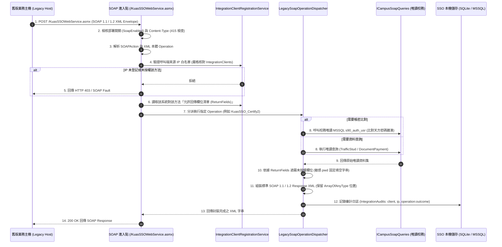
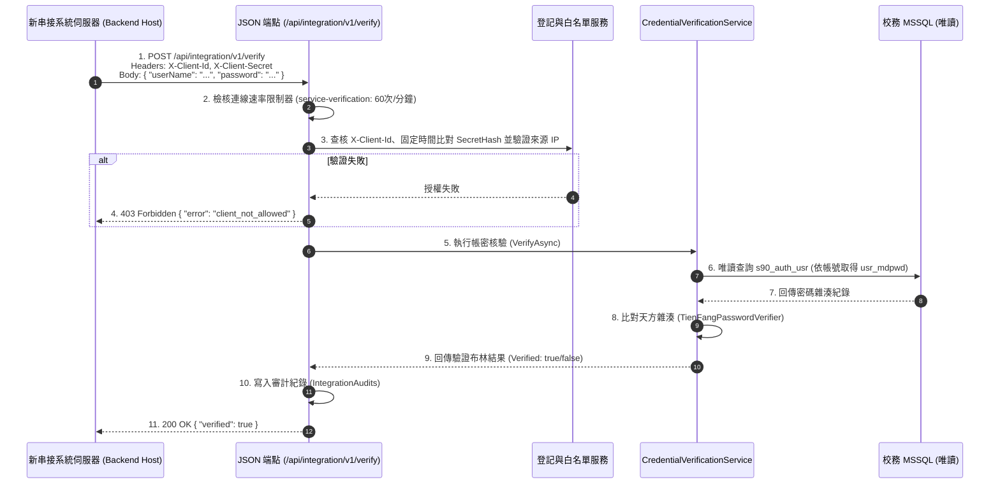

# NKUST SSO 專案架構與 SSO 憑證交換機制規格書 (PROJECT_ARCHITECTURE.md)

- **專案全銜**：國立高雄科技大學校園單一登入與服務入口系統 (NKUST SSO Server)
- **分析範圍**：系統分層架構、五大 SSO 憑證交換協定、全時序動態建模與跨域資安防護
- **產出日期**：2026-10-20
- **目標框架**：`.NET 10 LTS` (net10.0 / C# 14)
- **標準指引**：依據 [06_mermaid_diagram_specs.md](../../reference/06_mermaid_diagram_specs.md)、[02_codebase_ingestion_guide.md](../../reference/02_codebase_ingestion_guide.md) 與 [01_security_boundary_rules.md](../../reference/01_security_boundary_rules.md)

---

## 零、不可妥協之最高資安防衛邊界 (Zero-Trust Guardrail)

在進行本架構逆向工程、靜態代碼解析與任何測試作業時，全模組已完成合規審查，無條件嚴格遵守以下核心資安禁令：
1. **嚴禁異動 `Sybase.nkust.edu.tw` 資料庫**：禁止發起任何針對遠端 Sybase 之建表、修改或資料操作連線；本系統全面以離線靜態程式碼或隔離測試庫驗證。
2. **嚴禁異動或探測 `140.133.*.*` 核心網段**：禁止發送探測封包或任意異動請求。
3. **外部校務 MSSQL 唯讀存取**：透過 [`ICampusDatabaseFactory`](file:///d:/projects/01-main/nkustsso-story0720/NkustSso.Server/Models/CampusDatabaseFactory.cs) 建立唯讀連線（`ApplicationName = "NkustSso.ReadOnly"`），資料庫帳號僅具備 `SELECT` 權限，嚴禁執行 Migration、DDL 或 DML。
4. **路徑相對化原則**：所有產出文件、Markdown 引用與分析輸出路徑均以相對路徑或標準超連結呈現。

---

## 一、系統全景分層架構 (System Architecture Overview)

NKUST SSO Server 採用現代化 Clean Architecture 與領域驅動設計 (DDD) 理念，將展示層、業務層、實體層與持久化層進行嚴密解耦：



### 1.1 分層架構職責表

| 分層名稱 | 命名空間 / 實體目錄 | 核心職責與重要類別 |
| :--- | :--- | :--- |
| **展示層 (Presentation)** | [`NkustSso.Server.Controllers`](file:///d:/projects/01-main/nkustsso-story0720/NkustSso.Server/Controllers/) | 處理 HTTP/HTTPS 請求路由、協定參數解析、模型驗證、CSP/防偽 Token 攔截、速率限制及回應輸出。 |
| **領域服務層 (Service)** | [`NkustSso.Server.Services`](file:///d:/projects/01-main/nkustsso-story0720/NkustSso.Server/Services/) | 實作 5 大 SSO 核心協定邏輯、天方密碼雜湊比對、動態票券 PKCE 驗證、SAML 斷言簽章、Session 生命週期與權限查核。 |
| **資料存取層 (Data Access)** | [`NkustSso.Server.Models`](file:///d:/projects/01-main/nkustsso-story0720/NkustSso.Server/Models/) | 封裝 Linq2DB 雙模儲存工廠、SQL Server / SQLite Schema 映射、資料庫交易控制與外部唯讀連線保護。 |
| **持久化層 (Persistence)** | SQL Server (`NkustSSO`) / SQLite (`sso.db`, `sessions.db`) | 提供資料庫層級唯一性約束、原子化 UPDATE 鎖定、稽核紀錄儲存與會話狀態快取。 |
| **外部校務層 (External)** | 校務核心 MSSQL (`140.133.78.225`) | 唯讀身分資料來源，僅供帳號密碼比對 (`s90_auth_usr.usr_mdpwd`) 與教職員/學生基本屬性查核。 |

---

## 二、SSO 憑證交換機制詳解 (SSO Authentication & Credential Exchange Protocols)

系統整合了 **5 大身分驗證與憑證交換通道**，滿足從現代雲端標準至校內歷史遺留系統之多元串接需求：

```
                              ┌── 1. OpenID Connect (OIDC / OAuth 2.0 PKCE)
                              ├── 2. SAML 2.0 Identity Provider (Web SSO)
    NKUST SSO 憑證交換機制 ──┼── 3. Web API 60 秒動態票券 (Ticket / Redeem)
                              ├── 4. 舊版 SOAP WebService (KuasSSOWebService 9 大方法)
                              └── 5. 伺服器對伺服器 JSON 驗證 API (/api/integration/v1/verify)
```

---

### 2.1 協定一：OpenID Connect (OIDC) 授權碼模式 + PKCE (S256)

#### 協定概述
基於 **OpenIddict** 框架實作之標準 OpenID Connect Authorization Code Grant Flow，強制要求採用 **PKCE (RFC 7636) S256**，杜絕授權碼攔截攻擊。支援機密用戶端 (Confidential Client)。

#### 核心端點
- **探索端點 (Discovery)**：`GET /.well-known/openid-configuration`
- **授權端點 (Authorize)**：`GET /connect/authorize`
- **Token 兌換端點 (Token)**：`POST /connect/token`（僅限接收端後端以 Client Secret 發起）
- **登出端點 (Logout)**：`GET|POST /connect/logout`

#### 時序圖 (Sequence Diagram)



#### 安全邊界與設計細節
- **有效期限**：授權碼 (Authorization Code) 有效期為 **1 分鐘**；簽發之 ID Token 有效期為 **5 分鐘**。
- **單次兌換防護**：授權碼經兌換後立即作廢；若重複提交同一個 Code，後端將回傳 `invalid_grant`。
- **宣告最小化原則**：透過 [`IdentityClaimReleasePolicy.Filter`](file:///d:/projects/01-main/nkustsso-story0720/NkustSso.Server/Services/IdentityClaimReleasePolicy.cs) 依據 `RegisteredSystems.ClaimMask` 白名單嚴格遮蔽非必要欄位。

---

### 2.2 協定二：SAML 2.0 Identity Provider (IdP) 協定

#### 協定概述
採用 **ITfoxtec.Identity.Saml2** 核心，以 **IdP 身分提供者角色** 運作。實作標準 SP 發起的 Web SSO 流程 (SP-Initiated Web SSO Profile)，具備端到端 XML 數位簽章保護。

#### 核心端點
- **IdP 元數據 (Metadata)**：`GET /saml/metadata`
- **IdP SSO 進入點 (SSO URL)**：`GET /saml/sso`
- **SP 接收端點 (ACS URL)**：精確比對後台登記之 HTTPS ACS 回呼地址

#### 時序圖 (Sequence Diagram)



#### 安全邊界與設計細節
- **請求重送攻擊防禦 (Replay Prevention)**：系統對每次接收之 AuthnRequest 計算 SHA-256 雜湊，並在 [`SamlLoginRequests`](file:///d:/projects/01-main/nkustsso-story0720/NkustSso.Server/Models/SamlLoginRequest.cs) 資料表中建立 `RequestHash` 唯一性約束 (Unique Index)。任何重送請求將立即觸發資料庫唯一鍵衝突並被拒絕。
- **雙重簽名規範**：SAMLResponse 頂層與內部 Assertion 均進行 RSA-SHA256 簽署，避免訊息內容於傳輸中遭到篡改。

---

### 2.3 協定三：Web API 單一登入 60 秒動態票券機制 (Custom Protocol)

#### 協定概述
專為校內自研或無法負擔標準 OIDC/SAML 複雜性之後端系統設計之自訂輕量級 SSO 協定。具備 **60 秒超短有效期限**、**PKCE S256 強制防護**、**一次性原子核銷 (Single-Use Atomic Consumption)** 與 **雙向 IP/密鑰校驗**。

#### 核心端點
- **票券發起端點**：`GET /ticket/authorize` (瀏覽器發起)
- **表單兌換端點**：`POST /ticket/redeem` (接收系統後端)
- **JSON 兌換端點**：`POST /api/sso/v1/redeem` (接收系統後端，Content-Type: `application/json`)

#### 時序圖 (Sequence Diagram)



#### 安全邊界與設計細節
- **原子化防重送鎖定**：採用 Linq2DB 條件化單一 SQL `UPDATE`：
  ```csharp
  var changed = await db.LoginTickets
      .Where(t => t.Id == ticket.Id
          && t.ConsumedAt == null
          && t.ExpiresAt > now
          && db.LoginSessions.Any(s => s.Id == t.SessionId
              && s.AccountId == t.AccountId
              && s.RevokedAt == null
              && s.ExpiresAt > now
              && s.SecurityStamp == user.SecurityStamp))
      .Set(t => t.ConsumedAt, now)
      .Set(t => t.RedeemedIp, ip)
      .UpdateAsync();
  ```
  在 8 執行緒高度併發測試下，保證精確僅有 1 筆能兌換成功，其餘 7 筆全數回傳失敗。
- **零明文票券存檔**：資料庫僅儲存 `SHA256(raw_ticket)`，原始票券僅在回應 URL 中傳遞一次，即使資料庫外洩亦無法反組譯有效票券。

---

### 2.4 協定四：舊版 SOAP ASMX WebService 相容介面

#### 協定概述
完整承接舊校務系統之 `/KuasSSOWebService.asmx` SOAP 協定，相容於 **SOAP 1.1** 與 **SOAP 1.2** 規格，具備動態 WSDL 自動生成能力，供既有校內未升級系統無痛移轉。

#### 核心端點
- **合約與 WSDL 端點**：`GET /KuasSSOWebService.asmx?wsdl`
- **SOAP 執行端點**：`POST /KuasSSOWebService.asmx`

#### 已移植 9 大核心方法清冊

| 方法名稱 | SOAPAction / 命名空間 | 核心功能 | 輸出結構與回傳型別 |
| :--- | :--- | :--- | :--- |
| **`s90_login_chk`** | `http://tempuri.org/s90_login_chk` | 基礎帳號密碼校驗 | `ArrayOfString` (代碼, 訊息) |
| **`s90_chk_usr`** | `http://tempuri.org/s90_chk_usr` | 查驗帳號是否存在與有效性 | `boolean` (true/false) |
| **`s90_get_usr_nm`** | `http://tempuri.org/s90_get_usr_nm` | 查詢使用者真實姓名 | `string` (姓名明文) |
| **`KuasSSO_Certify1`** | `http://tempuri.org/KuasSSO_Certify1` | 舊校務代登票券驗證 (防重放) | `ArrayOfAnyType` (boolean, 身分代碼) |
| **`KuasSSO_Certify2`** | `http://tempuri.org/KuasSSO_Certify2` | 帳密直核 (不帶系統密鑰，純 IP 驗證) | `ArrayOfAnyType` (boolean, sts_id 身分代碼) |
| **`Get_Traffic_Stud`** | `http://tempuri.org/Get_Traffic_Stud` | 學生交通/身分唯讀資料查詢 | `DataSet` (DiffGram 格式 XML) |
| **`Get_Traffic_Teach`** | `http://tempuri.org/Get_Traffic_Teach` | 教職員交通/人事唯讀資料查詢 | `DataSet` (DiffGram 格式 XML) |
| **`Get_Traffic_Pub`** | `http://tempuri.org/Get_Traffic_Pub` | 公用帳號資訊唯讀查詢 | `DataSet` (DiffGram 格式 XML) |
| **`NkustSSO_DocumentApplyPaymentSystemSearch`** | `http://tempuri.org/...` | 文件申辦暨繳費系統專用查詢 | `DataSet` (`std_id`, `std_name`, `std_email`) |

#### 時序圖 (Sequence Diagram)



---

### 2.5 協定五：現代化伺服器對伺服器 JSON 驗證 API (Direct Credential Verification)

#### 協定概述
專為新式系統建置之純 REST/JSON 身分比對介面。不建立中央會話 Cookie，不發放使用者 Token，僅針對伺服器對伺服器之帳號密碼合法性提供高效能、無狀態之查驗結果。

#### 核心端點
- **驗證端點**：`POST /api/integration/v1/verify`

#### 認證標頭要求
- `X-Client-Id`：後台登記之串接系統代碼（符合正規表達式 `^[a-z0-9][a-z0-9_-]{0,99}$`）。
- `X-Client-Secret`：系統專屬高熵密鑰（64 位元組安全雜湊比對）。
- **來源 IP 綁定**：呼叫端 IP 必須完全符合後台登記之白名單，不信任自填之偽造標頭。

#### 時序圖 (Sequence Diagram)



---

## 三、資安防護與全域橫切機制 (Security Guardrails & Cross-Cutting Concerns)

### 3.1 內容安全政策 (CSP) 與防點擊劫持 (Clickjacking)
- **嚴格 CSP 標頭**：
  ```http
  Content-Security-Policy: default-src 'self'; script-src 'self'; style-src 'self'; img-src 'self' data:; font-src 'self'; frame-ancestors 'none'; base-uri 'self'; form-action 'self';
  ```
- **禁止外部 Frame 嵌入**：全域宣告 `frame-ancestors 'none'` 與 `X-Frame-Options: DENY`，徹底杜絕以 `<iframe>` 內嵌 SSO 頁面之點擊劫持攻擊。
- **無內聯指令碼**：完全摒棄 `unsafe-inline` 與 `unsafe-eval`，所有 JavaScript 與 CSS 均為本地獨立靜態檔案。

### 3.2 跨站請求偽造 (CSRF) 差異化防禦
- **瀏覽器端點**：全面套用 `AutoValidateAntiforgeryTokenAttribute`，任何透過瀏覽器發起之表單提交（如登入、登出確認、後台管理）均強制驗證 Anti-Forgery Token。
- **協定兌換端點**：明確標註 `[IgnoreAntiforgeryToken]`，專屬豁免給具備伺服器端密鑰認證之後端兌換端點（如 `/connect/token`、`/ticket/redeem`、`/api/sso/v1/redeem` 與 `/api/integration/v1/verify`）。

### 3.3 智慧型連線速率限制 (Rate Limiting)
透過 ASP.NET Core 10 原生 `Microsoft.AspNetCore.RateLimiting` 配置分級保護策略：
1. **互動登入限制 (`login`)**：滑動視窗每分鐘上限 20 次，阻絕暴力字典檔攻擊。
2. **整合驗證限制 (`service-verification`)**：固定視窗每分鐘上限 60 次，保護校務唯讀庫免於連線耗盡。

### 3.4 零敏感資訊落地原則 (Zero-Plaintext Policy)
- **使用者密碼**：記憶體中瞬時校驗，嚴禁記錄至日誌、暫存檔或資料庫。
- **隨機憑證與金鑰**：
  - 票券 (Tickets) 僅儲存 `SHA256(ticket)`。
  - 系統密鑰 (ClientSecrets) 僅儲存 `SHA256(secret)`。
  - 會話 Cookie 僅儲存 `KeyHash`，資料庫遭 Dump 亦無法偽造 Session。
  - Cookie 票證採用 ASP.NET Core Data Protection 進行強加密保護。

---

## 四、核心類別與符號對照索引 (Code Symbols Index)

| 類別 / 介面名稱 | 原始碼連結 | 核心職責 |
| :--- | :--- | :--- |
| **`CampusLoginService`** | [`CampusLoginService.cs`](file:///d:/projects/01-main/nkustsso-story0720/NkustSso.Server/Services/CampusLoginService.cs) | 整合外部校務驗證與本機身分建立。 |
| **`LoginTicketService`** | [`LoginTicketService.cs`](file:///d:/projects/01-main/nkustsso-story0720/NkustSso.Server/Services/LoginTicketService.cs) | 負責 60 秒動態票券之產生、PKCE 校驗與原子化核銷。 |
| **`SamlIdentityProvider`** | [`SamlIdentityProvider.cs`](file:///d:/projects/01-main/nkustsso-story0720/NkustSso.Server/Services/SamlIdentityProvider.cs) | 封裝 ITfoxtec SAML 2.0 協定、AuthnRequest 驗證與 XML 簽章。 |
| **`OidcAuthorizationController`**| [`OidcAuthorizationController.cs`](file:///d:/projects/01-main/nkustsso-story0720/NkustSso.Server/Controllers/OidcAuthorizationController.cs)| 管理 OpenIddict 授權碼模式與後端 Token 兌換。 |
| **`WebApiSsoController`** | [`WebApiSsoController.cs`](file:///d:/projects/01-main/nkustsso-story0720/NkustSso.Server/Controllers/WebApiSsoController.cs) | Web API 60 秒動態票券之 HTTP 進入點。 |
| **`CredentialVerificationApiController`**| [`CredentialVerificationApiController.cs`](file:///d:/projects/01-main/nkustsso-story0720/NkustSso.Server/Controllers/CredentialVerificationApiController.cs)| SOAP 1.1/1.2 與 JSON 帳密驗證之統一分派控制器。 |
| **`LegacySoapOperationDispatcher`**| [`LegacySoapOperationDispatcher.cs`](file:///d:/projects/01-main/nkustsso-story0720/NkustSso.Server/Services/LegacySoapOperationDispatcher.cs)| 舊版 KuasSSOWebService 9 大核心方法轉譯執行器。 |
| **`IdentityClaimReleasePolicy`** | [`IdentityClaimReleasePolicy.cs`](file:///d:/projects/01-main/nkustsso-story0720/NkustSso.Server/Services/IdentityClaimReleasePolicy.cs) | 個資最小化欄位過濾器，執行 ClaimMask 遮罩。 |
| **`LoginSessionStore`** | [`LoginSessionStore.cs`](file:///d:/projects/01-main/nkustsso-story0720/NkustSso.Server/Services/LoginSessionStore.cs) | 中央 Session 狀態管理、滑動過期計算與撤銷驗證。 |
| **`SsoStorage`** | [`SsoStorage.cs`](file:///d:/projects/01-main/nkustsso-story0720/NkustSso.Server/Models/SsoStorage.cs) | 定義 SQL Server / SQLite 雙模實體資料表映射與欄位規格。 |
