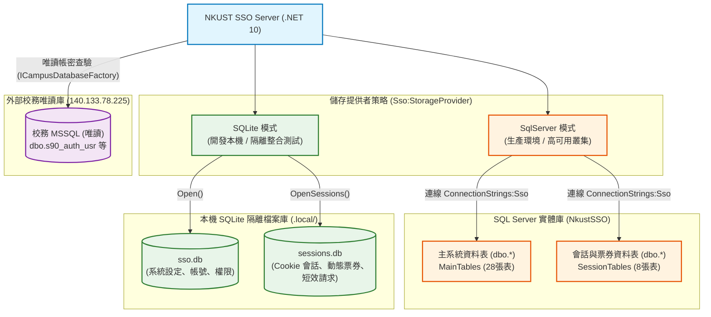

# NKUST SSO 專案資料庫結構與 SSO 憑證交換機制規格書 (PROJECT_DATABASE.md)

- **專案全銜**：國立高雄科技大學校園單一登入與服務入口系統 (NKUST SSO Server)
- **分析範圍**：雙模儲存架構、全資料表 Schema 結構、外部唯讀校務模型、憑證交換讀寫行為與原子性事務
- **產出日期**：2026-10-20
- **目標框架**：`.NET 10 LTS` (net10.0 / C# 14 / Linq2DB 6.x)
- **標準指引**：依據 [06_mermaid_diagram_specs.md](../../reference/06_mermaid_diagram_specs.md)、[02_codebase_ingestion_guide.md](../../reference/02_codebase_ingestion_guide.md) 與 [01_security_boundary_rules.md](../../reference/01_security_boundary_rules.md)

---

## 零、不可妥協之最高資安防衛邊界 (Zero-Trust Guardrail)

在進行本資料庫結構逆向解析與運行驗證時，全系統 100% 遵守以下核心資安禁令：
1. **嚴禁異動 `Sybase.nkust.edu.tw` 資料庫**：禁止發起任何針對遠端 Sybase 之建表、修改或資料操作連線；本系統全面以離線靜態程式碼或隔離測試庫驗證。
2. **嚴禁異動或探測 `140.133.*.*` 核心網段**：禁止發送探測封包或任意異動請求。
3. **外部校務 MSSQL 唯讀存取**：透過 [`ICampusDatabaseFactory`](file:///d:/projects/01-main/nkustsso-story0720/NkustSso.Server/Models/CampusDatabaseFactory.cs) 建立唯讀連線（`ApplicationName = "NkustSso.ReadOnly"`），資料庫帳號僅具備 `SELECT` 權限，嚴禁對校務庫執行 Migration、DDL 或 DML。
4. **路徑相對化原則**：所有產出文件、Markdown 引用與分析輸出路徑均以相對路徑或標準超連結呈現。

---

## 一、雙模儲存架構與資料庫實體拓撲 (Dual-Storage Architecture & Topology)

NKUST SSO 採用**雙引擎儲存隔離策略 (Dual-Storage Strategy)**，依據環境組態 `Sso:StorageProvider` 進行平滑切換，並與外部校務驗證庫完全隔離：



### 1.1 儲存引擎規格與比對

| 特性維度 | 生產環境：SQL Server (`NkustSSO`) | 開發/測試：SQLite 雙資料庫 |
| :--- | :--- | :--- |
| **組態設定** | `Sso:StorageProvider = "SqlServer"`<br/>`ConnectionStrings:Sso` | `Sso:StorageProvider = "SQLite"`<br/>預設目錄 `.local/` |
| **檔案/資料庫** | 實體資料庫 `NkustSSO`（Schema: `dbo`） | `sso.db` (系統主庫) + `sessions.db` (會話票券庫) |
| **字串定序 (Collation)** | `Latin1_General_100_BIN2` (大小寫敏感，確保 GUID、Token 與雜湊比對一致性) | SQLite 預設 BINARY 比較 |
| **連線安全 (Security)** | `Encrypt = Mandatory`, `PersistSecurityInfo = false` | 唯讀開啟保護 (`Mode=ReadOnly`, `Pooling=false`) |
| **並行控制 (Concurrency)**| `sys.sp_getapplock` 獨占鎖定 (`@Resource = 'NkustSso.Schema'`) | 檔案層級鎖定，資料庫拆分降低鎖競爭 |
| **遷移與建表** | `SsoStorage.MainTables` + `SessionTables` (明確白名單註冊) | `CreateTableAsync<T>(CreateIfNotExists)` |

---

## 二、主系統資料庫結構詳解 (Main Tables Schema)

主資料庫（SQL Server 的 `dbo` 或 SQLite 的 `sso.db`）負責儲存持久化設定、使用者主檔、整合系統登記與 OIDC 實體，共包含 **28 張核心資料表**。

### 2.1 使用者帳號與身分主檔

#### 1. `AspNetUsers` (對應實體類別：[`Account`](file:///d:/projects/01-main/nkustsso-story0720/NkustSso.Server/Models/Account.cs))
- **設計目的**：ASP.NET Core Identity 帳號主表，支援校務帳號對應、多重身分類別與鎖定狀態。
- **欄位定義**：
  | 欄位名稱 | 型別 (SQL Server / SQLite) | 限制條件 | 說明 |
  | :--- | :--- | :--- | :--- |
  | `Id` | `NVARCHAR(200)` / `TEXT` | PRIMARY KEY | 內部帳號識別碼 (UUID / GUID) |
  | `UserName` | `NVARCHAR(256)` / `TEXT` | NOT NULL | 登入帳號 (學號 / 員編) |
  | `NormalizedUserName` | `NVARCHAR(256)` / `TEXT` | UNIQUE INDEX | 標準化大寫帳號，供大小寫不敏感查詢 |
  | `DisplayName` | `NVARCHAR(MAX)` / `TEXT` | NOT NULL | 使用者真實姓名 |
  | `Email` | `NVARCHAR(256)` / `TEXT` | NULL | 電子郵件信箱 |
  | `AuthenticationSource` | `NVARCHAR(64)` / `TEXT` | DEFAULT '' | 身分來源標記 (`campus`, `local`) |
  | `SourceAccountId` | `NVARCHAR(256)` / `TEXT` | DEFAULT '' | 外部來源帳號代碼 |
  | `SourceStatusCode` | `NVARCHAR(256)` / `TEXT` | DEFAULT '' | 校務在學/在職代碼 (如 `02` 在學) |
  | `SourceStatusName` | `NVARCHAR(256)` / `TEXT` | DEFAULT '' | 校務在學/在職中文名稱 |
  | `UnitCode` | `NVARCHAR(256)` / `TEXT` | DEFAULT '' | 所屬單位代碼 (如系所或處室代碼) |
  | `UnitName` | `NVARCHAR(256)` / `TEXT` | DEFAULT '' | 所屬單位中文名稱 |
  | `Enabled` | `BIT` / `INTEGER` | NOT NULL, DEFAULT 1 | 帳號是否啟用 |
  | `LockoutEnd` | `BIGINT` / `INTEGER` | NULL | 鎖定結束時間戳 (UTC 毫秒) |
  | `SecurityStamp` | `NVARCHAR(MAX)` / `TEXT` | NOT NULL | 安全戳記，密碼變更或撤銷時更新 |
- **索引**：
  - `UserNameIndex`: `NormalizedUserName` (UNIQUE, 排除 NULL)
  - `AccountSourceIndex`: `AuthenticationSource, SourceAccountId` (UNIQUE, 過濾 `AuthenticationSource <> ''`)

#### 2. `AspNetRoles` (`IdentityRole`) & `AspNetUserRoles` (`AccountRole`)
- 儲存系統內建角色（如 `Administrator`）與使用者之多對多關聯。

#### 3. `LoginEvents` (`LoginEvent`)
- 記錄使用者於本系統發起之互動登入成功、失敗與鎖定事件稽核紀錄。

---

### 2.2 串接系統登記與授權管理

#### 4. `RegisteredSystems` (對應實體類別：[`RegisteredSystem`](file:///d:/projects/01-main/nkustsso-story0720/NkustSso.Server/Models/RegisteredSystem.cs))
- **設計目的**：統一管理 OIDC、SAML 2.0、Web API 票券與首頁捷徑連結之後端系統註冊表。
- **欄位定義**：
  | 欄位名稱 | 型別 | 說明 |
  | :--- | :--- | :--- |
  | `ClientId` | `NVARCHAR(200)` PK | 用戶端識別代碼 (Client ID) |
  | `Protocol` | `NVARCHAR(MAX)` | 支援協定：`oidc`, `saml`, `ticket` (Web API), `link` (純連結) |
  | `DisplayName` | `NVARCHAR(MAX)` | 系統中文名稱 |
  | `DisplayNameEn` | `NVARCHAR(MAX)` | 系統英文名稱 |
  | `EntryUrl` | `NVARCHAR(MAX)` | 登入發起入口 URL (非回呼網址) |
  | `RedirectUri` | `NVARCHAR(MAX)` | 精確白名單回呼 URL (Redirect URI) |
  | `PostLogoutRedirectUri` | `NVARCHAR(MAX)` | 登出後回呼 URL |
  | `Enabled` | `BIT` | 系統是否啟用 |
  | `SamlEntityId` | `NVARCHAR(1000)` | SAML SP Entity ID (SAML 模式專用) |
  | `SamlSigningCertificate` | `NVARCHAR(MAX)` | SAML SP 公開簽章憑證 (PEM 格式) |
  | `ShowOnPortal` | `BIT` | 是否於校園入口 (Portal) 顯示圖示連結 |
  | `PublicStudent` / `PublicEmployee` / `PublicAlumni` | `BIT` | 公開專區可見身分標記 (學生/教職員/校友) |
  | `RequirePortalLogin` | `BIT` | 存取外部連結前是否強制要求中央登入 |
  | `RequireLoginToView` | `BIT` | 是否僅登入且符合身分者可看見該系統 |
  | `Category` | `NVARCHAR(MAX)` | 入口所屬分類 (如教務、學務、總務) |
  | `ClaimMask` | `INT` | 欄位授權遮罩 (個資最小化控制) |
  | `Revision` | `NVARCHAR(MAX)` | 樂觀並行鎖定版本號 (UUID) |
- **索引**：
  - `SamlEntityIndex`: `SamlEntityHash` (UNIQUE, 過濾 `Protocol = 'saml'`)

#### 5. `TicketClients` (對應實體類別：[`TicketClient`](file:///d:/projects/01-main/nkustsso-story0720/NkustSso.Server/Models/LoginTicket.cs))
- **設計目的**：專供 Web API 60 秒動態票券機制之后端機密用戶端金鑰儲存。
- **欄位定義**：
  - `Id` (`NVARCHAR(200)` PK): 與 `RegisteredSystems.ClientId` 一致。
  - `DisplayName` (`NVARCHAR(MAX)`): 系統名稱。
  - `SecretHash` (`NVARCHAR(64)`): Client Secret 之 SHA-256 雜湊值（明文不落地）。
  - `RedirectUri` (`NVARCHAR(MAX)`): 精確回呼網址。
  - `Enabled` (`BIT`): 啟用標記。
  - `IncludeStudentProfile` (`BIT`): 是否允許釋出學生學籍個資。

#### 6. `IntegrationClients` (對應實體類別：[`IntegrationClient`](file:///d:/projects/01-main/nkustsso-story0720/NkustSso.Server/Models/IntegrationService.cs))
- **設計目的**：管理伺服器對伺服器之 SOAP ASMX 與 JSON 帳密驗證呼叫端登記。
- **欄位定義**：
  - `Id` (`NVARCHAR(200)` PK): 呼叫端系統代碼。
  - `Name` (`NVARCHAR(MAX)`): 系統中文名稱。
  - `ConnectionKind` (`NVARCHAR(MAX)`): `existing` (舊系統) 或 `new` (新串接)。
  - `Protocol` (`NVARCHAR(MAX)`): `soap` 或 `json`。
  - `AllowedIps` (`NVARCHAR(MAX)`): 允許呼叫之來源 IP 白名單（每行一個，禁止萬用字元）。
  - `SecretHash` (`NVARCHAR(64)`): JSON 模式專用之密鑰雜湊。
  - `CallerName` / `CallerPasswordHash`: 舊版 SOAP 專用之呼叫身分與密碼雜湊。
  - `AllowedFunctionIds`: SOAP 允許執行之功能代碼清單。

#### 7. `IntegrationClientReturnFields` (`IntegrationClientReturnField`)
- 記錄各 SOAP 呼叫端針對特定方法允許回傳的個資欄位白名單 (`ClientId`, `FieldKey`)。未勾選者回傳空值。

---

### 2.3 OpenID Connect (OpenIddict) 協定實體資料表

系統整合 OpenIddict，採用獨立標籤資料表儲存 OIDC 協定實體：
1. **`OidcApplications`**：儲存 OIDC Client 註冊資料 (`ClientId`, `ClientSecret`, `RedirectUris`, `Permissions`)。
2. **`OidcAuthorizations`**：儲存使用者對特定 Client 的已授權範圍與同意紀錄。
3. **`OidcScopes`**：儲存支援之 OAuth2 範圍定義 (`openid`, `profile`, `student_profile`)。
4. **`OidcTokens`**：儲存簽發之授權碼與 Token 參照 (`ReferenceId`, `Payload`, `ExpirationDate`, `Subject`)。
   - 索引：`OidcReferenceIndex` (UNIQUE on `ReferenceId`)、`OidcTokenAuthIndex` on `AuthorizationId`。

---

### 2.4 後台管理與細部權限

1. **`AdminMenus`**：後台動態導覽選單定義 (`Id`, `Label`, `Group`, `Target`, `Icon`, `SortOrder`, `Enabled`)。
2. **`AdminRoles`**：管理員角色定義 (`Id`, `Name`, `StartsAt`, `ExpiresAt`, `Enabled`)。
3. **`AdminRolePermissions`**：角色與 8 大管理功能權限之映射 (`RoleId`, `Permission`)。
4. **`AdminRoleMembers`**：管理員帳號與角色綁定 (`RoleId`, `AccountId`)。
5. **`AdminManagementAudits`**：選單與角色異動前/後完整快照 (`BeforeJson`, `AfterJson`) 審計表。

---

## 三、會話與動態票券資料庫結構詳解 (Session Tables Schema)

會話資料庫（SQL Server 的 `dbo` 或 SQLite 的 `sessions.db`）負責儲存高度高頻讀寫、具時效性之狀態資料，包含 **8 張核心資料表**。

### 3.1 核心會話與票券資料表

#### 1. `LoginSessions` (對應實體類別：[`LoginSession`](file:///d:/projects/01-main/nkustsso-story0720/NkustSso.Server/Models/LoginSession.cs))
- **設計目的**：中央登入 Cookie 會話狀態管理。儲存 Data Protection 加密後之驗證票證與滑動過期狀態。
- **欄位定義**：
  | 欄位名稱 | 型別 | 限制 | 說明 |
  | :--- | :--- | :--- | :--- |
  | `Id` | `NVARCHAR(200)` | PRIMARY KEY | 公開會話識別碼 (GUID，不等於 Cookie 金鑰) |
  | `KeyHash` | `NVARCHAR(64)` | UNIQUE INDEX | 瀏覽器 Cookie 秘密金鑰之 SHA-256 雜湊（原值不落地） |
  | `AccountId` | `NVARCHAR(200)` | INDEX | 所屬使用者內部帳號 ID |
  | `UserName` | `NVARCHAR(MAX)` | NOT NULL | 登入帳號名稱 |
  | `DisplayName`| `NVARCHAR(MAX)` | NOT NULL | 使用者顯示名稱 |
  | `SecurityStamp`| `NVARCHAR(MAX)`| NOT NULL | 當前安全性戳記（帳號停用或改密碼時不符即失效） |
  | `ProtectedTicket`| `VARBINARY(MAX)`| NOT NULL | ASP.NET Core Data Protection 加密驗證票（撤銷時清空） |
  | `CreatedAt` | `BIGINT` | NOT NULL | 會話建立時間 (UTC 毫秒) |
  | `LastSeenAt` | `BIGINT` | NOT NULL | 最近一次活動時間戳 (UTC 毫秒) |
  | `ExpiresAt` | `BIGINT` | INDEX | 會話絕對過期時間戳 (UTC 毫秒) |
  | `IpAddress` | `NVARCHAR(MAX)` | NOT NULL | 登入時之用戶端 IP |
  | `UserAgent` | `NVARCHAR(MAX)` | NOT NULL | 登入時之瀏覽器代理識別字串 |
  | `RevokedAt` | `BIGINT` | NULL | 撤銷時間戳（非 NULL 即代表已手動撤銷） |
  | `RevokedBy` | `NVARCHAR(MAX)` | NULL | 執行撤銷動作之管理員 ID |
  | `RevocationReason`| `NVARCHAR(MAX)`| NULL | 撤銷原因說明 |

#### 2. `LoginTickets` (對應實體類別：[`LoginTicket`](file:///d:/projects/01-main/nkustsso-story0720/NkustSso.Server/Models/LoginTicket.cs))
- **設計目的**：Web API 單一登入之 60 秒動態一次性票券儲存。
- **欄位定義**：
  | 欄位名稱 | 型別 | 限制 | 說明 |
  | :--- | :--- | :--- | :--- |
  | `Id` | `NVARCHAR(200)` | PRIMARY KEY | 票券唯一識別碼 (GUID) |
  | `TicketHash` | `NVARCHAR(64)` | UNIQUE INDEX | 原始隨機票券之 SHA-256 雜湊值（明文不落地） |
  | `AccountId` | `NVARCHAR(200)` | NOT NULL | 綁定之使用者 ID |
  | `SessionId` | `NVARCHAR(MAX)` | NOT NULL | 關聯之中央 SessionId |
  | `ClientId` | `NVARCHAR(200)` | NOT NULL | 綁定之接收系統 Client ID |
  | `RedirectUri` | `NVARCHAR(MAX)` | NOT NULL | 綁定之回呼網址 (兌換時嚴格核對) |
  | `CodeChallenge`| `NVARCHAR(MAX)` | NOT NULL | 接收端提供之 PKCE S256 挑戰值 |
  | `CreatedAt` | `BIGINT` | NOT NULL | 核發時間 (UTC 毫秒) |
  | `ExpiresAt` | `BIGINT` | INDEX | 過期時間戳 (核發時間 + 最多 60 秒) |
  | `ConsumedAt` | `BIGINT` | NULL | 兌換時間戳（NULL 代表尚未兌換，更新後作廢） |
  | `IssuedIp` | `NVARCHAR(MAX)` | NOT NULL | 核發請求之瀏覽器 IP |
  | `RedeemedIp` | `NVARCHAR(MAX)` | NULL | 兌換請求之後端伺服器 IP |

#### 3. `SamlLoginRequests` (對應實體類別：[`SamlLoginRequest`](file:///d:/projects/01-main/nkustsso-story0720/NkustSso.Server/Models/SamlLoginRequest.cs))
- **設計目的**：SAML 2.0 AuthnRequest 流程暫存與防重送攻擊檢查表。
- **欄位定義**：
  - `Id` (`NVARCHAR(200)` PK): 流程識別碼 (Base64Url 32 位元組隨機數)。
  - `RequestHash` (`NVARCHAR(64)` UNIQUE INDEX): 原始 SAMLRequest XML 之 SHA-256 雜湊，阻絕請求重送。
  - `RequestId`: SAML 請求識別 ID (InResponseTo 核對依據)。
  - `ClientId`: 關聯之 SAML SP Client ID。
  - `RelayState`: SP 傳入之返回狀態值。
  - `ExpiresAt`: 流程有效截止時間戳 (最多 5 分鐘)。
  - `ConsumedAt`: 完成 SAMLResponse 簽發之時間戳。

#### 4. 稽核與日誌資料表
- **`SessionAudits`**：記錄會話建立、過期剔除與管理員強制撤銷動作。
- **`TicketAudits`**：記錄票券之 `issue` (核發) 與 `redeem` (兌換) 結果 (`success`, `invalid_ticket`, `session_inactive`)。
- **`SamlAudits`**：記錄 SAML 登入驗證結果與被攔截之重放請求 (`replayed_request`)。
- **`IntegrationConsumedTickets`**：舊版 SOAP ASMX 代登票券之已消耗雜湊清冊。

---

## 四、外部校務唯讀資料模型 (External Campus Read-Only Models)

本專案與校務核心 MSSQL (`140.133.78.225`) 採**純唯讀連線**，僅透過 [`ICampusDatabaseFactory`](file:///d:/projects/01-main/nkustsso-story0720/NkustSso.Server/Models/CampusDatabaseFactory.cs) 執行特定查詢，實體模型位於 [`NkustSso.Server/Models/External/`](file:///d:/projects/01-main/nkustsso-story0720/NkustSso.Server/Models/External/)：

```mermaid
classDiagram
    class CampusCredentialRecord {
        +string MemberId (usr_id)
        +string EncodedPassword (usr_mdpwd)
        +string StatusCode (sts_id)
    }
    class TrafficStudRecord {
        +string std_id
        +string std_name
        +string id_num_md5
        +string unit_name
    }
    class TrafficTeachRecord {
        +string emp_id
        +string emp_name
        +string unit_name
    }
    class DocumentPaymentRecord {
        +string std_id
        +string std_name
        +string std_email
    }
    CampusCredentialRecord ..> "s90_auth_usr (唯讀)"
    TrafficStudRecord ..> "校務學生主檔 (唯讀)"
    TrafficTeachRecord ..> "校務教職員主檔 (唯讀)"
    DocumentPaymentRecord ..> "校務申請繳費表 (唯讀)"
```

### 4.1 核心校務資料表映射
1. **`s90_auth_usr`** (對應實體：[`CampusCredentialRecord`](file:///d:/projects/01-main/nkustsso-story0720/NkustSso.Server/Models/External/CampusCredentialRecord.cs))：
   - `usr_id`: 校務帳號（學號 / 員編）。
   - `usr_mdpwd`: 校務天方演算法加密密碼雜湊。
   - `sts_id`: 在學/在職狀態代碼 (如 `02` 學生在學)。
2. **交通與人事查詢紀錄** (`TrafficStudRecord`, `TrafficTeachRecord`, `TrafficPubRecord`)：
   - 供 SOAP ASMX 之 9 大核心方法輸出 DataSet XML，敏感欄位（如 `pwd`）強制遮蔽為空字串。

---

## 五、SSO 憑證交換中的資料庫讀寫行為與交易機制 (Database Transactions in Credential Exchange)

在 SSO 憑證交換過程中，資料庫承擔了安全驗證、狀態轉換與防攻擊閉環的核心職責：

### 5.1 Web API 票券核發與原子兌換事務
- **核發階段 (Issue Phase)**：
  在 Session 庫開啟事務，寫入 `LoginTickets` 記錄並插入 `TicketAudits`：
  ```csharp
  await using var transaction = await db.BeginTransactionAsync();
  await db.InsertAsync(ticket);
  await db.InsertAsync(Audit(client.Id, "issue", "success", ip, ticket.Id, accountId));
  await transaction.CommitAsync();
  ```
- **兌換階段 (Redeem Phase - 原子性保護)**：
  採用條件式單一 SQL `UPDATE`，結合外部 Session 活性子查詢，杜絕重放攻擊 (Replay Attack) 與競爭條件 (Race Condition)：
  ```csharp
  var changed = await db.LoginTickets
      .Where(t => t.Id == ticket.Id
          && t.ConsumedAt == null
          && t.ExpiresAt > now
          && db.LoginSessions.Any(s => s.Id == t.SessionId
              && s.AccountId == t.AccountId
              && s.RevokedAt == null
              && s.ExpiresAt > now
              && s.CreatedAt + lifetime.MaximumMilliseconds > now
              && s.SecurityStamp == user.SecurityStamp))
      .Set(t => t.ConsumedAt, now)
      .Set(t => t.RedeemedIp, ip)
      .UpdateAsync();
  ```
  只有當 `changed == 1` 時才准予發放身分資料；重複提交或逾期者 `changed == 0`，事務自動回滾並記錄審計失敗。

### 5.2 OIDC 授權碼生命週期與 Token 儲存
- 授權碼簽發時，OpenIddict 將授權碼加密雜湊儲存於 `OidcTokens` 表，`ExpirationDate` 設為目前時間 + 1 分鐘。
- 後端發起 `/connect/token` 兌換時，系統原子性刪除或標記消耗該授權碼，並建立有效期間為 5 分鐘之 ID Token。

### 5.3 SAML 請求防重放雜湊約束
- 接收到 SAML AuthnRequest 後，系統計算 XML 內容之 SHA-256 雜湊，並寫入 `SamlLoginRequests`：
  ```csharp
  await db.InsertAsync(new SamlLoginRequest {
      Id = flowId,
      RequestHash = Hash(xml),
      ExpiresAt = now + 5分鐘
  });
  ```
  資料庫於 `RequestHash` 配置有唯一性索引 (`SamlRequestReplayIndex`)。若攻擊者攔截重送相同請求，資料庫將拋出唯一鍵衝突例外（SQL Server 2601/2627 或 SQLite 1555/2067），系統立即攔截並記錄 `replayed_request` 審計日誌。

### 5.4 Central Session 軟撤銷與安全連動
- 當管理員於後台點擊「終止會話」或「撤銷帳號所有登入」時，系統執行**軟撤銷 (Soft Revocation)** 而非硬刪除：
  ```csharp
  await db.LoginSessions
      .Where(s => s.Id == sessionId)
      .Set(s => s.RevokedAt, now)
      .Set(s => s.RevokedBy, adminId)
      .Set(s => s.RevocationReason, reason)
      .Set(s => s.ProtectedTicket, Array.Empty<byte>()) // 清空加密票證
      .UpdateAsync();
  ```
  同時寫入 `SessionAudits`。此舉保留了完整的稽核軌跡，且清空加密票證後任何後續請求即便持原始 Cookie 亦無法還原 ClaimsPrincipal。

---

## 六、資料庫遷移與維護機制 (Schema Migration & Maintenance)

### 6.1 雙模平滑補欄位遷移 (`AddColumns`)
為解決 `TableOptions.CreateIfNotExists` 無法針對既有資料表動態追加欄位的限制，[`DatabaseFactory`](file:///d:/projects/01-main/nkustsso-story0720/NkustSso.Server/Models/SsoDatabase.cs) 實作了跨引擎相容的 `AddColumns` 機制：
- **SQL Server 遷移**：查詢系統目錄 `sys.columns WHERE object_id = OBJECT_ID('dbo.表名')`，動態補上缺失欄位，並將型別轉換為 `NVARCHAR(...) COLLATE Latin1_General_100_BIN2`。
- **SQLite 遷移**：查詢 `pragma_table_info('表名')`，動態執行 `ALTER TABLE 表名 ADD COLUMN 欄位 定義`。

### 6.2 SQL Server 獨占架構鎖定
在叢集或多處理程序同時啟動時，為了避免 DDL 語法衝突，系統透過預存程序取得工作階段鎖定：
```sql
DECLARE @result int;
EXEC @result = sys.sp_getapplock 
    @Resource = N'NkustSso.Schema', 
    @LockMode = 'Exclusive', 
    @LockOwner = 'Session', 
    @LockTimeout = 30000;
```
確保同時間僅能有一個執行實例執行資料庫結構更新。

### 6.3 離線備份匯入工具 ([`SqliteStorageImport`](file:///d:/projects/01-main/nkustsso-story0720/NkustSso.Server/Models/SqliteStorageImport.cs))
提供將開發/測試機之 SQLite 備份檔（`sso.db` 與 `sessions.db`）無損匯入生產環境 SQL Server 之離線工具：
1. **唯讀保護與 WAL 檢查**：來源檔案強制唯讀開啟；若偵測到 `-wal` 存在未合併資料，立即中斷匯入以保證資料完整性。
2. **目標空庫檢查**：目標 SQL Server 必須為全空狀態（`COUNT_BIG(*) == 0`），嚴禁覆寫或混合既有生產資料。
3. **全域可序列化交易 (Serializable Transaction)**：全模組所有資料表在單一 `Serializable` 事務中完成批次搬移。

---

## 七、關鍵類別與符號對照索引 (Code Symbols Index)

| 類別 / 實體名稱 | 原始碼連結 | 資料庫表名稱 | 核心儲存職責 |
| :--- | :--- | :--- | :--- |
| **`Account`** | [`Account.cs`](file:///d:/projects/01-main/nkustsso-story0720/NkustSso.Server/Models/Account.cs) | `AspNetUsers` | 使用者帳號主檔與外部身分標記。 |
| **`RegisteredSystem`** | [`RegisteredSystem.cs`](file:///d:/projects/01-main/nkustsso-story0720/NkustSso.Server/Models/RegisteredSystem.cs) | `RegisteredSystems` | 串接系統登記、協定種類與回呼白名單。 |
| **`LoginTicket`** | [`LoginTicket.cs`](file:///d:/projects/01-main/nkustsso-story0720/NkustSso.Server/Models/LoginTicket.cs) | `LoginTickets` | 60 秒動態票券、雜湊值與原子兌換狀態。 |
| **`LoginSession`** | [`LoginSession.cs`](file:///d:/projects/01-main/nkustsso-story0720/NkustSso.Server/Models/LoginSession.cs) | `LoginSessions` | 中央 Cookie 會話、加密票證與撤銷狀態。 |
| **`SamlLoginRequest`**| [`SamlLoginRequest.cs`](file:///d:/projects/01-main/nkustsso-story0720/NkustSso.Server/Models/SamlLoginRequest.cs)| `SamlLoginRequests` | SAML 請求雜湊約束與流程關聯。 |
| **`IntegrationClient`**| [`IntegrationService.cs`](file:///d:/projects/01-main/nkustsso-story0720/NkustSso.Server/Models/IntegrationService.cs)| `IntegrationClients` | SOAP / JSON 驗證呼叫端與來源 IP 白名單。 |
| **`SsoStorage`** | [`SsoStorage.cs`](file:///d:/projects/01-main/nkustsso-story0720/NkustSso.Server/Models/SsoStorage.cs) | - | SQL Server 定序、長度規則與實體清冊。 |
| **`DatabaseFactory`** | [`SsoDatabase.cs`](file:///d:/projects/01-main/nkustsso-story0720/NkustSso.Server/Models/SsoDatabase.cs) | - | 雙模連線工廠、`AddColumns` 遷移與索引建立。 |
| **`CampusDatabaseFactory`**| [`CampusDatabaseFactory.cs`](file:///d:/projects/01-main/nkustsso-story0720/NkustSso.Server/Models/CampusDatabaseFactory.cs)| - | 外部校務 MSSQL 唯讀連線保護工廠。 |
