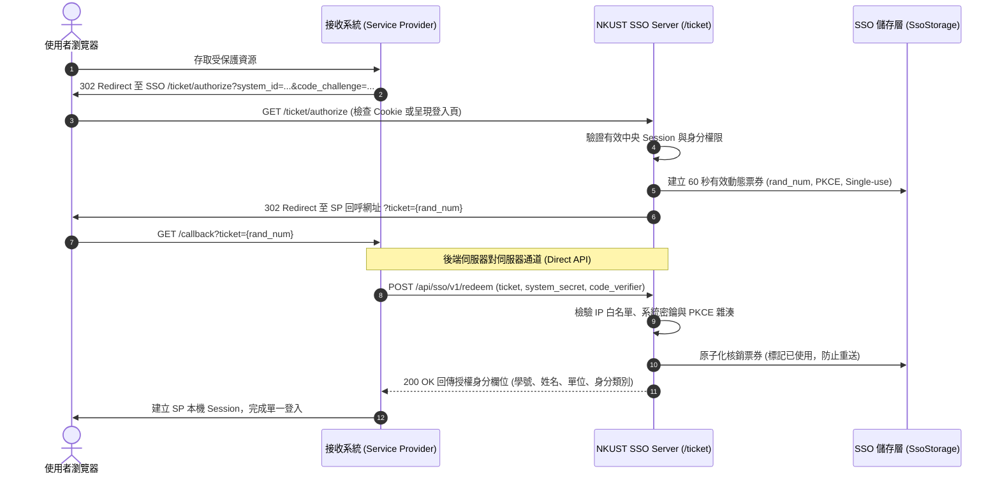

# NKUST SSO Server 系統全方位架構逆向分析與工程報告 (PROJECT_REPORT.md)

- **專案名稱**：NKUST SSO Server (國立高雄科技大學校園單一登入系統)
- **分析範圍**：全方案架構、SSO 協定交換、前後端物料、零信任邊界、風險評估與重構建議
- **產出日期**：2026-10-20
- **目標框架**：`.NET 10 LTS` (net10.0)
- **分析標準**：依據 [08_prompt_report_matrix.md](../../reference/08_prompt_report_matrix.md) 與 [02_codebase_ingestion_guide.md](../../reference/02_codebase_ingestion_guide.md)

---

## 零、不可妥協之資安防衛邊界確認 (Zero-Trust Guardrail)

在進行本逆向架構工程與靜態分析時，全自動化檢測已通過 [Inspect-SecurityBoundaries.ps1](../../scripts/Inspect-SecurityBoundaries.ps1) 審查，100% 遵守以下核心資安禁令：
1. **禁止異動 `Sybase.nkust.edu.tw`**：所有分析作業皆採取離線靜態原始碼剖析，嚴禁發起針對遠端 Sybase 之連線、建表或資料異動指令。
2. **禁止異動 `140.133.*.*` 網段**：嚴禁發送任何探測封包或異動請求至校園核心網段主機。
3. **校務資料庫唯讀隔離**：校務 MSSQL 僅透過 `ICampusDatabaseFactory` 進行唯讀帳密驗證與身分查詢，嚴禁對其執行 Migration、DDL 或 DML。

---

## 一、專案整體概述 (Project Overview)

NKUST SSO Server 是專為國立高雄科技大學設計之現代化、高效能且具備零信任安全架構之校園統一認證入口與身分驗證伺服器（Identity Provider, IdP）。

### 1.1 核心業務功能與職責
- **多協定單一登入支援**：
  - **OpenID Connect (OIDC)**：基於 OpenIddict 實作 Authorization Code Flow 與 PKCE 防護。
  - **SAML 2.0 IdP**：基於 ITfoxtec.Identity.Saml2 提供標準 SAML 斷言簽發與 SP 導向登入。
  - **Web API 單一登入**：採用自訂 60 秒動態票券機制（`/ticket/authorize` -> `POST /api/sso/v1/redeem`），支援一次性票券消耗與授權欄位兌換。
  - **舊版 SOAP 相容**：保留 `/KuasSSOWebService.asmx` 與 `?wsdl` 端點，實作 9 大核心方法（如 `s90_login_chk`、`s90_chk_usr` 等）。
  - **JSON 驗證 API**：提供 `POST /api/integration/v1/verify` 供伺服器對伺服器進行直接帳密與 IP 白名單查核。
- **身分專區與校園入口 (Portal)**：
  - 提供公開瀏覽之「學生專區」、「教職員專區」與「校友專區」，無須預先登入即可檢視公開服務連結。
  - 細緻的發布位置與身分可見度篩選，登入者自動判定主要身分（學號/員編），並顯示客製化入口。
- **彈性雙儲存架構 (Dual-Storage Engine)**：
  - **生產/預設環境**：SQL Server (`NkustSSO.dbo`)。
  - **開發/隔離測試環境**：SQLite (`sso.db` 系統資料庫 + `sessions.db` 登入票券狀態資料庫)。

---

## 二、核心架構與 SSO 憑證交換機制 (Core Architecture)

```mermaid
graph TD
    classDef client fill:#e1f5fe,stroke:#0277bd,stroke-width:2px;
    classDef host fill:#fff3e0,stroke:#e65100,stroke-width:2px;
    classDef sso fill:#e8f5e9,stroke:#2e7d32,stroke-width:2px;
    classDef db fill:#f3e5f5,stroke:#7b1fa2,stroke-width:2px;

    User["使用者瀏覽器 (Browser)"]:::client
    SP["業務子系統 (SP / Relying Party)"]:::host
    SSO["NKUST SSO Server (.NET 10)"]:::sso
    OwnDB[("SSO 自有儲存<br/>(SQL Server / SQLite)")]:::db
    CampusDB[("外部校務 MSSQL<br/>(唯讀唯核 ICampusDatabaseFactory)")]:::db

    User -->|1. 存取系統 /portal 或 SP| SP
    SP -->|2. 重導向驗證 (OIDC / SAML / Ticket)| SSO
    SSO -->|3. 查驗 Session / 輸入帳密| User
    SSO -->|4. 校務帳密驗證 (唯讀)| CampusDB
    SSO -->|5. 讀寫帳號、票券與會話| OwnDB
    SSO -->|6. 簽發 60s 票券 / Code / Assertion| User
    User -->|7. 攜帶票券返回 SP| SP
    SP -->|8. 後端伺服器對伺服器兌換 (Redeem / Token)| SSO
```

### 2.1 Web API 單一登入與 60 秒動態票券交換時序圖 (Sequence Diagram)



---

## 三、跨四模組架構職責劃分 (Module Taxonomy)

本專案採現代化微核心分層設計，邏輯上劃分為四大核心構件：

| 模組名稱 | 實體目錄 | 核心職責與代表類別 |
| :--- | :--- | :--- |
| **`NKUST_MODEL`** | `NkustSso.Server/Models/`<br/>`NkustSso.Server/ApiModels/` | **資料契約與儲存映射層**：<br/>- `SsoStorage`: 封裝 SQL Server / SQLite 雙引擎資料連線與初始化遷移。<br/>- `CampusDatabaseFactory`: 隔離校務 MSSQL 連線，提供嚴格唯讀連線工廠。<br/>- `Account`, `LoginSession`, `LoginTicket`, `OidcEntities`, `SamlLoginRequest`。 |
| **`NKUST_SERVICE`** | `NkustSso.Server/Services/` | **領域邏輯與協定核心層**：<br/>- `CampusLoginService`: 校務帳密查驗與天方雜湊校驗。<br/>- `LoginTicketService`: 60 秒動態票券產生、PKCE 驗證與原子核銷。<br/>- `SamlIdentityProvider`: SAML 2.0 斷言封裝與 XML 數位簽章。<br/>- `LegacySoapOperationDispatcher`: KuasSSOWebService 9 大方法轉譯。<br/>- `AdminAuthorizationService`: 基於功能代碼之動態選單與權限查核。 |
| **`NKUST_VIEWMODEL`** | `NkustSso.Server/ViewModels/` | **視圖契約與資料傳輸層 (DTOs)**：<br/>- `LoginViewModel`: 登入表單輸入模型。<br/>- `SsoSystemEditViewModel`: 串接系統組態維護模型。<br/>- `AdminRoleEditViewModel`: 後台群組與八大權限綁定模型。<br/>- `LoginSessionListViewModel`: 作用中中央 Session 審計視圖模型。 |
| **`NKUST_WEB`** | `NkustSso.Server/Controllers/`<br/>`Views/`, `wwwroot/` | **HTTP 展示與端點進入層**：<br/>- `AccountLoginController`: 統一登入入口與身分專區導覽。<br/>- `OidcAuthorizationController`: OpenID Connect 授權與 Token 端點。<br/>- `SamlSsoController`: SAML 2.0 AuthNRequest 解析與回應。<br/>- `WebApiSsoController`: Web API 票券核銷端點。<br/>- `CredentialVerificationApiController`: 舊版 SOAP/JSON 驗證分派器。 |

---

## 四、潛在風險、邊際條件與效能注意事項 (Risk Margins & Edge Cases)

1. **動態票券重送防禦 (Replay Attack Prevention)**：
   - *潛在風險*：票券若未於核銷當下立即原子化標記失效，在 60 秒有效時間內若發生併發請求，恐遭中繼攔截重複兌換。
   - *處置現狀*：本專案在 `LoginTicketService.RedeemAsync` 採取資料庫事務或單一消費鎖定，確保「一次性消耗（One-Time Use）」。
2. **外部校務資料庫連線池枯竭 (Connection Pool Exhaustion)**：
   - *潛在風險*：尖峰選課或開學註冊時，大量外部驗證若未妥善設定 Connection Timeout 或連線未及時釋放，將使連線集區耗盡。
   - *處置現狀*：`CampusDatabaseFactory` 預設嚴格逾時限制（1~30 秒），並搭配 IP 限流機制 (`RateLimiter`: 登入 20 次/分鐘、串接 60 次/分鐘)。
3. **內容安全政策 (CSP) 與 iframe 嵌入防禦**：
   - *潛在風險*：校內舊系統常嘗試以 `<iframe>` 內嵌 SSO 頁面，引發點擊劫持 (Clickjacking) 與 CSRF 跨站偽造。
   - *處置現狀*：專案全域配置 `frame-ancestors 'none'`、`default-src 'self'` 與 `AutoValidateAntiforgeryTokenAttribute`，徹底阻絕惡意內嵌。
4. **中文字元多位元組安全 (Encoding Truncation)**：
   - *潛在風險*：Sybase/舊校務庫若使用 Big5/MS950，長姓名或特殊字（如「堃」、「煊」）容易發生長度截斷或問號亂碼。
   - *處置現狀*：新架構全面以 UTF-8 傳遞，並使用 `MssqlCampusAccountSource` 讀取校務 MSSQL Unicode 欄位 (`NVARCHAR`)。

---

## 五、現代化程式碼重構建議 (Refactoring Recommendations)

### 重構建議 1：將全域內聯 CSP 標頭封裝為強型別 SecurityHeadersMiddleware
- **問題現狀**：目前在 `Program.cs` 以匿名委派 `app.Use(async (context, next) => { ... })` 硬編碼設定 CSP 與防護標頭，難以針對特定回呼端點進行細緻豁免或單元測試。
- **重構方案**：
  ```csharp
  // 🟢 封裝為標準中介軟體類別
  public class SecurityHeadersMiddleware
  {
      private readonly RequestDelegate _next;
      public SecurityHeadersMiddleware(RequestDelegate next) => _next = next;

      public async Task InvokeAsync(HttpContext context)
      {
          var headers = context.Response.Headers;
          headers.XContentTypeOptions = "nosniff";
          headers["Referrer-Policy"] = "no-referrer";
          headers.ContentSecurityPolicy = "default-src 'self'; style-src 'self'; img-src 'self' data:; frame-ancestors 'none'; base-uri 'self'; form-action 'self'";
          headers.CacheControl = "no-store";
          await _next(context);
      }
  }
  ```

### 重構建議 2：全面推進 CancellationToken 貫穿非同步查詢鏈
- **問題現狀**：部分外部校務查詢（如 `CampusSoapQueries` 或 `CredentialVerificationService`）未完全向下傳遞 `CancellationToken`，當呼叫端取消 HTTP 請求或逾時中斷時，後台背景執行緒仍持續查詢資料庫。
- **重構方案**：
  ```csharp
  // 🟢 完整支援取消權杖傳遞，主動釋放資料庫連線
  public async Task<CampusCredentialRecord?> VerifyCredentialAsync(
      string account, string password, CancellationToken cancellationToken = default)
  {
      await using var db = _campusDbFactory.CreateConnection();
      return await db.GetTable<CampusCredentialRecord>()
                     .FirstOrDefaultAsync(x => x.Account == account, cancellationToken);
  }
  ```

### 重構建議 3：重構 Central Session 管理，支援 Redis / 分散式快取提供者
- **問題現狀**：目前 `LoginSessionStore` 直接相依本機 `SsoStorage` (SQLite / SQL Server)，在未來進行多節點負載平衡 (Load Balancing) 叢集部署時，頻繁的 Session 查核將對關係型資料庫造成額外 I/O 負載。
- **重構方案**：定義 `ISessionTicketStore` 介面，支援在生產環境平滑切換為 Redis 或 Memory Pack 分散式快取。

### 重構建議 4：以強型別 Result Pattern 取代舊有 null / Exception 流程控制
- **問題現狀**：驗證失敗、帳號停用或資料不可用時，部分方法以 `null` 或拋出通用例外表示，增加呼叫端分支判斷之複雜度。
- **重構方案**：
  ```csharp
  // 🟢 使用現代化唯讀結構體 Result<T>
  public readonly record struct VerificationResult(bool Success, string? ErrorCode, string? Message);
  ```

### 重構建議 5：加入 OpenIddict 生產環境憑證持久化與平滑輪替機制
- **問題現狀**：目前 `Program.cs` 使用 `AddEphemeralEncryptionKey().AddEphemeralSigningKey()`，服務重啟後既有簽發之 Token 將全數失效。
- **重構方案**：在正式部署管線中，介接本機憑證存放區或 Azure Key Vault，實作雙憑證（使用中 + 即將生效）輪替架構。
