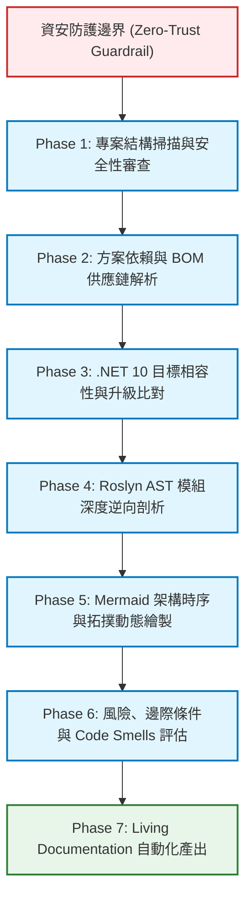

# 「讀取專案 skills」規劃書 (Implementation Plan)
- `${project_name}`：專案名稱。

## 專案版本與規劃中繼資訊
- **專案名稱**：`${project_name}`
- **規劃文件**：`1_implementation_plan.md`
- **目標成果路徑**：`1_implementation_plan.md`
- **負責角色**：Antigravity Codebase Ingestion & Architectural Analysis Agent
- **生效日期**：2026-10-16

---

## 一、專案背景與核心目標

### 1.1 系統業務背景
- **專案說明資訊**：[`${project_name}`](README.md) 為國立高雄科技大學資訊系統整體專案架構，採用 .NET 方案。
---
- **專案架構 1**：

| 資料夾 / 檔案名稱 | 說明 | 常見檔案與命名範例 |
| :--- | :--- | :--- |
| `Controllers/` | 存放控制器的資料夾。名稱必須以 `Controller` 結尾。 | `HomeController.cs`<br/>`ProductController.cs` |
| `Models/` | 存放資料模型、資料庫實體（Entities）或檢視模型（ViewModels）。 | `Product.cs`<br/>`UserViewModel.cs` |
| `ViewModels/` | （檢視模型） 資料夾代表的是專門為前端視窗（View）量身打造的資料結構層。<br/>它是一種設計模式（MVVM 中的 VM 概念），用來作為 **資料庫實體（Entity）** 與 **前端網頁（View）** 之間的溝通橋樑。 | `RegisterViewModel.cs` (檢視模型：只針對註冊表單設計) |
| `Views/` | 存放 Razor 網頁檢視。內部會依據 Controller 名稱建立子資料夾。 | `Views/Home/Index.cshtml`<br/>`Views/Product/Detail.cshtml` |
| `Views/Shared/` | 存放跨頁面共用的版面（Layout）或局部檢視（Partial View）。 | `_Layout.cshtml`（全站主版面）<br>`_ValidationScriptsPartial.cshtml` |
| `Services/` | 應用程式的商業邏輯層（Business Logic Layer, BLL）。<br/>在開發中大型專案時，為了避免 `Controller` 變得肥大（Fat Controller），開發者會將所有核心業務邏輯、第三方 API 串接、複雜的資料處理從 `Controller` 抽離出來，集中放進 `Services/` 資料夾中。 | `IOrderService.cs` (介面：定義有哪些功能)<br/>`OrderService.cs` (實作：寫入具體的商業邏輯) |
| `wwwroot/` | 存放所有前端靜態資源（瀏覽器可直接存取的檔案）。 | `wwwroot/css/site.css`<br/>`wwwroot/js/site.js`<br/>`wwwroot/images/` |
| `Data/` 或 `DbContext/` | 存放 Entity Framework Core 的資料庫內容設定檔案。 | `ApplicationDbContext.cs`｜
| `Program.cs` | 專案的進入點。負責配置應用程式服務（DI）、中間件（Middleware）與路由。 | `Program.cs` |
| `appsettings.json` | 專案的應用程式設定檔（如資料庫連接字串、API 密鑰等）。 | `appsettings.json` |
---
- **專案架構 2**：


| 資料夾 / 檔案名稱 | 說明 | 常見檔案與命名範例 |
| :--- | :--- | :--- |
| `${project_name}`.`Model/`<br/>或<br/>`${project_name}`.`Models/` | 存放資料模型、資料庫實體（Entities）或檢視模型（ViewModels）。 | `Product.cs`<br/>`UserViewModel.cs` |
| `${project_name}`.`ViewModel/`<br/>或<br/>`${project_name}`.`ViewModels/` | （檢視模型） 資料夾代表的是專門為前端視窗（View）量身打造的資料結構層。<br/>它是一種設計模式（MVVM 中的 VM 概念），用來作為 **資料庫實體（Entity）** 與 **前端網頁（View）** 之間的溝通橋樑。 | `RegisterViewModel.cs` (檢視模型：只針對註冊表單設計) |
| `${project_name}`.`Service/`<br/>或<br/>`${project_name}`.`Services/` | 應用程式的商業邏輯層（Business Logic Layer, BLL）。<br/>在開發中大型專案時，為了避免 `Controller` 變得肥大（Fat Controller），開發者會將所有核心業務邏輯、第三方 API 串接、複雜的資料處理從 `Controller` 抽離出來，集中放進 `${project_name}`.`Services/` 資料夾中。 | `IOrderService.cs` (介面：定義有哪些功能)<br/>`OrderService.cs` (實作：寫入具體的商業邏輯) |
| `${project_name}`.`Web/` | 主要 APP 專案實作的位址 | 內涵：MVC 架構。 |
| `${project_name}`.`Web`.`Controllers/` | 存放控制器的資料夾。名稱必須以 `Controller` 結尾。 | `HomeController.cs`<br/>`ProductController.cs` |
| `${project_name}`.`Web`.`Views/` | 存放 Razor 網頁檢視。內部會依據 Controller 名稱建立子資料夾。 | `Views/Home/Index.cshtml`<br/>`Views/Product/Detail.cshtml` |
| `${project_name}`.`Web`.`Views/Shared/` | 存放跨頁面共用的版面（Layout）或局部檢視（Partial View）。 | `_Layout.cshtml`（全站主版面）<br>`_ValidationScriptsPartial.cshtml` |
| `${project_name}`.`Web`.`wwwroot/` | 存放所有前端靜態資源（瀏覽器可直接存取的檔案）。 | `wwwroot/css/site.css`<br/>`wwwroot/js/site.js`<br/>`wwwroot/images/` |
| `${project_name}`.`Web`.`Data/` 或 `${project_name}`.`Web`.`DbContext/` | 存放 Entity Framework Core 的資料庫內容設定檔案。 | `ApplicationDbContext.cs`｜
| `${project_name}`.`Web`.`Program.cs` | 專案的進入點。負責配置應用程式服務（DI）、中間件（Middleware）與路由。 | `Program.cs` |
| `${project_name}`.`Web`.`appsettings.json` | 專案的應用程式設定檔（如資料庫連接字串、API 密鑰等）。 | `appsettings.json` |
---

### 1.2 「讀取專案 skills」之核心目的
當 AI Agent、架構師或新進工程師接手此複雜的多層級異質專案時，需要一套**標準化、可重複執行、無死角且絕對安全**的專案讀取與逆向解析方法論（Software Architecture Recovery & Ingestion Skill）。該技能必須能自動或半自動地：
1. 全面盤點原始碼組織與依賴關係。
2. 提取精確的軟體物料清單（SBOM / BOM）。
3. 比對現代化升級支援度（.NET 10 LTS 目標環境相容性與 Deprecated 標記）。
4. 深度解析 Class、Function 之 Input / Output / 核心處理邏輯。
5. 生成高精確度之 Mermaid 系統架構圖、流程圖、時序圖與依賴拓撲。
6. 識別系統架構瓶頸、潛在風險、邊際條件與 Code Smells，提出具體重構方向。
7. 產出一致、標準化且符合 Prompt 要求的 Markdown 技術文件清冊。

---

## 二、最高資安防護規則 (Zero-Trust Security Boundary)

> [!CAUTION]
> **絕對限制條款（不可違背之紅線）：**
> 1. **禁止異動 `Sybase.nkust.edu.tw` 資料庫內的任何資料。**
> 2. **禁止異動 `140.133.*.*` 網段主機的任何資料。**

### 2.1 安全防護實施架構
為確保 100% 遵守上述兩項核心禁令，「讀取專案 skills」的所有分析行為必須在**離線純靜態程式碼分析（Air-Gapped Static Analysis）**模式下運作：
1. **靜態 AST 與檔案解析**：僅讀取本機磁碟中的原始碼檔案（`.cs`, `.csproj`, `.sln`, `.json`, `.config`），不發起任何對外部資料庫的連線。
2. **自動連線攔截器**：在所有產出的腳本與程式中，強制置入目標端點黑名單檢驗；凡包含 `sybase.nkust.edu.tw`、`140.133.`、`update`、`delete`、`drop`、`alter` 等資料異動關鍵字，一律主動熔斷並終止程序。
3. **唯讀模擬**：凡涉及資料庫 Schema 或實體對應之分析，一律透過解析 `${project_name}`.`Model` 之 C# POCO 實體與 [DBScript](DBScript) 靜態 SQL 腳本進行逆向還原，絕不向遠端資料庫發送查詢或異動指令。

---

## 三、業界標準比對與深度最佳實踐 (State of the Art Alignment)

依據網際網路調研與業界前沿標準（包含「Software Architecture Recovery」、「Reverse Documentation Engineering」、「Roslyn Compiler Platform Analysis」以及「CycloneDX SBOM 規範」），本規劃書將以下關鍵要素納入「讀取專案 skills」的標準規範中，填補傳統專案讀取的缺漏：



### 3.1 傳統讀取模式 vs. 現代工程化 Ingestion Skills 缺漏比對表

| 比較維度 | 傳統人工作業 / 簡易 LLM 讀取 | 現代工程化 Ingestion Skills (本規劃案) | 增補機制與業界標準 |
| :--- | :--- | :--- | :--- |
| **檔案盤點方式** | 散漫瀏覽、人工點開目錄 | 自動化遍歷方案樹狀圖，排除 bin/obj 雜訊，計算程式碼規模 | Roslyn MSBuild Workspace + PowerShell 樹狀掃描 |
| **套件與依賴追蹤** | 僅肉眼看 NuGet 介面或少數 csproj | 深度解析 PackageReference、ProjectRef、LibMan 前端庫與二進位資產 | 契合 CycloneDX / SPDX 規範之前後端 BOM 清冊 |
| **版本升級評估** | 憑經驗猜測相容性 | 結合 NuGet API / Microsoft 官方生命週期比對 .NET 10 LTS 支援度 | 標註 Deprecated、破壞性變更 (Breaking Changes) 與遷移替代對策 |
| **類別與函式提取** | 人工摘要易遺漏參數與邊界條件 | 語法樹（AST）靜態遍歷，精確萃取 Input、Output、處理邏輯 | Roslyn 語法分析器 / 結構化 Signature Extractor |
| **架構圖表表達** | 文字敘述抽象難懂 | 標準化 Mermaid.js 語法繪製 C4 架構圖、流程圖、時序圖 | 一鍵渲染、版本控制友善、無語法警告 |
| **資安邊界防衛** | 依賴工程師自律，易失誤觸發連線 | 腳本層強制阻斷敏感網段 (`140.133.*.*`, `Sybase`)，保證只讀/離線 | Zero-Trust 靜態沙盒隔離機制 |

---

## 四、七階段端到端執行工作流程 (End-to-End Workflow)

### Phase 1: 專案盤點與資安邊界審查 (Discovery & Security Auditing)
1. **輸入標的**：方案檔 `${project_name}`.`sln`](${project_name}.sln) 及各子專案目錄。
2. **執行內容**：
   - 掃描方案結構，確認四大子專案與目錄拓撲。
   - 掃描所有設定檔（`appsettings*.json`、`*.config`），過濾資料庫連線字串，確認連線目標。
   - 執行安全規則審查腳本，確認無任何連向 `Sybase.nkust.edu.tw` 或 `140.133.*.*` 的主動連線行為。
3. **產出驗證**：產出專案實體目錄樹與安全檢查日誌。

### Phase 2: 方案依賴與 BOM 供應鏈解析 (BOM & Supply Chain Ingestion)
1. **輸入標的**：所有 `.csproj` 檔案、`libman.json`、`packages.config`（若有）與原生工具（如 wkhtmltox）。
2. **執行內容**：
   - 解析後端 NuGet 套件名稱、版本號、目標框架（Multi-Targeting：`netstandard2.0` / `netstandard2.1` / `net5.0`）。
   - 解析前端客戶端函式庫（jQuery、Bootstrap、DataTables Suite、Select2、SweetAlert2、FontAwesome 等）之 CDN 來源、精確版本與職責。
   - 建立全方案物料清單（Client-side BOM & Server-side BOM）。
3. **產出對齊**：對應產出符合 [.prompt/${project_name}-BOM.md](.prompt/${project_name}-BOM.md) 之清單架構。

### Phase 3: .NET 10 目標相容性與升級比對 (Modernization Compatibility Analysis)
1. **輸入標的**：Phase 2 提取之 BOM 清冊、.NET 10 LTS 規格。
2. **執行內容**：
   - 上網搜尋與比對各套件於 .NET 10 (ASP.NET Core 10 / C# 14) 的相容版本。
   - 檢出不相容或官方已終止支援之套件（例如：`wkhtmltox`、舊版 `System.Drawing.Common`、EOL 之 .NET 5.0 內建組件），正式標註為 `Deprecated`。
   - 制定升級替代方案（例如：ImageSharp 替代 System.Drawing、PuppeteerSharp 替代 wkhtmltopdf、Microsoft.AspNetCore 內建中介軟體替代舊版 Cookies 套件）。
3. **產出對齊**：對應產出符合 [README/PROJECT_BOM_UPGRADE.md](README/PROJECT_BOM_UPGRADE.md) 規格。

### Phase 4: Roslyn AST 模組深度逆向剖析 (Multi-Layer Codebase Ingestion)
1. **輸入標的**：各專案原始碼（`${project_name}`.`.Model/*`、`${project_name}`.`.Service/*`、`${project_name}`.`T.ViewModel/*`、`${project_name}`.`.Web/*`）。
2. **執行內容**：
   - **${project_name}.Model**：解析 `Own/`（SQL Server 實體）與 `Sybase/`（s10, s30, s31, s32, s36~s40, s41~s49, s90 等實體），提取 Linq2DB 屬性與關聯導航。
   - **${project_name}.Service**：解析 `Base/`（資料存取層與 UoW）、`Login/`（認證與代登票券處理）、`Admin/`（後台管理業務）、`Common/`（共用校務查詢）與 `Utility/`（加解密、快取管理）。
   - **${project_name}.ViewModel**：解析前後端資料契約、驗證特性標籤與 DTO 定義。
   - **${project_name}.Web**：解析 Controllers、自訂過濾器（Attributes）、ViewComponents、中介軟體管線。
   - **核心解析項**：精確條列出主要類別（Class）與公開函式（Method）之輸入參數（Input）、回傳型別（Output）與核心處理邏輯（What it does）。
3. **產出對齊**：對應各子模組之 REPORT 與 ENV 文件。

### Phase 5: Mermaid 架構時序與拓撲動態繪製 (Architectural Modeling)
1. **執行內容**：
   - 繪製「系統分層架構圖 (System Architecture Diagram)」：包含展示層、業務層、資料存取層、雙資料庫與外部 IdP/SP 拓撲。
   - 繪製「SSO 憑證交換流程圖與時序圖 (Flowchart & Sequence Diagram)」：精確還原本系統作為受代登端 (SP) 與代登發起端 (IdP) 的 60 秒票券驗證、Cookie 建立與跳轉流程。
   - 繪製「方案依賴關聯拓撲 (Dependency Graph)」：清晰展現子專案間之引用關聯。
2. **技術守則**：確保 Mermaid 語法完全相容於 GitHub Flavored Markdown，避免使用特殊符號造成渲染解析錯誤。

### Phase 6: 品質、潛在風險、邊際條件與重構建議 (Risk & Refactoring Assessment)
1. **執行內容**：
   - **潛在風險與邊際條件**：連線字串憑證洩漏、多執行緒快取併發存取、N+1 查詢負擔、未受保護的 iframe 嵌入與 CSRF、Sybase 連線字串缺少 `CharSet=utf8` 導致中文亂碼、票券重送攻擊（Replay Attack）防範。
   - **Code Smell 偵測**：過度使用全域靜態輔助類別（`StaticServicesHelper`）、業務邏輯滲透至 Controller、缺少非同步 API（Async/Await）、Magic String 寫法。
   - **重構建議**：為各模組提供 3-5 個具體、具備代碼範例的高價值重構方向。

### Phase 7: 標準化文件輸出與目錄封裝 (Documentation & Packaging)
1. **輸出項目**：
   - 主要技能手冊：`SKILL.md`
   - 參考文件資料：`reference/`
   - 執行腳本程式：`scripts/`
   - 工具與產出程式：`program/`
   - 過程管理紀錄：`process/`

---

## 五、產出架構與目錄規範

```
../
├── SKILL.md                           # 主要「讀取專案 skills」定義手冊
├── process/
│   ├── 1_implementation_plan.md       # 本規劃書
│   ├── 2_task_list.md                 # 任務執行清單 (Task List)
│   └── 3_walkthrough.md               # 執行過程紀錄 (Walkthrough)
├── reference/                         # 參考文件資料與標準規範
│   ├── 01_security_boundary_rules.md  # 資安防衛邊界與零信任禁令指引
│   ├── 02_codebase_ingestion_guide.md # 專案程式碼結構化讀取與逆向方法論
│   ├── 03_bom_and_sbom_standard.md   # 前後端 BOM 與供應鏈物料清單標準
│   ├── 04_dotnet10_upgrade_eval.md    # .NET 10 LTS 升級評估與 Deprecated 判準
│   ├── 05_roslyn_ast_parsing_spec.md  # C# Roslyn 靜態語法樹與符號提取規格
│   ├── 06_mermaid_diagram_specs.md    # 架構圖、時序圖與拓撲圖繪製標準
│   ├── 07_code_smell_refactor_sop.md  # 程式碼壞味道偵測與重構建議指引
│   └── 08_prompt_report_matrix.md     # Prompt 需求與說明文件對齊矩陣
├── scripts/                           # 自動化執行腳本庫
│   ├── Analyze-ProjectStructure.ps1   # 專案方案目錄與架構掃描腳本
│   ├── Extract-DotnetBOM.ps1          # 前後端元件 BOM 自動解析腳本
│   ├── Generate-MermaidTopology.ps1   # 方案依賴與架構 Mermaid 生成腳本
│   ├── Inspect-SecurityBoundaries.ps1 # 資安邊界掃描與違規攔截腳本
│   └── Verify-UpgradeCompatibility.ps1# .NET 10 相容性與棄用套件比對腳本
└── program/                           # 核心程式碼與分析工具實現
    ├── AstCodeExtractor/              # C# 控制台工具：Roslyn 靜態簽章提取器
    │   ├── AstCodeExtractor.csproj
    │   └── Program.cs
    └── BomValidator/                  # BOM 驗證工具
        └── BomValidator.ps1
```

---

## 六、驗收條件與成功指標 (Acceptance Criteria)

1. **規則合規性**：所有腳本、程式與參考文件中，皆嚴格聲明並落實對 `Sybase.nkust.edu.tw` 與 `140.133.*.*` 的 100% 禁動保障。
2. **完整性**：
   - 完整涵蓋 7 份 Prompt 規格與 11 份現存 README 報告的知識萃取技術。
   - 所有產出檔案皆在指定路徑生成，無缺漏。
3. **可執行性**：
   - 位於 `scripts/` 的 PowerShell 腳本可於本機環境直接運行並產出結構化結果。
   - 位於 `program/` 的 C# 分析程式碼具備完整建置能力，並可解析專案原始碼。
4. **規格標準化**：`SKILL.md` 包含完整 YAML frontmatter 與符合 Antigravity 規格的漸進式結構。
