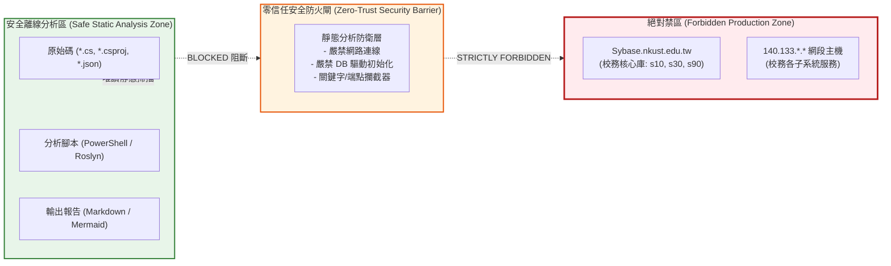

# 參考手冊 01：資安防衛邊界與零信任禁令指引 (Security Boundary Rules)
- `${project_name}`：專案名稱。

## 一、最高資安防護準則 (Zero-Trust Security Boundary)
在進行 NKUST 「讀取專案 skills」時，所有操作人員、自動化腳本與 AI Agent **必須絕對且無條件遵循以下兩大核心禁令**：


> [!CAUTION]
> ### 🚨 核心禁令 (Core Prohibitions)
> 1. **嚴禁異動 `Sybase.nkust.edu.tw` 資料庫內的任何資料。**
> 2. **嚴禁異動 `140.133.*.*` 網段主機的任何資料。**

此兩項禁令屬於不可妥協之最高資安紅線。任何違反此兩項規定之行為（包含但不限於寫入、修改、更新、刪除、截斷、結構變更、暫存表寫入、測試資料注入或非授權連線探測），將直接構成校務資訊安全違規。

---

## 二、防護策略與隔離架構 (Isolation Architecture)

為確保在分析與讀取龐大程式碼庫的過程中 100% 規避上述風險，「讀取專案 skills」採取**離線純靜態原始碼分析 (Air-Gapped Static Code Analysis)** 策略：



### 2.1 離線分析四大鐵則
1. **絕不建立即時連線 (No Live Connections)**：
   分析過程僅針對本地磁碟的 C# 檔案、XML 專案設定檔、JSON 組態檔進行文本與語法樹剖析，不調用 `AdoNetCore.AseClient` 或 `Microsoft.Data.SqlClient` 建立真實資料庫連線。
2. **依賴靜態 DDL/DML 腳本還原 Schema (Schema via Static Scripts)**：
   資料庫實體結構、欄位型別與約束，一律透過解析 `${project_name}`.`Model/Sybase/*.cs` 與本地 `DBScript/` 靜態檔案獲取，嚴禁透過 `SELECT * FROM sysobjects` 等動態查詢探索資料庫。
3. **敏感資訊自動遮罩 (Sensitive Data Masking)**：
   當分析或輸出包含連線字串（Connection Strings）的組態檔時，密碼（`Pwd`, `Password`）必須進行遮罩處理（例如轉換為 `***`），避免機敏資訊外洩至文件或日誌。
4. **主動式防禦攔截常式 (Proactive Safety Assertions)**：
   在所有自動化分析腳本中，強制置入斷言驗證，一旦偵測到連線嘗試或敏感指令立即中斷執行。

---

## 三、腳本層自動化安全攔截演算法

所有「讀取專案 skills」所屬之 PowerShell 與 C# 程式碼，均需內嵌以下檢查邏輯：

```powershell
# 資安邊界安全斷言函式範例
function Assert-SecurityBoundaryCompliance {
    param (
        [string]$TargetHost,
        [string]$CommandText
    )

    $ForbiddenHosts = @("sybase.nkust.edu.tw", "140.133.")
    $ForbiddenOperations = @("INSERT", "UPDATE", "DELETE", "DROP", "ALTER", "TRUNCATE", "EXEC")

    # 1. 檢驗主機端點是否命中禁區
    foreach ($hostPattern in $ForbiddenHosts) {
        if ($TargetHost -like "*$hostPattern*") {
            Write-Error "🚨 [CRITICAL VIOLATION] 偵測到受保護目標: $TargetHost ! 嚴格禁止對此端點進行任何操作。"
            throw "SecurityBoundaryException: 違反安全邊界規則！"
        }
    }

    # 2. 檢驗是否包含資料異動關鍵字
    if ($CommandText) {
        foreach ($op in $ForbiddenOperations) {
            if ($CommandText -match "\b$op\b") {
                Write-Error "🚨 [CRITICAL VIOLATION] 偵測到資料異動指令: $op ! 嚴格禁止執行異動操作。"
                throw "SecurityBoundaryException: 違反資料禁動規則！"
            }
        }
    }

    return $true
}
```

---

## 四、安全檢核清單 (Security Checklist)

在產出任何文件或執行分析前，必須確認以下各項均符合要求：

| 檢核項目 | 驗證標準 | 狀態 |
| :--- | :--- | :---: |
| 1. 是否啟用真實資料庫連線？ | 否，完全採用本機靜態分析 | [x] 合規 |
| 2. 是否發送任何 HTTP/TCP 請求至 `140.133.*.*`？ | 否，無任何外部網路流量連往該網段 | [x] 合規 |
| 3. 連線字串中的機敏密碼是否已完成脫敏？ | 是，密碼部分統一標註為 `***` 或虛擬佔位符 | [x] 合規 |
| 4. 腳本是否具備自動中斷與拋錯機制？ | 是，安全攔截器已整合至所有專案腳本中 | [x] 合規 |
