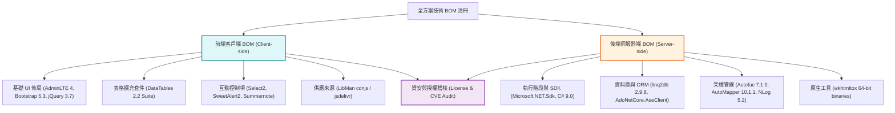

# 參考手冊 03：軟體物料清單 (BOM) 與供應鏈安全標準 (BOM & SBOM Standard)
- `${project_name}`：專案名稱。

## 一、概述與法規合規背景

軟體物料清單（Software Bill of Materials, SBOM / BOM）是現代軟體供應鏈安全（Supply Chain Security）的基石。在國家級資通安全與教育體系資訊治理中，明確掌握應用程式所依賴的所有前端與後端開源元件之**名稱、版本、來源管道、開源授權（License）與生命週期狀態**，為資安弱點（CVE）通報與法律風險防範之先決條件。

---

## 二、NKUST-OOSA 專案之雙維度物料清單體系

在「讀取專案 skills」中，BOM 提取必須涵蓋**客戶端（Client-side）**與**伺服器端（Server-side）**兩大維度：

---

## 三、前端客戶端 BOM 規範與提取方式

### 3.1 提取管道
前端元件主要透過 [${project_name}.Web/libman.json]../../../${project_name}.Web/libman.json) 進行宣告式管理，輔以 `_Layout.cshtml` 載入之 CDN 資源。

### 3.2 標準欄位規格
前端 BOM 表必須具備以下欄位：
1. **元件名稱**：通用函式庫名稱（如 `DataTables Suite`）。
2. **套件識別碼 (Package ID)**：套件庫標準識別字串（如 `datatables.net-bs5`）。
3. **部署版本 (Version)**：目前專案採用的版本（如 `2.2.2`）。
4. **載入來源 (Provider)**：`cdnjs`、`jsdelivr`、`unpkg` 或本機自研腳本。
5. **授權條款 (License)**：開源授權（如 MIT）。
6. **用途與功能描述 (Description)**：於專案中承擔的 UI 職責。

---

## 四、後端伺服器端 BOM 規範與提取方式

### 4.1 提取管道
後端元件主要從四個子專案的 `.csproj` 中的 `<PackageReference>`、`<ProjectReference>` 與 `<TargetFrameworks>` 節點提取。

### 4.2 目標框架 (Target Frameworks) 解析
需特別留意專案的多目標框架（Multi-Targeting）：
- `netstandard2.0`：向下相容舊版 .NET Framework 4.6.1+。
- `netstandard2.1`：相容 .NET Core 3.x 及 .NET 5+ 現代特性。
- `net5.0`：Web 展示層之主機執行環境。

### 4.3 標準欄位規格
後端 BOM 表必須具備以下欄位：
1. **類別 / 模組名稱**：如「核心 ORM」、「Sybase 連線驅動」、「IoC 容器」。
2. **識別碼 / 套件名稱**：如 `linq2db`、`AdoNetCore.AseClient`、`Autofac`。
3. **版本 (Version)**：如 `2.9.8`、`7.1.0`。
4. **授權條款 (License)**：如 MIT、Apache-2.0、BSD-3。
5. **相依專案 (Dependency Scope)**：標註該套件被哪個子專案（Model / Service / Web）直接或間接引用。
6. **職責與用途說明**：其在架構中的定位與不可替代性。

---

## 五、開源授權合規性與法律風險分類表 (License Compliance Matrix)

| 授權類別 | 代表授權條款 | 商業與閉源使用許可度 | 傳染性 / 原始碼公開義務 | 專案適用性與風險評估 |
| :--- | :--- | :---: | :---: | :--- |
| **寬鬆型 (Permissive)** | **MIT, Apache-2.0, BSD-2/3** | 自由使用、修改與封閉部署 | **無**（只需保留版權宣告與許可證） | **最優推薦**。NKUST 專案絕大部分元件（如 Bootstrap, jQuery, Linq2DB）均屬於此類。 |
| **弱傳染型 (Weak Copyleft)** | **LGPL 2.1 / 3.0, MPL 2.0** | 允許動態連結使用 | **僅限對該函式庫本身的修改需公開** | **中度風險**。若以 DLL 動態連結方式使用通常合規；靜態編譯則需避免。 |
| **強傳染型 (Strong Copyleft)** | **GPL 2.0 / 3.0, AGPL 3.0** | 嚴格受限 | **極高**。任何引用專案全體皆必須以 GPL 開源 | **高度風險（紅線）**。專案中嚴禁未經審批引入 GPL/AGPL 套件，以防閉源業務邏輯被迫公開。 |
| **商用專屬 (Commercial/Proprietary)** | 商業授權 (Commercial) | 需採購授權合約 | 視商業條款而定 | 需確認學校或機關是否具備合法企業授權。 |
