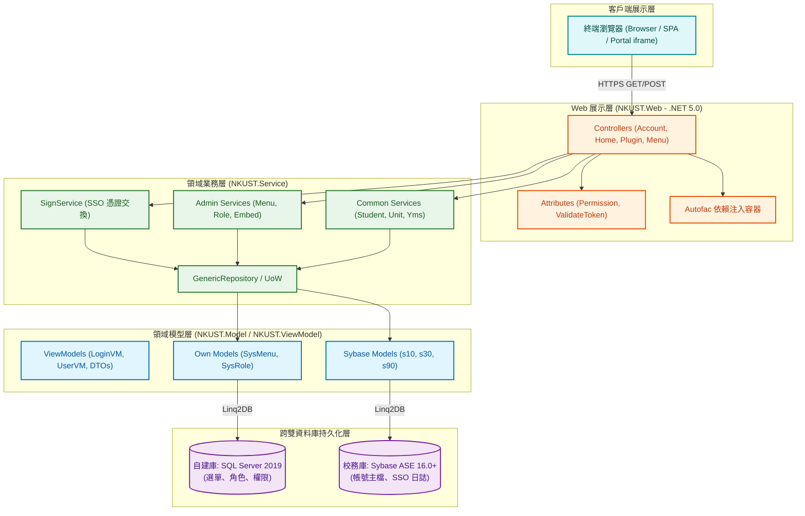
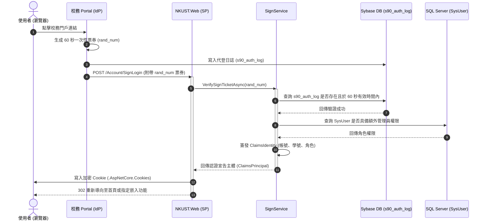
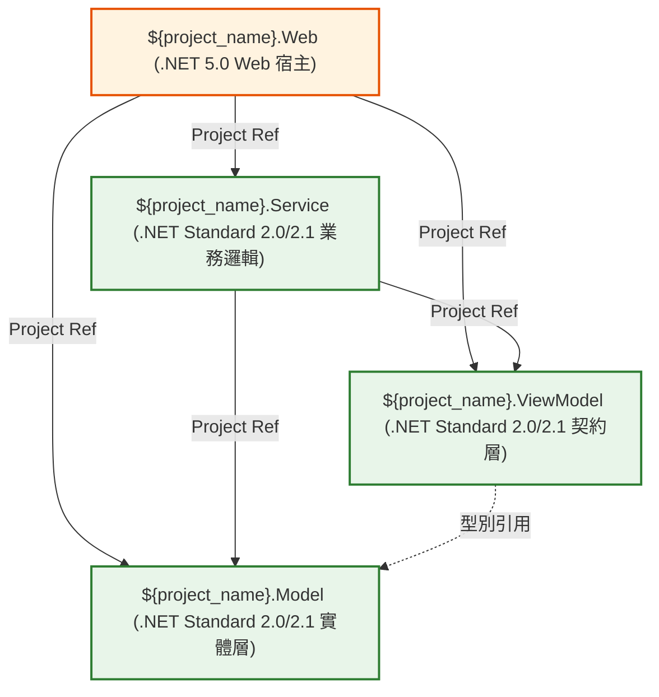

# 參考手冊 06：架構圖、流程圖、時序圖與拓撲圖 Mermaid 繪製規範 (Mermaid Diagram Specs)
- `${project_name}`：專案名稱。

## 一、概述與視覺化原則

在「讀取專案 skills」中，技術文件的文字描述必須輔以高品質、標準化的視覺化圖表。本規範強制採用 **Mermaid.js** 作為統一的圖表繪製語法：
1. **純文字版本控制**：與 Markdown 檔案原生整合，能隨程式碼提交並清楚顯示 Git Diff。
2. **免外掛自動渲染**：GitHub、GitLab、VS Code、Azure DevOps 原生支援。
3. **消除歧義**：將文字難以描述的複雜非同步流程、跨資料庫交互與 SSO 憑證交換以清晰的時序與拓撲呈現。

---

## 二、Mermaid 繪圖三大禁忌與防錯守則 (Syntax Guardrails)

> [!WARNING]
> **常見 Mermaid 語法解析錯誤防範：**
> 1. **節點標籤字串跳脫**：節點名稱若包含括號 `()`、方括號 `[]`、引號 `""` 或冒號 `:`，**必須使用雙引號包覆**。例如：`NodeA["SignService.VerifyTicket(string ticket)"]`，嚴禁寫成 `NodeA[SignService.VerifyTicket(string ticket)]`。
> 2. **禁用 HTML 複雜標籤**：避免在標籤內插入複雜 HTML（如 ``, `<table>`），換行統一使用 ` `。
> 3. **保留字衝突**：避免使用 Mermaid 關鍵字（如 `end`, `subgraph`, `graph`）作為節點 ID。

---

## 三、標準圖表類型與樣板庫

### 3.1 方案分層架構圖樣板 (System Architecture Diagram)
適用於 `README.md` 與 `PROJECT_REPORT.md`，表達展示層、服務層、實體層與雙資料庫的職責邊界：

---

### 3.2 SSO 憑證交換時序圖樣板 (SSO Sequence Diagram)
精確還原校務系統受代登（SP 模式）之動態票券校驗與身分宣告流程：

---

### 3.3 方案依賴關聯拓撲 (Dependency Topology)
適用於 `*_ENV.md` 文件，表達方案內專案的單向引用關係：

