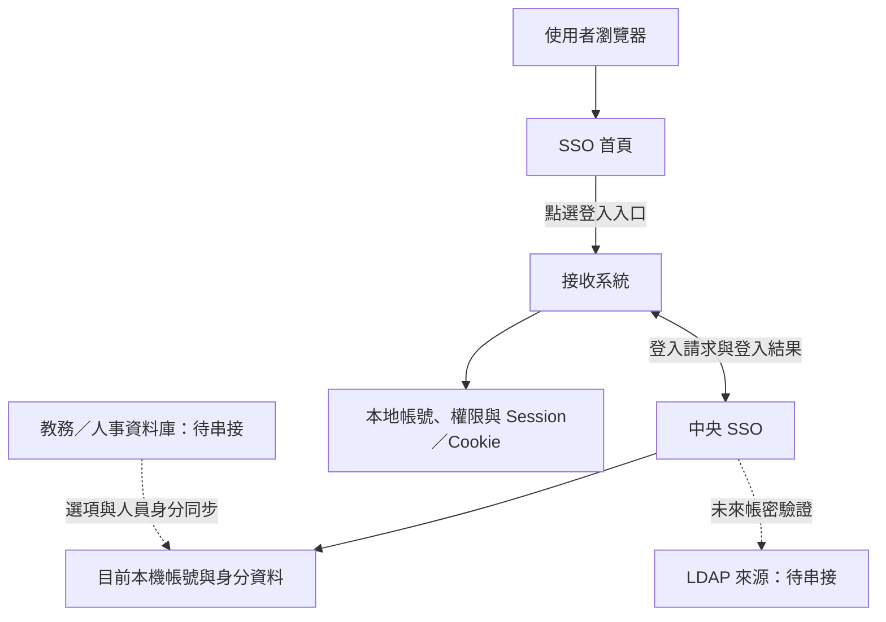
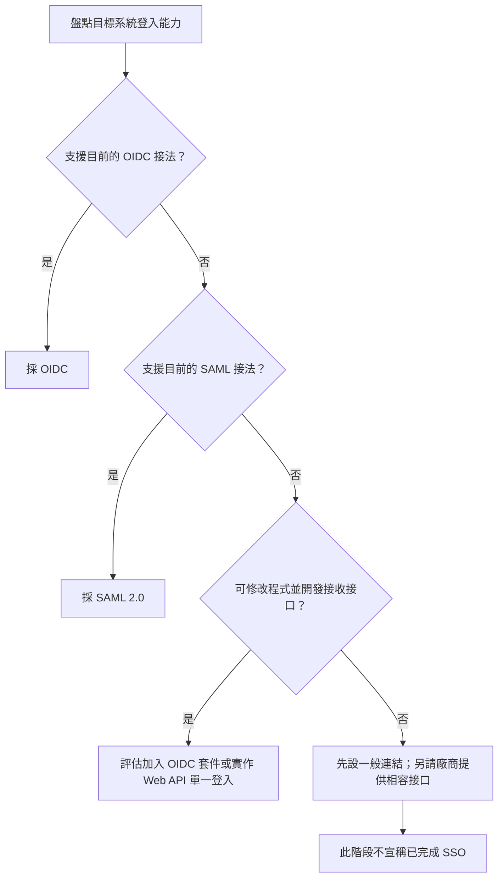
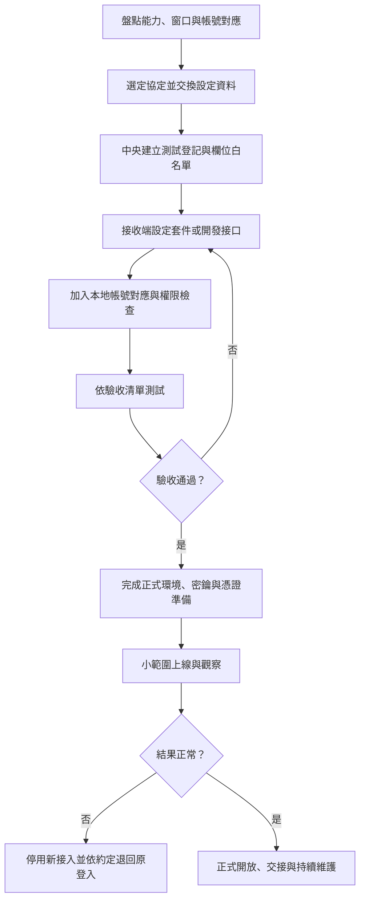
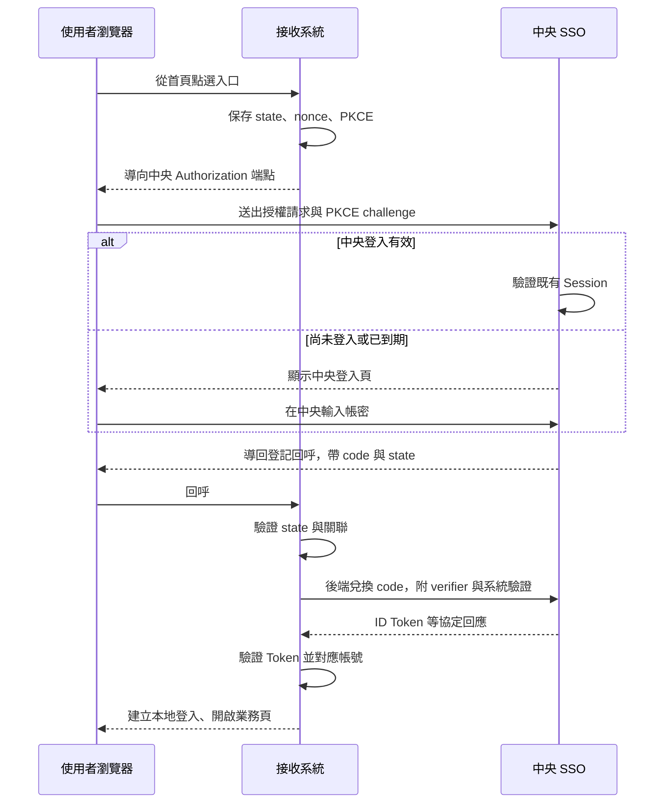
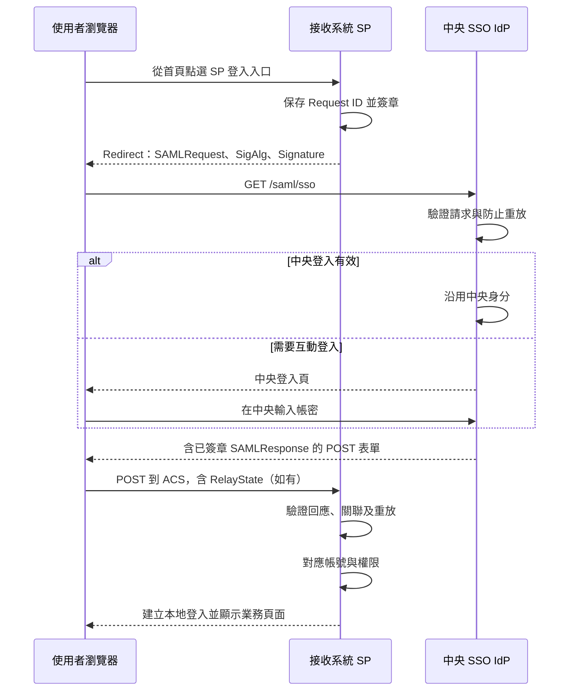
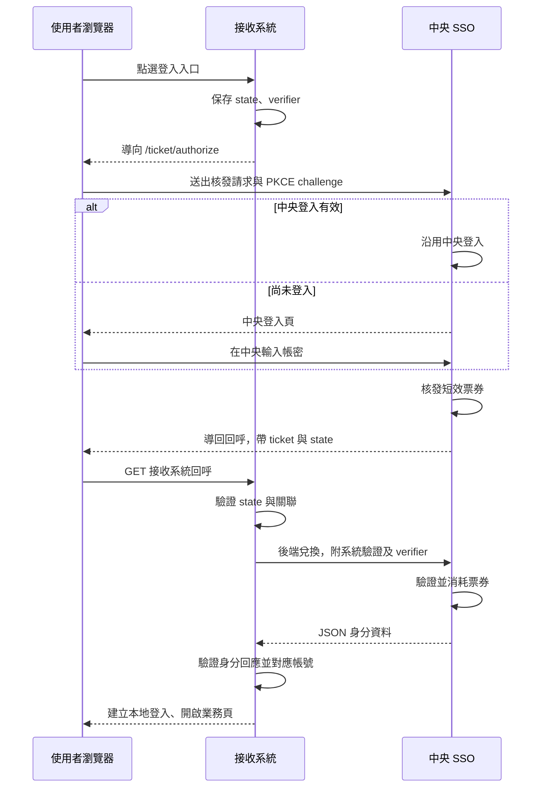
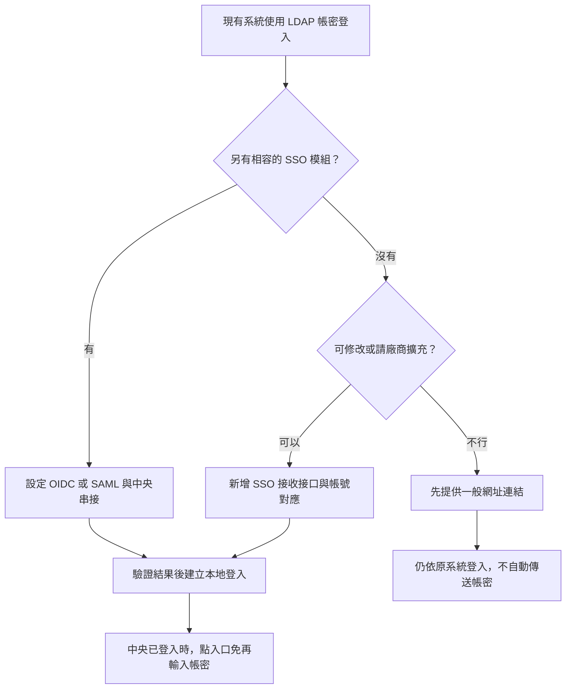
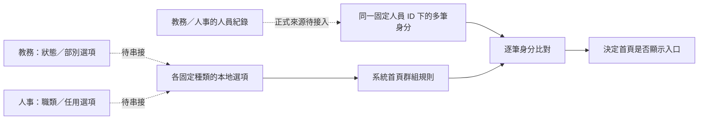

# NKUST SSO 系統串接流程書

版本：1.1｜依本專案目前實作編寫｜適用對象：校內系統窗口、接收系統開發人員、廠商及維運人員

本書說明接收系統如何讓使用者從 SSO 首頁點選入口後，免重複輸入帳密進入系統，包含準備項目、責任分工、設定、流程圖與驗收清單。實作狀態以本書及目前程式為準；未完成的功能另行標示，不以標準協定本身的全部能力當成本專案能力。

**交付內容：** 本 Markdown 為可維護原稿；同名 HTML 為圖文閱讀版，需連同 `assets/sso-integration-guide/` 一起保存；同名 PDF 可直接交付或列印。圖中的「接收系統」是教務、圖書、人事等業務系統，不是 LDAP 伺服器。

## 1. 支援範圍與名詞

| 串接方式 | 本專案狀態 | 接收系統要做什麼 | 可從首頁免重複輸入帳密進入？ |
| --- | --- | --- | --- |
| OIDC | 已實作 Authorization Code＋PKCE S256，機密用戶端 | 設定 OIDC 用戶端、回呼及本地帳號對應 | 可以，中央登入須有效 |
| SAML 2.0 | 已實作 SP 發起的基本登入流程 | 設定 SP、簽章請求、ACS 與信任憑證 | 可以，中央登入須有效 |
| Web API 單一登入 | 已實作 | 依本專案接口開發登入啟動、回呼驗證與後端兌換 | 可以，中央登入須有效 |
| 僅首頁連結 | 已實作 | 提供系統網址 | 只開啟網址，不提供 SSO 登入 |
| LDAP 作為中央帳密驗證來源 | 待串接 | 由中央 SSO 接入 LDAP；接收系統仍用前三種方式之一 | 單靠 LDAP 不會建立接收系統的登入 |
| 各身分種類的獨立資料庫來源 | 已確認方向，連線與同步待實作 | 提供選項來源、欄位對應、更新規則 | 提供身分資料，不是登入協定 |

OIDC 的 SSO 端是身分提供者，接收系統是用戶端；SAML 稱兩者為 IdP 與 SP。`Session／Cookie` 是各網站自己的登入狀態，中央與接收系統分別建立。

「Web API 單一登入」是本專案統一使用的功能名稱，採自訂協定，不是通用標準協定名稱。「一次性票券」是這個流程使用的短效憑證，「票券兌換 API」是接收後端取得身分資料的介面，兩者屬於同一套登入功能。接收系統需要實作本書的專用接口。

**本原型目前僅允許 Development 環境執行，尚未完成正式上線配置及校方實際系統互通驗收。** 正式主機、憑證、來源與維運安排依第 11 節確認。

## 2. 整體架構示意圖



登入結果的傳遞路徑依協定不同：OIDC 與 Web API 單一登入透過後端兌換；SAML 由瀏覽器 POST 簽章回應。詳細訊息方向見各節時序圖。

使用者已登入中央 SSO 時，中央可沿用登入狀態；接收系統仍須驗證結果、對應帳號並建立自己的登入。流程不會把使用者密碼或中央 Cookie 交給接收系統。

### 2.1 如何選擇方式



僅支援 LDAP 帳密登入的系統，須先確認是否也有 OIDC／SAML 模組，或是否可開發接收接口。純前端 SPA 不能保存 Client Secret；本版後台建立的是機密用戶端，SPA 須透過後端處理登入，不能把現有密鑰直接放到 JavaScript。

## 3. 串接前準備與責任分工

### 3.1 所有接收系統共用的準備項目

| 項目 | 接收系統提供／確認 | 中央 SSO 提供／確認 |
| --- | --- | --- |
| 系統基本資料 | 名稱、用途、維護單位、技術窗口、廠商及版本 | 登記系統、分配固定 Client ID |
| 環境 | 測試及正式環境的主機、網域、HTTPS 網址 | 各環境的 SSO 基底網址；環境分開登記 |
| 登入入口 | 可啟動 SSO 的網址，或未登入時會發起驗證的受保護首頁 | 將此網址設為首頁入口 |
| 回呼地址 | OIDC 回呼、SAML ACS 或 Web API 單一登入回呼的精確 HTTPS URL | 登記允許的回呼，不使用萬用字元 |
| 帳號對應 | 本地帳號鍵、帳號開通／停用規則、未對應時的處理 | 固定使用者 ID 及可提供的身分欄位 |
| 功能權限 | 誰可查詢、借用、簽核；權限由接收端執行 | 設定首頁顯示群體；此設定不等於登入准入 |
| 網路 | 瀏覽器可到兩端；接收端可連中央所需端點 | DNS、TLS、反向代理、必要連線與時鐘同步 |
| 登出／期限 | 本地 Session 期限、登出行為、停權可接受延遲 | 中央期限及目前撤銷生效範圍 |
| 驗收帳號 | 正常、無本地權限、未對應、停用等測試案例 | 可供測試的固定使用者 ID 與必要資料 |

首頁入口應填「接收系統的登入啟動網址」，不要填中央 `/account/login`，也不要把回呼 URL 當登入啟動網址。回呼通常必須帶有該次登入的關聯資訊，不能直接點選代替完整流程。

### 3.2 各方式需交換的資料

| 方式 | 接收系統交給中央 | 中央交給接收系統 |
| --- | --- | --- |
| OIDC | 入口、Redirect URI、需要的 claims、選填登出回呼 | Issuer／Discovery URL、Client ID、Client Secret、核准欄位 |
| SAML 2.0 | SP Entity ID、入口、ACS、SP 簽章公開憑證 PEM、Attribute 需求 | IdP metadata URL、Entity ID、SSO URL、簽章公開憑證、NameID／Attribute 約定 |
| Web API 單一登入 | 入口、回呼、欄位需求、後端能否完成 HTTPS 兌換 | 中央基底網址、Client ID、Client Secret、核發／兌換接口 |
| 一般連結 | 目標網址及首頁顯示範圍 | 登記結果；不配發登入密鑰 |
| LDAP（待串接） | LDAP 主機、TLS 方式、目錄範圍、帳號查找規則、必要服務帳號及識別欄位 | 另行約定驗證、對應、錯誤與停權處理 |

Client Secret 是「系統對系統」的機密，不是使用者密碼。經核准的安全管道交付並保存於後端；SAML 交換公開憑證，雙方各自保管私鑰。新建 OIDC／Web API 單一登入系統的密鑰只顯示一次，目前未提供後台查閱／輪替功能。

### 3.3 網址範例

以下 `example.edu` 都是佔位範例，必須換成雙方確認的網域。本機中央範例是 `https://localhost:7100/`，不是正式服務位址。

| 名稱 | 範例 | 誰提供 |
| --- | --- | --- |
| 中央基底網址／OIDC Issuer | `https://sso.example.edu/` | 中央 |
| 接收系統入口 | `https://app.example.edu/login` | 接收端 |
| OIDC 回呼 | `https://app.example.edu/signin-oidc` | 接收端 |
| SAML ACS | `https://app.example.edu/saml/acs` | 接收端 |
| Web API 單一登入回呼 | `https://app.example.edu/sso/callback` | 接收端 |

尾端斜線、大小寫、埠號與路徑均依登記值比對，不假設相近網址可以互換。

## 4. 導入工作流程



中央在 `/admin/systems` 設定登入方式、入口、回呼、啟用狀態、首頁顯示範圍及允許提供的欄位。Client ID 與協定建立後固定；協定選錯時另建登記。新系統預設只提供固定識別碼及協定必要資訊。

## 5. OIDC 串接流程

本版採 Authorization Code＋PKCE S256，以接收系統後端兌換授權碼。一般 OIDC 流程與 ID Token 驗證原則參見 [OpenID Connect Core](https://openid.net/specs/openid-connect-core-1_0.html#CodeFlowAuth)；PKCE 的挑戰值由 verifier 計算，規則參見 [RFC 7636](https://www.rfc-editor.org/rfc/rfc7636)。以下列的是本專案實際接法。

### 5.1 設定項目

| 項目 | 本專案設定 |
| --- | --- |
| Discovery | `{中央基底網址}.well-known/openid-configuration` |
| Authorization | `GET /connect/authorize` |
| Token | `POST /connect/token`，僅後端呼叫 |
| Response Type | `code` |
| PKCE | `S256`；每次登入產生新的 verifier |
| 用戶端 | 後端保存 Client Secret 的機密用戶端 |
| Scope | 必須 `openid`；依需要加入 `profile`、`student_profile` |
| 登出 | `/connect/logout`；GET 顯示確認，實際登出須經 POST 與防偽驗證 |

端點、簽章公鑰位置及用戶端驗證方式應由受信任的 Discovery 與套件設定取得；不要接受使用者任意指定的 Issuer。請使用合適的 OIDC 套件處理驗證，不以自行解碼 JWT 取代驗證。

### 5.2 時序圖



### 5.3 接收端執行步驟

1. 設定 Authority、Client ID、Client Secret、精確 Redirect URI、`response_type=code` 與 PKCE。
2. 登入開始時，由套件建立並保存 `state`、`nonce`、verifier 及安全的返回路徑。
3. 回呼驗證 `state` 與本次瀏覽器登入關聯，再由後端送授權碼及 verifier 到 token 端點。
4. 由套件驗證簽章、`iss`、`aud`、期限、`nonce` 與必要的協定關聯。
5. 以 `iss + sub` 查找本地帳號；未對應時顯示申請／無權限頁，不自行賦予管理權限。
6. 建立本地 Session／Cookie，依本地角色檢查功能權限，再導回允許的站內頁面。

本版授權碼有效期為 1 分鐘，ID Token 有效期為 5 分鐘；實際期限以回應為準。授權碼只可成功兌換一次，兌換時會重新檢查中央 Session、帳號及系統狀態。

本版未提供 UserInfo、Refresh Token、PAR 或通用下游 API 授權服務；不要要求 `offline_access`，不要把 ID Token 當 API Access Token 使用。接收系統須自行配置 OIDC 函式庫及回呼處理，Server 端設定見 [Program.cs](../NkustSso.Server/Program.cs)。

## 6. SAML 2.0 串接流程

本專案是 IdP，接收系統是 SP；採 SP 發起的 Web SSO，概念可參考 [OASIS SAML 2.0 Profiles](https://docs.oasis-open.org/security/saml/v2.0/saml-profiles-2.0-os.pdf)。實際支援的 Binding 與驗證限制如下，不能僅以「支援 SAML」就假定所有模式相容。

### 6.1 設定與準備

| 項目 | 本專案要求 |
| --- | --- |
| IdP metadata／Entity ID | `{中央基底網址}saml/metadata` |
| IdP SSO URL | `{中央基底網址}saml/sso` |
| 發起方式 | SP 發起；首頁指向 SP 的登入啟動網址 |
| AuthnRequest Binding | HTTP-Redirect，簽署 Redirect 查詢字串 |
| 請求簽章 | RSA-SHA256；SP 公開憑證為 PEM、RSA 至少 2048 位元且仍有效 |
| 回應 Binding | HTTP-POST 到精確登記的 ACS |
| 成功回應簽章 | Response 與 Assertion 都簽章 |
| NameID | 固定帳號 ID；persistent 格式 |
| 帳號對應 | IdP Entity ID＋NameID |
| Attribute | 依中央白名單提供，欄位見第 9 節；不使用 OIDC scope |

SP 匯入經確認的 metadata 並信任 IdP 公開憑證；中央後台登記 SP Entity ID、ACS 與 SP 公開憑證。目前中央不會自動下載 SP metadata 建立信任，須由管理者登記。

### 6.2 時序圖



### 6.3 必須對齊的限制

- AuthnRequest 須為過去 5 分鐘內，最多容忍未來 30 秒；Request ID 不可重用。
- Assertion 與 SubjectConfirmation 有效期為 2 分鐘；SP 須驗證並防止 Assertion 重放。
- `Issuer`、`Destination`、ACS／Recipient 與 Audience 必須符合雙方登記。`InResponseTo` 必須對應該次請求。
- RelayState 最多 80 個 UTF-8 位元組；可使用隨機關聯代碼，由 SP 自行保存真正返回路徑。
- SAML 是跨網站 POST，SP 須確認關聯 Cookie 能在 ACS 回呼時使用；依套件正確配置 SameSite 與 Secure，不可因 Cookie 缺少就省略關聯驗證。
- `IsPassive` 無中央登入時會回傳簽章的 NoPassive 回應，接收端應提供一般互動登入入口。
- 尚不支援 ForceAuthn、HTTP-POST AuthnRequest、ACS 索引、IdP 主動發起、加密 Assertion、Artifact 及 SAML Single Logout。RequestedAuthnContext 僅接受 exact PasswordProtectedTransport。

設定或憑證變更後要重新開始登入，不重用進行中的請求。憑證輪替須安排雙方信任更新；本原型未提供自動輪替。流程驗證參考 [SAML 測試](../tests/saml.py)，正式廠商仍需另外互通驗收。

## 7. Web API 單一登入串接流程

此方式須由接收系統實作回呼關聯、PKCE、後端兌換及帳號對應。它沒有 OIDC Discovery，也不是 SAML；不要套用其他票券協定的端點或參數。

管理者在建立成功頁可查看本次系統的交接資料、已授權欄位及回應示例；既有系統的編輯頁也有共用指南。可交付 [PNG 流程圖](../NkustSso.Server/wwwroot/guides/web-api-sso.png)、[SVG 流程圖](../NkustSso.Server/wwwroot/guides/web-api-sso.svg) 與 [HTTP 呼叫格式範例](../NkustSso.Server/wwwroot/guides/web-api-sso.http.txt)。範例不含密鑰，亦不替接收端完成瀏覽器關聯驗證或建立登入。

### 7.1 時序圖



### 7.2 步驟一：接收系統啟動登入

後端產生新的 `state` 與 `code_verifier`，保存至有期限、綁定原瀏覽器的登入關聯狀態。不要將 verifier 與 Client Secret 放在導向網址中。

```text
code_challenge = BASE64URL(SHA256(ASCII(code_verifier)))
```

Base64Url 不保留 `=` 補位。建議各自產生 32 位元組安全亂數，再以 Base64Url 編碼為 43 字元的 state 與 verifier。

### 7.3 步驟二：瀏覽器發起核發

`GET {中央基底網址}ticket/authorize`

| Query 參數 | 規定 |
| --- | --- |
| `client_id` | 中央登記的固定 Client ID，最長 100 字元 |
| `redirect_uri` | 精確登記的完整 HTTPS 回呼，最長 2000 字元 |
| `state` | 32–128 字元，僅英數、底線、連字號；每次登入重新產生 |
| `code_challenge` | S256 結果，43 字元 Base64Url |
| `code_challenge_method` | 固定 `S256` |

使用 URL 編碼函式組成查詢字串。中央確認登入後導回：

```text
https://app.example.edu/sso/callback?ticket=<本次票券>&state=<原始state>
```

此為格式示意，尖括號內容不是可重用的實際值。票券為 43 字元 Base64Url，最長有效 60 秒，且不超過中央 Session 的剩餘期限。

### 7.4 步驟三：接收端回呼與後端兌換

先驗證 state、原瀏覽器關聯、關聯期限與返回路徑，防止把他人的登入結果套用到目前瀏覽器。驗證後由接收端後端送出：

```http
POST /ticket/redeem HTTP/1.1
Host: sso.example.edu
Authorization: Basic <Base64(UTF8(ClientId:ClientSecret))>
Content-Type: application/x-www-form-urlencoded

ticket=<本次票券>&redirect_uri=<URL編碼的登記回呼>&code_verifier=<本次verifier>
```

`code_verifier` 必須為 43–128 字元，允許英數及 `-._~`；POST 表單上限 8192 位元組。Basic 的 Base64 只是編碼，必須使用 HTTPS。不要由瀏覽器 JavaScript 直接帶 Client Secret 呼叫兌換端點。

### 7.5 步驟四：檢查身分回應

成功為 HTTP 200 JSON，以下是假資料範例；可選欄位依白名單省略：

```json
{
  "issuer": "https://sso.example.edu/",
  "client_id": "campus_app",
  "sub": "example-person-id",
  "authenticated_at": 1800000000,
  "session_expires_at": 1800003600,
  "username": "example-user",
  "name": "示範使用者",
  "identity_type": "student",
  "student_status_code": "DEMO_ACTIVE"
}
```

接收端核對 `issuer` 等於預期中央基底網址、`client_id` 等於自己、`sub` 非空，且 `session_expires_at` 尚未到期，再以 `issuer + sub` 對應本地帳號。時間欄位是 Unix 秒；`session_expires_at` 是中央 Session 到期，不是票券的 60 秒期限，也不表示本地 Cookie 會在中央撤銷時自動消失。

這個 JSON 是經 HTTPS 後端通道取得的回應，不是簽章 JWT；不得接受使用者自行 POST 同形狀 JSON 來登入。成功後清除本次關聯狀態並轉向不含 ticket 的站內網址。

### 票券兌換 API（JSON）

管理頁 `/admin/systems/new?section=sso` 的「Web API 單一登入」對應此流程；資料庫仍保存 `Protocol=ticket`。接收端不需要 OIDC middleware，但須完成上文的登入啟動、state／PKCE 與回呼驗證。

除了原有表單兌換，也可由接收系統後端送出：

```http
POST /api/sso/v1/redeem HTTP/1.1
Authorization: Basic <Base64(Client ID:Client Secret)>
Content-Type: application/json

{
  "ticket": "<本次回呼票券>",
  "redirect_uri": "https://app.example.edu/sso/callback",
  "code_verifier": "<本次登入保存在接收後端的 verifier>"
}
```

成功回傳與原有兌換相同的 JSON：固定 `issuer`、`client_id`、`sub`、`authenticated_at`、`session_expires_at`，其餘欄位依後台勾選提供。接收端確認 issuer／client_id 與有效期限後，以 sub 對應帳號並建立自己的登入狀態；不要把此回應當成可轉交其他 API 的 Bearer Access Token。

兩個兌換端點共用一次性消耗；任一成功後，另一個也不得再次兌換。JSON 端點同樣檢查中央 Session、已啟用的系統、回呼白名單、系統密鑰與 PKCE。未登入瀏覽器先經 `/ticket/authorize` 前往中央登入；JSON 兌換端點不會跳登入畫面，也不替接收端設定 Cookie。錯誤分別為 `401 invalid_client`、`400 invalid_request`／`invalid_ticket`；非 JSON 格式回傳 415，超過 8192 bytes 回傳 413。

| 回應／錯誤 | 接收端處理 |
| --- | --- |
| HTTP 401 `invalid_client` | 確認 Client ID、Secret、啟用狀態與 Basic 格式 |
| HTTP 400 `invalid_request` | 檢查欄位、長度、PKCE 格式及表單編碼 |
| 核發 HTTP 400 `invalid_client_or_redirect` | 檢查用戶端登記、協定及精確回呼 |
| 核發 HTTP 400 `session_inactive` | 從登入入口重新開始 |
| 兌換 HTTP 400 `invalid_ticket` | 可能過期、已使用、PKCE 不符或狀態失效；重新開始登入 |
| 逾時／回應遺失 | 原票券可能已使用，不無限重送；重新發起登入 |

完整欄位契約見 [SsoIdentityResponse.cs](../NkustSso.Server/ApiModels/SsoIdentityResponse.cs)。接收系統須實作登入啟動與回呼處理，可自行選擇路徑，但須精確登記。

## 8. LDAP 與一般網址連結的接入邊界

LDAP 提供目錄操作與 Bind 等能力，協定定義見 [RFC 4511](https://www.rfc-editor.org/rfc/rfc4511)。在此架構中，LDAP 可作為中央驗證帳密的來源；瀏覽器單一登入與目標網站 Session 的建立仍由 OIDC、SAML 或 Web API 單一登入處理。



### 8.1 未來接入 LDAP 時要準備

1. 主機、網路可達性、TLS 連線與信任憑證、目錄範圍及服務帳號權限。
2. 使用者帳號查找規則、DN 或登入名稱格式、固定人員識別欄位。
3. 錯誤密碼、停用、鎖定、過期、來源不可用等情況的處理約定。
4. 舊本地帳號如何對應中央固定 ID；帳號改名、離校與再入校是否仍是同一人。
5. 使用者密碼僅用於該次驗證，不存成可供其他系統重送的密碼。

以上為待接入準備項目，目前程式尚未實作 LDAP 驗證，也不是供其他系統 Bind 的 LDAP 伺服器。只把既有 LDAP 網址放到首頁，不會完成 SSO。

### 8.2 一般網址連結

後台選「僅首頁連結」，填 HTTPS 入口、分類、排序及首頁顯示群體即可。回呼留空，不產生 Client Secret。點選後只是開啟目標網址；若目標本來已有自己的有效登入狀態，可能直接進入，但不能因此判定已完成本專案的 SSO 串接。

## 9. 身分資料、帳號對應及各種類來源

### 9.1 接收端可使用的欄位

| 資料 | OIDC | SAML Attribute／NameID | Web API 單一登入 JSON |
| --- | --- | --- | --- |
| 固定識別碼 | `iss + sub` | IdP Entity ID＋persistent NameID | `issuer + sub` |
| 校園帳號 | `preferred_username` | `preferred_username` | `username` |
| 使用者姓名 | `name` | `name` | `name` |
| 身分類別 | `identity_type` | `identity_type` | `identity_type` |
| 班級 | `class_code`、`class_name` | 同左 | 同左 |
| 學籍狀態 | `student_status_code`、`student_status_name` | 同左 | 同左 |
| 學制 | `education_level_code`、`education_level_name` | 同左 | 同左 |

除必要固定識別碼與協定資訊外，均須由管理者勾選允許提供。OIDC 的帳號／姓名另須 `profile`，身分、班級、學籍、學制另須 `student_profile`。不要假設一定有 Email、職稱、單位或管理員角色；目前這些不在對外白名單。

接收端以固定識別碼關聯本地帳號，建立明確的綁定／開通流程；姓名與可變動帳號作為顯示資料。資料缺少時依業務規則處理，不把缺少資料判定為「全部權限」。

### 9.2 首頁群組與資料來源

首頁規則支援多重身分：任一筆有效身分完整符合任一組即可，不能拼湊不同身分欄位。但是目前對外 `identity_type` 等欄位仍是原單值契約，多重身分清單尚未對外提供。

每個種類未來可有自己的資料庫來源，例如學籍狀態來自教務、任用類別來自人事。種類由技術端定義，來源同步選項；管理者不在後台新增種類。



分類選項回答「有哪些值可選」，人員身分回答「這個人有哪些值」，兩者需對應相同代碼。來源同步服務與完整快照模型已具備部分基礎，但各種類來源連線／映射／同步排程及正式人員來源尚未完成；詳見 [身分分類與群組規則](identity-audiences.md)。

**首頁顯示限制目前不限制直接 OIDC／SAML／Web API 單一登入，也不代替接收系統的功能授權。** 若接收端要求只有特定身分能使用，仍須在後端執行相關權限判斷。

## 10. 登入期限、登出與異常處理

| 狀況 | 目前行為／應有處理 |
| --- | --- |
| 中央登入有效，接收端未登入 | 發起 SSO 後可免重複帳密，但仍完成協定驗證 |
| 中央登入已到期 | 下一次需要中央驗證時重新登入 |
| 中央 Session | 預設 1 小時滑動窗口，首次登入起最長 4 小時；符合續期條件的中央請求才續期 |
| 只停留在接收系統 | 不會自動延長中央登入 |
| 接收系統 Cookie | 由各系統自行設定期限與續期方式 |
| 登出接收系統 | 清除自己的登入；中央仍有效時，再次進入可能自動登入 |
| 登出／撤銷中央登入 | 阻止後續中央登入流程，不會立即清除各系統既有 Cookie |
| 隱藏首頁入口 | 不等於停用該系統 SSO 登入 |
| 停用系統或帳號 | 後續核發／兌換檢查會拒絕；接收端已建立的 Session 仍由接收端管理 |
| SSO 失敗或本地帳號未對應 | 顯示錯誤／申請開通頁，避免無限登入轉向 |

OIDC 的 `prompt=login` 會要求重新輸入帳密；若目標是沿用既有登入，不應每次固定帶入此參數。本版 SAML `ForceAuthn` 尚未支援，不可用於要求重新驗證。

跨系統即時登出、即時停權推播與 SAML Single Logout 尚未完成。需要立即失效的業務須另外確認方案，不能只靠縮短 Token 有效期推定已具備即時撤銷。

## 11. 測試、驗收與上線準備

### 11.1 共同驗收清單

- [ ] 未登入中央，直接開接收系統：導向中央登入，成功後返回正確業務頁。
- [ ] 已登入中央，從首頁進入接收系統：不重複要求帳密，帳號對應正確。
- [ ] 無本地帳號／無功能權限：顯示開通提示或 403，不取得預設高權限。
- [ ] 錯誤密碼、帳號停用／鎖定、系統停用：新登入被拒絕。
- [ ] 未列入白名單的欄位不提供，接收端可處理缺少欄位。
- [ ] 竄改回呼、錯誤 state／關聯、過期或重放登入結果：被拒絕。
- [ ] 多分頁及登入中途重整：不登入成其他人，失敗時可重新開始。
- [ ] 本地／中央登出及期限符合雙方約定，清楚告知撤銷延遲。
- [ ] 日誌不記錄原始密碼、密鑰、授權碼、票券或完整 Assertion。
- [ ] 測試與正式設定分開；測試結果、責任窗口與回復方式有紀錄。

### 11.2 各協定專項驗收

| 方式 | 另須驗收 |
| --- | --- |
| OIDC | 錯誤 Client Secret／verifier、nonce 不符、錯誤簽章／Issuer／Audience、授權碼重放及缺少 scope |
| SAML | 錯誤 SP 簽章、錯誤 ACS／Destination、Audience／Recipient／InResponseTo 不符、Assertion 重放、憑證到期、跨站 POST 關聯與 NoPassive |
| Web API 單一登入 | 60 秒到期、錯誤 Basic／verifier、重複與並行兌換、錯誤 issuer／client_id、兌換回應遺失後重新登入 |
| 一般連結 | 網址正確、可見群組正確，文案不宣稱已完成自動登入 |

### 11.3 正式上線前的交付項目

| 負責方 | 交付內容 |
| --- | --- |
| 中央 SSO | 正式網域與 TLS、持久簽章／加密金鑰、來源對應、機密交付、備份與復原、可信代理設定、監控與日誌保存政策 |
| 接收系統 | 正式回呼與帳號對應、後端機密保存、本地權限與 Session 政策、錯誤處理、部署及回復步驟 |
| 雙方 | 驗收紀錄、上線時間、異常聯絡人、密鑰／憑證到期與輪替安排、停權／登出可接受的生效時間 |

OIDC 原型簽章／加密金鑰存在程序記憶體，重啟會更換；SAML 原型有獨立持久的開發簽章憑證，但未自動輪替。正式部署須完成上述準備，不以移除 Development 限制直接視為可上線。

### 11.4 本專案的驗證工具

建置完成後，可依需要執行以下隔離測試；使用各自資料庫與服務，結束時停止測試服務。實際廠商接入仍須執行雙方驗收案例。

```powershell
dotnet run --project tests/NkustSso.StorageChecks --no-build
python tests/systems.py
python tests/saml.py
python tests/identities.py
```

## 12. 串接資料交接表

以下表格可逐一複製給各系統填寫，機密另循安全管道交付，不填在本表。

| 欄位 | 填寫內容 |
| --- | --- |
| 系統名稱／維護單位／技術窗口 | 待填 |
| 廠商／版本／是否可修改程式 | 待填 |
| 串接方式 | OIDC／SAML 2.0／Web API 單一登入／一般連結 |
| 環境 | 測試／正式 |
| 中央 Issuer／metadata URL | 待填 |
| 固定 Client ID | 待填 |
| 首頁入口網址 | 待填 |
| 精確回呼／ACS | 待填 |
| SP Entity ID／公開憑證與到期日（SAML） | 待填；不附私鑰 |
| 必要身分欄位與用途 | 待填 |
| 固定人員 ID 與本地帳號的對應方式 | 待填 |
| 未對應帳號／缺少欄位的處理 | 待填 |
| 本地登入期限／登出及停權生效要求 | 待填 |
| 網路連線／憑證／時鐘確認 | 待填 |
| 驗收案例、日期與結果 | 待填 |
| 上線日期／回復步驟／異常聯絡窗口 | 待填 |

## 附錄：實作核對位置

| 內容 | 本專案程式／文件 |
| --- | --- |
| OIDC 端點、流程與期限 | [Server Program.cs](../NkustSso.Server/Program.cs)、[OidcAuthorizationController.cs](../NkustSso.Server/Controllers/OidcAuthorizationController.cs) |
| SAML 請求、metadata、簽章回應 | [SamlIdentityProvider.cs](../NkustSso.Server/Services/SamlIdentityProvider.cs)、[SamlSsoController.cs](../NkustSso.Server/Controllers/SamlSsoController.cs) |
| Web API 單一登入參數與 HTTP 回應 | [WebApiSsoController.cs](../NkustSso.Server/Controllers/WebApiSsoController.cs) |
| 票券期限、一次性兌換與 Session 檢查 | [LoginTicketService.cs](../NkustSso.Server/Services/LoginTicketService.cs) |
| 白名單與對外欄位 | [IdentityClaimReleasePolicy.cs](../NkustSso.Server/Services/IdentityClaimReleasePolicy.cs)、[SsoIdentityResponse.cs](../NkustSso.Server/ApiModels/SsoIdentityResponse.cs) |
| 中央管理操作 | [串接系統與資料提供管理](system-administration.md) |
| 身分種類及來源方向 | [身分分類與群組規則](identity-audiences.md) |
| 中央續期與限制 | [SSO 登入續期與系統整合需求](sso-session-renewal.md) |

本書的支援範圍、路徑、欄位名稱與期限均依上述實作整理；調整程式後應同步更新本書與圖文匯出版本。

維護者可使用 `python scripts/export-sso-guide.py --mermaid <本機mermaid.min.js路徑>` 重新產生 SVG、HTML 與 PDF；需安裝 `markdown-it-py`、Playwright 及可用的 Chrome／Chromium。本次圖表以 Mermaid 10.9.3 匯出，產物不需連網或載入 JavaScript 即可閱讀。
